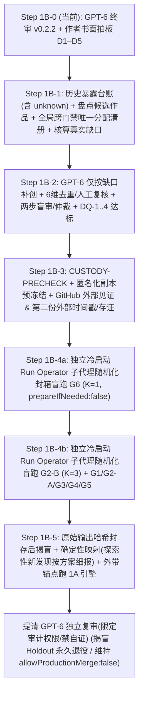

# P0-6-Stage-1B-Experiment-Design-v0.2.2
## P0-6 阶段 1B 完整实验设计方案：跨 Agent 混合建集、Data Custody、双评委定案与 Neon 隔离盲测协议

> **文档版本**：`P0-6-Stage-1B-Experiment-Design-v0.2.2`（在 `v0.2.1` 基础上完成 GPT-6 条件通过前的最后 4 项定点收口补充，未做结构重设计）  
> **文档状态**：`DESIGN_V0_2_2_FINAL_CLOSURE_FOR_GPT6_ACCEPTANCE_AND_AUTHOR_SIGNOFF`（**当前仍处于设计审批阶段：历史素材盘点、GPT-6 补创、Gold Standard 标注、A/B/C 盲测全部尚未授权启动；零代码变更、零修改 1A 统计引擎、零改变 `08 v1.2.3` 冻结门槛**）  
> **前置基线**：`P0-6 阶段 1A` 统计裁决引擎与零泄漏检查器已于 `feat/r3-p0-controlled` Commit `2199c88c3b0723052832e60f9e3779bd0f0a4ab7` 获 GPT-6 第六轮正式 `ACCEPTED（仅限阶段 1A 工程交付）`（Issue `#10` Comment `7213091661`）。  
> **上位冻结规范**：[08-工程效率与文学质量双重验收方案.md](../review-v3/08-工程效率与文学质量双重验收方案.md)（`v1.2.3`）、[P0-Implementation-PRD.md](./P0-Implementation-PRD.md)（`P0-6`）、[P0-0-Baseline-Audit-Report.md](./P0-0-Baseline-Audit-Report.md)（附录 C）。  
> **接口锚点**：[eval_g1_g6_stats.mjs](../../../scripts/p0_prototypes/eval_g1_g6_stats.mjs)、[abc_orchestrator.mjs](../../../scripts/p0_prototypes/abc_orchestrator.mjs)、[review_pack_compiler.mjs](../../../scripts/p0_prototypes/review_pack_compiler.mjs)。

---

## v0.2.1 → v0.2.2 最终 4 项定点收口记录

| 序号 | 定点补充项 | v0.2.2 落地条款 |
|---:|---|---|
| 1 | **Neon 执行隔离升级为强制要求** | 删去「必要时」：只要 Neon 同时担任开发与测试角色，**强制由独立冷启动执行子代理承担 Run Operator**，不依赖同一主会话自我约束。 |
| 2 | **增加全局素材分配清册** | 在 `Step 1B-1` 盘点完成后、核算缺口前新增 **`00c-global-asset-allocation-manifest.json`**，实行跨门禁全局唯一分配（`sourceWorkId → 单一 assignedGate`），杜绝同一作品被重复计入 `G2-B`/`G6`/`G3`/`G4` 可复用额度；明确仅保留 **`QHL-CH1..3` 在 G3/G4 间的历史回归交叉例外**。 |
| 3 | **限定 GPT-6 独立复审权限（利益冲突回避）** | 明确 GPT-6 可审计实验设计、执行日志、统计计算与防泄漏证据链，**但严禁将 GPT-6 自己创作的章节再作为独立审稿证据进行自我认证**；其所创章节的 Gold Standard 必须完全由独立评委组（`Judge 1 / Judge 2 / Arbiter 3`）+ 作者人工复核决定。 |
| 4 | **修正外部存证与防篡改表述** | 明确 GitHub Issue 公开哈希属于**「外部公开见证（External Public Witness）」**，**不等同于绝对不可篡改存证**；新增**第二份独立外部存证 / 独立时间戳机制**（如独立 Git Commit 锚定脱敏封条 + 独立时间戳/作者离线只读副本归档），避免夸大证据强度。 |

---

## 一、设计定位、前置基线、角色分权与不可突破红线

### 1.1 阶段 1A、阶段 1B 与数据质量门禁的职责隔离

| 维度 | 归属阶段 | 性质与不可逾越边界 |
|---|---|---|
| **G1–G6 统计裁决、B=2,000 聚类 Bootstrap 95% CI、方案 B 淘汰线、A/B/C 案例等价性、`K_rep` 协议元数据与外带清册哈希校验** | **阶段 1A（已 `ACCEPTED` @ `2199c88c`）** | 冻结复用 [eval_g1_g6_stats.mjs](../../../scripts/p0_prototypes/eval_g1_g6_stats.mjs)；**阶段 1B 严禁修改 1A 统计引擎代码或任何冻结 G1–G6 门槛**。 |
| **跨 Agent 混合建集、Data Custody、历史暴露核查、独立 Gold Standard 定案、独立副本隔离盲跑、1B 清册预检与真实执行日志归档** | **阶段 1B（本设计方案）** | 本方案的 **Gold Standard 数据质量门禁（`DQ-1`–`DQ-4`）** 与 **1B 清册预检（`CUSTODY-PRECHECK`）** 严格属于建集期数据治理控制，**与冻结 `08 v1.2.3` 中 G1–G6 验收门槛严格分开，绝非修改或替换 G1–G6**。 |
| **D1–D5 前置拍板 + G2-B 冻结清册签封 + 阶段二放行权** | **作者书面拍板** | 任何 Agent 均不得越权替代作者决策。 |

### 1.2 阶段 1B 正式角色分权与盲态隔离表（v0.2.2 硬化执行隔离与复审回避边界）

| 正式角色 | 承担方 | 权限与核心职责 | 严格信息隔离与禁止事项 |
|---|---|---|---|
| **1. Corpus Contributors（素材供给与补创方）** | **A. 历史合格子代理资产**（待盘点）<br>**B. GPT-6（缺口挑战语料创作者）**<br>**C. 作者（可选未揭盲供稿）** | 盘点/交付章节正文、细纲切片、账本切片、硬约束；GPT-6 补创时附创作者预期位置、严重度与判定依据（仅标为 `creatorIntendedLabel`）。 | 创作者意图**绝不等于**最终 Gold Standard；**严禁**将 `corpusOrigin` 或 `creatorIntendedLabel` 注入盲测输入；**GPT-6 对自创章节无 Gold Standard 认证权**。 |
| **2. Independent Gold Standard Panel（真值定案组）** | 独立冷启动 **`Judge 1` / `Judge 2` / `Arbiter 3`** + **作者人工复核签封** | 对所有新入库/拟入库 Holdout 样本（含全部历史合格子代理章与 GPT-6 补创章）执行两步盲审（先整章开放盲审 → 再案例级标定）、仲裁分歧，达成 `DQ-1..4` 后产出最终 Gold Standard 清册。 | 评委零接触 `creatorIntendedLabel`、零接触 `corpusOrigin`、零接触任何 A/B/C 预测输出；**GPT-6 创作者不得介入该组定案**。 |
| **3. Custody Sealer & Blinding Packager（封存与脱敏打包层）** | 自动化确定性脚本 + 作者外部见证签封 | 执行 `CUSTODY-PRECHECK`、生成去除了来源标记/预期标签/Gold Labels 的**完全匿名化盲测输入包**、在独立沙箱副本预冻结快照、计算并发布 `SEALED_ANCHORS.sha256`（外部见证 + 第二份独立时间戳/离线存证）。 | 封存后将 Gold Standard 与 `creatorIntendedLabel` 留在盲测输入目录之外；外部见证哈希必须在首跑前发布完毕。 |
| **4. Run Operator（强制独立冷启动执行子代理）** | **独立冷启动执行子代理（由 Neon 宿主按协议派生，强制替代开发者主会话直接执行）** | 仅接收 `04-anonymized-sandbox-copies/` 匿名化独立沙箱输入；按随机化调度序列以 `prepareIfNeeded: false` 执行 A/B/C 全量盲跑；落盘宿主机运行日志、基础包字节哈希、Provider Request ID（如可得）与全部原始模型输出哈希（`EXECUTION_OUTPUTS.sha256`）；全部跑完封存后交还归档再揭盲运行 1A 统计引擎。 | **强制执行隔离（非可选）**：① 只要 Neon 同时是开发者与测试组织者，**必须**由独立冷启动执行子代理承担 Run Operator，**不能仅依赖同一主 Agent 自我约束**；② 该执行子代理全程零挂载/零读取 `02-ground-truth-adjudication/`（Gold Standard、创作者预期标签与仲裁记录）；③ 全程禁止依据中间输出修改任何模板、提示词、阈值或代码；④ 揭盲后的本次 Holdout **永久退出后续调参用途**。 |
| **5. Independent Auditor（独立复审方 — 限定权限）** | **GPT-6** | **获准审计范围**：实验设计合规性、全局素材分配清册、宿主机执行日志、防泄漏与去重证据链、`DQ-1..4` 统计、1A 确定性统计计算与探索性发现报告，独立给出复审结论。 | **利益冲突回避硬限制**：GPT-6 **不得将自己创作的章节再当作独立审稿证据进行自我认证**，不得推翻或替代独立评委组与作者确定的 Gold Standard；不以 Neon 本地自测代替复审方独立核验。 |

### 1.3 七条不可突破实施红线

1. **不修改 `08 v1.2.3` 冻结门槛**：原封不动保留 G1–G6 全部门槛、聚类统计口径、方案 B 淘汰线与平局决胜顺序。
2. **不修改阶段 1A 统计引擎**：[eval_g1_g6_stats.mjs](../../../scripts/p0_prototypes/eval_g1_g6_stats.mjs)（`2199c88c`）作为只读黑盒裁决器直接调用，不在 1A 内叠新逻辑。
3. **本轮纯设计修订，绝不提前动工**：不生成测试章节、不开始历史样本盘点、不开展 Gold Standard 标注、不执行 A/B/C。
4. **不修改生产模板、R2 或其他生产代码**：零触碰 `SKILL.md`、非 `prototypes/` 的 `references/**`、R2 脚本、`scripts/r3_review_kernel.mjs` 及 `.github/**`。
5. **不提前进入阶段二**：未获 GPT-6 阶段 1B 最终 `ACCEPTED` 及作者书面放行前，禁止启动阶段二文学盲评，维持 `allowProductionMerge: false`。
6. **严守 `DEC-11` 正文不入主仓**：任何来源的原始小说正文仅存仓外 Data Custody Vault，主仓 0 字节原文。
7. **新增数据质量门禁与冻结 G1–G6 严格分开表述**：所有报告均显式隔离「`DQ-1..4` 数据质量门禁」与「冻结 `08 v1.2.3` G1–G6 模型统计门禁」。

---

## 二、动工前须作者书面拍板的 5 项前置决策（D1–D5）

### D1 · `G2-B` 独立 Holdout 正例 Cohort 规模与构成（**主推荐：`D1-B`**）

- **1A 引擎边界说明**：[eval_g1_g6_stats.mjs](../../../scripts/p0_prototypes/eval_g1_g6_stats.mjs#L1327-L1381) 仅强制校验 `totalPositives > 0`、`positiveCohortApproved === true`、非空 `positiveCohortApprovalRef` 与 `positiveCohortApprovedManifestSha256 === computedManifestSha256 === expectedG2BManifestSha256`，**并未硬编码 `60` 或 `72`**。因此，阶段 1B 独立清册预检（`CUSTODY-PRECHECK`）必须在封箱前强制验证作者最终批准的精确正负例数。
- **三轮（`K = 3`）离散整数 `TP / FP` 实际门槛敏感度分析（固定每轮 `N_neg = 60`，三轮共 `180` 负例-轮）**：
  - 冻结 `3 轮均值 FPR <= 13.0%` → 三轮整数总 `FP <= 23 / 180`（`12.78%`；`24 / 180 = 13.33%` FAIL）；
  - 冻结 `单轮最大 FPR <= 15.0%` → 单轮整数 `FP <= 9 / 60`（`15.00%`；`10 / 60 = 16.67%` FAIL）；
  - 冻结 `Clear-tier FP = 0`（每轮）；冻结 `3 轮均值 Precision >= 88.00%`。

| 候选规格 | 样本结构（20 独立源章，4 题材 × 5 章，`K = 3`） | 典型三轮整数情景（`TP_1,TP_2,TP_3` / `FP_1,FP_2,FP_3`） | 3 轮均值 Recall | 3 轮均值 FPR（单轮 max） | 3 轮均值 Precision | 裁决与余量评估 |
|---|---|---|---:|---:|---:|---|
| **`D1-B`（主推荐）** | **`N_pos = 72`**（建议 `18` BLOCKER + `54` MAJOR）<br>**`N_neg = 60`**（`30` CLEAR + `30` BORDERLINE）<br>正负比 `72 : 60 = 1.20 : 1`（贴近 G2-A `40 : 33 = 1.212 : 1`） | 高召回+稳态误报：`TP=(68,69,68)` / `FP=(6,6,6)` | `94.91%` | `10.00%` (`10.00%`) | **`91.93%`** | ✅ PASS（`+3.93 pp`） |
| | | 高召回+贴线误报：`TP=(68,69,68)` / `FP=(7,8,8)` | `94.91%` | `12.78%` (`13.33%`) | **`89.92%`** | ✅ PASS（**`+1.92 pp`**） |
| | | 高召回+波动贴线：`TP=(68,69,68)` / `FP=(6,8,9)` | `94.91%` | `12.78%` (`15.00%`) | **`89.94%`** | ✅ PASS（**`+1.94 pp`**） |
| | | 边界召回+贴线误报：`TP=(65,65,65)` / `FP=(7,8,8)` | `90.28%` | `12.78%` (`13.33%`) | **`89.45%`** | ✅ PASS（**`+1.45 pp`**，不互相挤兑） |
| **`D1-A`（备选）** | **`N_pos = 60`**（`15` BLOCKER + `45` MAJOR）<br>**`N_neg = 60`**（`30` CLEAR + `30` BORDERLINE）<br>正负比 `1 : 1` | 高召回+稳态误报：`TP=(57,57,57)` / `FP=(6,6,6)` | `95.00%` | `10.00%` (`10.00%`) | **`90.48%`** | ✅ PASS（`+2.48 pp`） |
| | | 高召回+贴线误报：`TP=(57,57,57)` / `FP=(7,8,8)` | `95.00%` | `12.78%` (`13.33%`) | **`88.15%`** | ✅ PASS（仅 `+0.15 pp`，极度贴线） |
| | | 边界召回+贴线误报：`TP=(54,54,54)` / `FP=(7,8,8)` | `90.00%` | `12.78%` (`13.33%`) | **`87.57%`** | ❌ **FAIL**（被 Precision 击穿，总 FP 被迫压至 `<= 22/180`） |
| **`D1-C`（不推荐）** | `N_pos = 40`, `N_neg = 60`（`0.67 : 1`） | 高召回+稳态误报：`TP=(38,38,38)` / `FP=(6,6,6)` | `95.00%` | `10.00%` (`10.00%`) | **`86.36%`** | ❌ **FAIL**（总 FP 被迫压至 `<= 15/180 = 8.33%`） |

---

### D2 · `G2-B` 与 `G6` 独立性（**保留 `D2-A` 并锁定来源作品级 6 维互斥与分层去重处置**）

- **`D2-A`（主推荐 — 来源作品级 6 维完全互斥）**：
  - 严禁仅凭章节 ID 不同和原始哈希不同宣称 `G2-B` 与 `G6` 完全独立；必须同时满足 **6 维隔离**（`sourceWorkId`、`sourceChapterId`、`rawContentSha256`、`normalizedContentSha256`、近似重复/改写检测、`caseId`），确保每个 Holdout 来源作品唯一性（默认 `G2-B` 与 `G6` 跨集零同作品复用）。
  - **分层处置规则（v0.2.1 细化，防误杀正常题材表述）**：
    1. **精确重复**（`rawContentSha256` 或 `normalizedContentSha256` 跨集/命中历史暴露库）→ **自动硬拒绝**；
    2. **相同来源作品**（`sourceWorkId` 跨集重复）→ **自动硬拒绝跨集复用**；
    3. **近似重复命中**（字符 5-gram Jaccard、LCS 比例或专有名词/实体重叠超过预警线）→ **交人工复核，不自动判定污染**；
    4. **经人工复核确认属改写或复制** → **拒绝入库并记入审计日志**（若人工核实为独立创作的行业常规表达，须书面记录放行依据）。
  - **阈值预校准与 LCS 分母定义（v0.2.1 明确）**：
    - 字符 5-gram Jaccard 与 LCS 比例预警阈值**必须在非 Holdout 样本上预先校准确定**（例如使用历史已知同章不同 Arm 改写对 vs 历史不同独立作品章节对做正负分离标定后再冻结预警阈值，严禁拍脑袋硬编码）；
    - **最长公共子串（LCS）比例计算分母明确锁定为**：对规范化去空白正文计算 $\text{LCS\_ratio}_{\min} = \frac{\text{len}(\text{LCS}(A, B))}{\min(\text{len}(A), \text{len}(B))}$（防止短章被长章分母稀释漏检），并同步辅报 $\text{LCS\_ratio}_{\max} = \frac{\text{len}(\text{LCS}(A, B))}{\max(\text{len}(A), \text{len}(B))}$ 供人工复核参考。
- **`D2-B`（低预算备选，不推荐）**：`G6` 与 `G2-B` 共享 12 章，须先封箱跑 `G6 (K=1)` 且报告降级声明为「共享 Holdout 章节的关联多门禁评估（非两份独立 Holdout 证明）」。

---

### D3 · 跨 Agent 混合语料来源路径（**v0.2.1 核心重构：`D3-C` 为主推荐**）

结合「优先复用 Neon 已有合规子代理作品、由 GPT-6 按实际缺口补创、再由 Neon 独立盲测」的分工，将 **`D3-C`（跨 Agent 混合语料）** 定义为以下三级优先级：

| 优先级 | 语料来源类别（Data Custody 必填 `corpusOrigin`） | 准入核查与交付规范 | 诚实方法学边界 |
|---|---|---|---|
| **Priority A（首选盘点复用）** | **Neon 历史子代理作品**<br>(`neon_historical_subagent_eligible`) | 1. 在 `Step 1B-1` 恢复并盘点此前子代理创作的章节与原始交付物；<br>2. **不因创作者曾是 Neon 子代理而自动判定污染**；<br>3. **上下文压缩既不等于历史暴露自动消失，也不等于样本自动失效**；<br>4. 逐章核查其是否曾用于 **R3 规则调优、审稿反馈、误报校准或模型修正**，以及是否命中退役黑名单/历史暴露库；<br>5. 核查确认符合独立性要求的，允许按规申请进入 `G2-B` / `G6`（或辅助门禁），同样须经两步双评委+仲裁定案。 | 凡存在历史调参/审稿反馈记录或命中黑名单者一律硬拒入 Holdout；不可追溯来源历史的标记 `unknown`，不强行宣称零暴露。 |
| **Priority B（缺口定向补创）** | **GPT-6 新创作挑战语料**<br>(`gpt6_controlled_challenge`) | 1. **仅在 Priority A 盘点确认合格素材不足时按实际缺口补充**（正例与反例均可创作）；<br>2. 交付完整测试输入：**正文、细纲切片、账本切片、硬约束、预期案例位置、预期严重程度与判定依据**；<br>3. GPT-6 提供的预期标签仅登记为 **`creatorIntendedLabel`（创作者意图）**，**绝不直接作为最终 Gold Standard**——最终 Gold Standard 必须同样经过独立双评委+第三仲裁定案。 | 显式标注为 **`GPT-6 受控合成挑战语料`**，**不宣称代表自然连载语料分布**；不得声称 AI 生成语料 100% 无版权风险；提示词隔离不等于证明基础模型预训练阶段未接触相似内容（`pretraining_exposure_unknown`）。 |
| **Priority C（可选补充）** | **作者提供的未揭盲素材**<br>(`author_unblinded_original`) | 可选补充，**不作为实验启动的必要条件**；若提供，执行与 A/B 相同的 6 维防泄漏检查与两步双评委定案。 | 原始正文按 `DEC-11` 仅存仓外 Vault，不入公开主仓。 |

> **严格盲化纪律**：Data Custody 内部必须逐章标记 `corpusOrigin`（A/B/C），但**在交付给 Neon Run Operator 的盲测输入包中，严禁泄露 `corpusOrigin`、`creatorIntendedLabel` 与任何 Gold Labels**，避免执行期产生来源偏置。

---

### D4 · 受测模型固定配置与双评委 + 第三仲裁配置

- **`D4-A`（推荐）**：
  - A / B / C 三方案锁定完全相同的受测基座 `modelId` 与 `configVersion`（如 `p0-6-stage1b-v1`），禁止中途切模型或调 prompt；
  - 独立冷启动 `Judge 1`、`Judge 2`（优先异构模型/独立视角）执行**两步盲审**（先整章开放盲审 → 再案例级标注），分歧交独立冷启动 `Arbiter 3`；
  - **作者强制人工复核范围**：**100% 仲裁案例 + 100% `BLOCKER` 正例 + 100% `CLEAR` 负例 + 其余案例 `>= 20%` 分层随机抽核**。

---

### D5 · GitHub Issue `#10` 生命周期处置

- **`D5-A`（推荐）**：保持 `#10` 为 `OPEN`，追踪阶段 1B 盘点、建集与盲跑直至 P0-6 全案收口；
- **`D5-B`**：按阶段 1A 交付关闭 `#10`，另开独立 Issue 追踪阶段 1B。

---

## 三、全门禁样本目标、历史复用与预注册选样规则（G1–G6）

### 3.1 全门禁目标规模与主/备建设路径（按推荐 `D1-B` + `D2-A` [`G6 = 16 章`] + `D3-C`）

| 门禁 | 冻结门槛（`08 v1.2.3` & 1A 引擎） | 历史基线核实 | 阶段 1B 样本构造规则（主方案 vs 兜底） |
|---|---|---|---|
| **G1** | Track 2：`N_ch >= 9, N_pos >= 40, K = 3`<br>Reg 7：`N_ch >= 7, K = 1`<br>Recall `>= 95%`；7 章 `100%`；已知 BLOCKER 漏检 `= 0` | 已齐（9 章 / 40 正例 + 7 章回归） | 从历史私钥导出逐案例 `cases[]` 清册，对 A/B/C 实跑 `K = 3` / `K = 1` |
| **G2-A** | **精确冻结 `9` 章 / `40` 正例 / `33` 负例，`K = 3`**；Clear-FP `= 0`；均值 FPR `<= 13%`；单轮 `<= 15%`；Precision `>= 88%`；外带 `--expected-g2a-manifest-sha256` | 已齐（73 条定论，不含争议 `ORIG-18`） | 冻结为 `manifestVersion: "g2a-p00-frozen-v1"`，外带登记 `expectedG2AManifestSha256`，实跑 `K = 3` |
| **G2-B** | `N_ch >= 20`、`N_neg >= 60`（单章 `<= 3` 负例）、`>= 3` 规范题材、`K = 3`、0 历史重叠；Clear-FP `= 0`、均值 FPR `<= 13%`、单轮 `<= 15%`、Precision `>= 88%`；外带锚点 + 作者审批绑定哈希 | `0` 章（`underpowered`） | **目标（按 `D1-B`）**：**`20` 个独立来源作品 × 1 章**（`4` 规范题材 × `5` 章）、`60` 非阻断（`30` CLEAR + `30` BORDERLINE）、`72` 正例（建议 `18` BLOCKER + `54` MAJOR）；**优先由 `D3-C` Priority A 合格历史子代理作品填充，仅对核实缺口由 GPT-6 定向补创**；1B 独立清册预检强锁 `20 / 72 / 60`。 |
| **G3** | `N_ch >= 10` **独立故事来源章**（每章 `1–2` 段）、`N_case >= 15` 清白段、`K = 3`；非阻断 `100%`，`NO_ISSUE >= 90%` | 历史 `S4`：`9` 条引文（9 个精确哈希），但源于 3 Arm × 3 章，**实际仅 `3` 个独立来源章（`QHL-CH1..3`）** | **主方案（`G3-Plan A`）**：先对 9 条历史段落做规范化哈希与近似重复核查 → 保留历史 `3` 个独立来源章（每源章取去重确认的 `1–2` 段，严守 `<= 2` 段/源章）+ 补充 **`7` 个独立来源章**（优先合格子代理作品，缺口由 GPT-6 补创）→ 最终 `>= 10` 独立来源章、`>= 15` 正文去重清白段落（不足 15 段再补段）。<br>**保守兜底（`G3-Plan B`）**：若历史段落独立性无法证明，则全量使用 `10` 个全新独立来源章 × `2` 段 = `20` 清白段。 |
| **G4** | `>= 8` **独立来源章**、**精确 `N_case === 24`**（四级全覆盖）、`K = 2`；$\kappa_w >= 0.85$、`SUGGESTION` 进闭环 `= 0` | `four-class-24.json` 真实分布：**`4` BLOCKER（均合成）+ `8` MAJOR（真实）+ `6` MINOR（真实）+ `6` SUGGESTION（真实）**（20 真实 + 4 合成），仅 `3` 独立来源章（`QHL-CH1..3`） | **主方案（`G4-Plan A`）**：严格按 **§3.2 预注册选样规则** 从 `QHL-CH1..3` 锁定 `9` 个历史真实案例（**严禁为凑 6/6/6/6 修改任何历史真值**）+ 补充 **`5` 个独立来源章共 `15` 个新案例**（优先合格子代理作品，缺口由 GPT-6 补创）→ 精确 `24` 案例、`8` 独立来源章、四级全覆盖、`K = 2`。<br>**保守兜底（`G4-Plan B`）**：若无法构造合法的 `9 + 15` 方案，则重建完整 `8` 独立来源章 × `3` 案 = `24` 探针数据集。 |
| **G5** | `>= 3` **独立大纲死锁章**（`100%` `PLANNING_CONFLICT_BLOCK`、`0%` 漂白）+ 合法桥段 `0%` 误阻断 + `s1CompatPassed` & `engFixP1Passed` + `compatEvidenceRef.{s1CompatTest, engFixP1Test}`；`K = 1` | `1` 历史死锁章（`V22-H4`）+ `3` 历史合法桥段（`CAL-49/62/11`） | **冻结最低要求**：保留 `V22-H4` + 补齐 **`2` 个独立大纲死锁章**（`S1B-G5-DL-02`、`S1B-G5-DL-03`）+ `CAL-49/62/11` 补齐真实来源映射后作为合法桥段参考。<br>**可选增强项（非冻结最低要求）**：可另增 `3` 条合法桥段作增强参考并分开汇报。<br>**实跑证据**：`compatEvidenceRef` 仅为测试路径锚点，另行保存两套测试完整运行日志与退出码。 |
| **G6** | `4–6` 规范题材 × `12–16` 独立未揭盲整章（每题材 `>= 2` 章，默认预算上限 `<= 6` 题材且 `<= 16` 章）、`N_pos >= 30`、`N_neg >= 40`（单章 `<= 5` 案免权重披露）、**精确 `K = 1`**；BLOCKER 漏检 `= 0`、综合 Recall `>= 90%`（95% CI 下界 `>= 75%`）、FPR `<= 13%`、Clear-FP `= 0` | `0` 章（`underpowered`） | **目标（按 `D2-A`）**：**`16` 个独立来源作品 × 1 章**（`4` 规范题材 × `4` 章，与 G2-B 满足 6 维作品级完全互斥；每章精确 `2` 正例 + `3` 负例 = `5` 案 → `N_pos = 32` [10 BLOCKER + 22 MAJOR] + `N_neg = 48` [24 CLEAR + 24 BORDERLINE]）；**同样遵循 `D3-C` 优先复用合格历史子代理作品、仅对缺口由 GPT-6 定向补创**；预算内无需 `--approve-g6-budget-expansion`。 |

> **关于 `G3` / `G4` 历史来源交叉的透明披露（v0.2.1 新增）**：当 `G3` 与 `G4` 均采用 `Plan A` 复用历史资产时，两者均涉及历史故事来源章 `QHL-CH1..3`。本方案明确声明：**这是允许披露的跨门禁历史回归资产交叉，不代表两套彼此独立的来源证据**；不为此额外制造章节，亦不改变 `08 v1.2.3` 任何冻结门槛。与此同时，`G3` / `G4` / `G5` 的全部章节（含历史与新增）均登记进非 Holdout 暴露库，与 `G2-B` / `G6` 保持严格的来源作品级零交集。

### 3.2 `G4` 历史 9 个真实案例的预注册选择规则（v0.2.1 新增）

为彻底杜绝任何事后挑样嫌疑，`G4-Plan A` 从历史 `four-class-24.json` 的 `20` 条真实案例（全部来自 `QHL-CH1..3`：`8` MAJOR / `6` MINOR / `6` SUGGESTION；4 条 BLOCKER 均为合成故不纳入“历史真实案例”池）中挑选 `9` 条时，必须在首次运行任何模型前执行以下预注册流程：

1. **分层结构**：按 `sourceChapterId`（`QHL-CH1` / `QHL-CH2` / `QHL-CH3`，每章 3 条）× 原始真值类别（`MAJOR` / `MINOR` / `SUGGESTION`）进行分层；
2. **固定随机种子**：使用运行前冻结的确定性种子（如 `g4HistSelectionSeed = 20261128`）在各层内一次性抽选 `9` 条；
3. **双清册完整留痕**：同步保存 **`g4-hist-selected-9.json`（入选清册）** 与 **`g4-hist-unselected-11.json`（未入选清册）** 及其哈希；
4. **两条绝对禁令**：**严禁根据任何 A/B/C 运行结果选择或替换历史案例**；**严禁为凑成 6/6/6/6 篡改任何一条历史案例的原始真值**（四级缺额——尤其是真实 `BLOCKER` 探针——仅通过新增的 `5` 个独立来源章共 `15` 个新案例补齐）；
5. **自动降级兜底**：若经上述固定规则仍无法构造合法的 `9 + 15` 组合（例如某历史源章分层不足导致无法满足四级覆盖与源章均衡），自动切换为 `G4-Plan B`（全量新建 `8` 独立来源章 × `3` 案 = `24` 探针）。

---

## 四、独立 Gold Standard 定案协议与数据质量门禁（`DQ-1`–`DQ-4`）

> **治理隔离声明**：`DQ-1`–`DQ-4` 均为**阶段 1B 建集期数据质量门禁**，与冻结 `08 v1.2.3` 中的 G1–G6 模型验收门禁完全分开表述，绝不修改 G1–G6 任何门槛。

### 4.1 两步盲审流程（适用于所有 A/B/C 三类来源的新入库 Holdout 样本）

`Judge 1` 与 `Judge 2`（独立冷启动，**零接触 `creatorIntendedLabel`、`corpusOrigin` 与任何 A/B/C 输出**）严格执行两步盲审：
1. **Step A · 完整章节无锚点开放盲审**：仅读章节正文 + 细纲切片 + 账本切片，不给任何候选位置提示，独立输出全章开放发现 `openFindings[]` 并锁盘哈希；
2. **Step B · 案例级结构化标定**：Step A 落盘后再下发候选定位（仍不含 `creatorIntendedLabel`），逐条输出 `verdictClass`、`derivedTruthClass`、`nonBlockingTier`、`wasFoundInStepA` 与 `rationale`。

### 4.2 争议仲裁、预期改判留痕与预注册替补边界（v0.2.1 强化）

1. **强制交 `Arbiter 3`（独立冷启动）仲裁**：阻断/非阻断分歧、任一评委判 `BLOCKER` 引发的分歧、`CLEAR` vs `BORDERLINE` 分歧、G4 四级任两级分歧；
2. **预期正例被判为非阻断的处理原则（禁止静默删除）**：
   - 无论样本来自 Neon 历史子代理还是 GPT-6 补创，若评委将原本的 `creatorIntendedLabel`（预期正例）判定为非阻断（或降级），**必须完整保留其原始判定记录、创作者原意图与仲裁记录，严禁直接从记录中静默删除**；
   - 该案例按真实定案结果如实归档于 `adjudication-audit-log.jsonl`（若因真实定案偏离目标配额而需在封箱前调整清册构成，必须作为显式配额调整事件全量披露，严禁掩盖）；
3. **严格限定替补触发条件（`DQ-3`）**：
   - **仅当案例明确满足预注册排除条件**（例如：文本本身存在不可消解的设定矛盾或语义歧义，经 `Arbiter 3` 正式判定为 `AMBIGUOUS_EXCLUDED`；或经 6 维防泄漏复核确认存在改写污染）时，**才允许**在首次模型运行前按预注册备用清册的 **FIFO 既定顺位** 替补；
   - 一旦清册封存并启动任何 A/B/C 运行，永久禁止替补、剔除或修改主 Gold Standard。

### 4.3 独立 Gold Standard 数据质量门禁（`DQ-1`–`DQ-4`，v0.2.1 分门禁细化）

| 数据质量门禁 | 检验对象与统计口径 | 封箱前强制门槛 | v0.2.1 关键修正 |
|---|---|---|---|
| **`DQ-1` · 二分类盲标一致性（分门禁独立达标）** | 仲裁前 `Judge 1` vs `Judge 2` 阻断/非阻断二分类 | **`G2-B` 单独计算**：Cohen's $\kappa \ge 0.80$ 且原始一致率 $\ge 90.0\%$<br>**`G6` 单独计算**：Cohen's $\kappa \ge 0.80$ 且原始一致率 $\ge 90.0\%$ | **不允许仅提供 G2-B+G6 混合总值**；**`G3` 全部为清白样本（单类退化），不强制计算无意义的二分类 $\kappa$**，改为报告 G3 原始一致率、清白确认率与逐条分歧仲裁记录。 |
| **`DQ-2` · G4 四级有序一致性** | 仲裁前 `Judge 1` vs `Judge 2` G4 探针四级分类 | **二次加权 $\kappa_w \ge 0.85$** | 仅针对 G4 四级探针真值质量，与模型 G4 门禁分开汇报。 |
| **`DQ-3` · 预注册排除与替补审计** | `AMBIGUOUS_EXCLUDED` 判定、预期正例改判与 FIFO 替补日志 | 仅预注册排除条件可替补；预期改判 100% 留痕不静默删除；100% 在首跑前完成 | 杜绝 cherry-picking 与幸存者偏差。 |
| **`DQ-4` · 作者强制人工复核签封** | 作者人工核验覆盖率 | **100% `Arbiter 3` 仲裁案** + **100% `BLOCKER` 正例** + **100% `CLEAR` 负例** + **其余案例 $\ge 20\%$ 分层随机抽核** | 100% 锁定零容忍红线后由作者签封锚点。 |

---

## 五、Data Custody、历史暴露注册表与真实防篡改机制

### 5.1 历史暴露注册表的诚实边界（v0.2.1 修正）

`00-historical-exposure-registry.json` 汇总全部可核查的历史暴露源：`P0-0` 附录 C（18 核心文件 + 62 引用稿件）、历史仓库分支 `c0966b12`、本机可访问的 Artifact/scratch 记录、GitHub Issue `#4`–`#11` 及阶段 1B 新增非 Holdout 辅助章节（`G3`/`G4`/`G5`），每条记录登记 **`rawContentSha256` + `normalizedContentSha256` + 近似重复索引**。

- **诚实声明（禁止过度宣称）**：对于因历史会话未归档、上游平台不可访问或缺乏可验证日志而**无法直接查验的历史来源，注册表必须显式标记 `exposureAuditStatus: "unknown"`**，**严禁宣称无法证明的「全渠道 100% 零暴露」**；仅对已登记且可核查范围出具「已核查暴露库零命中」证据。

### 5.2 仓外 Vault、盲测隔离目录与外部存证边界（v0.2.2 修正）

```text
# 1) 仓库外独立 Data Custody Vault（不入 Git）
<ART_ROOT>/stage1b-custody-vault/
├── 00-historical-exposure-registry.json       # 可核查历史暴露双哈希+近似重复索引（不可访问源显式标 unknown）
├── 00b-historical-subagent-inventory.json     # Step 1B-1 盘点产出的 Neon 历史子代理作品资格审计表
├── 00c-global-asset-allocation-manifest.json  # 全局跨门禁唯一素材分配清册（sourceWorkId → 单一 assignedGate，防跨门禁重复计额）
├── 01-raw-corpus/                             # 全量原文+切片+corpusOrigin（永不直接作为 prepareR3Review 目标！）
├── 02-ground-truth-adjudication/              # Step A/B 盲审、Arbiter 3、DQ-1..4、G4 双清册、预注册备用清册（对 Run Operator 不可见）
├── 03-sealed-manifests/                       # 冻结清册、CUSTODY-PRECHECK 报告、SEALED_ANCHORS.sha256
├── 04-anonymized-sandbox-copies/              # 仅交付独立冷启动 Run Operator 子代理的匿名化独立副本（剥离来源/预期/真值，预冻结后只读）
└── 05-host-execution-logs/                    # 宿主机执行日志、Provider Request ID、EXECUTION_OUTPUTS.sha256、G5 兼容测试实跑日志

# 2) 主仓脱敏交付目录（0 字节小说原文，仅在阶段 1B 获批执行后提交）
docs/r3/p0-implementation/stage1b/
├── P0-6-Stage1B-Global-Allocation-Sanitized.json  # 脱敏全局跨门禁唯一分配清册（含 QHL-CH1..3 历史交叉例外披露）
├── P0-6-Stage1B-Custody-Manifest-Sanitized.json   # 脱敏清册（含 corpusOrigin 统计、6 维去重与人工复核摘要、SEALED 锚点）
├── P0-6-Stage1B-GoldStandard-IRR-Report.json      # DQ-1(分 G2-B/G6)~DQ-4 完整报告 + G3 一致率 + 作者签核记录
├── P0-6-Stage1B-Author-Approval-Record.json       # D1–D5 书面决议 + positiveCohortApprovalRef + 绑定 SHA-256
├── P0-6-Stage1B-Eval-Input-Sanitized.json         # eval_g1_g6_stats.mjs 正式输入（0 字节正文）
├── P0-6-Stage1B-Exploratory-Findings.json         # 未匹配新发现（按 A/B/C 分方案统计数量、严重度分布与人工复核结果）
└── P0-6-Stage1B-Final-Adjudication-Report.md      # 正式统计裁决与四层证据边界报告
```

- **外部存证与防篡改强度诚实边界（v0.2.2 修正，避免夸大证据强度）**：
  - **`chmod -R a-w`**：仅属本地误写权限保护，不构成密码学防篡改证明；
  - **GitHub Issue 公开哈希（`SEALED_ANCHORS.sha256`）**：属于**「外部公开见证（External Public Witness）」**（具备平台时间线与编辑历史留痕），**但不等同于绝对不可篡改存证**；
  - **双重外部存证加强方案**：在首跑前同步留存**第二份独立外部存证 / 独立时间戳**——例如：① 将脱敏封条哈希写入独立 Git Commit（带可验 Commit SHA 与时间戳）并推送远端；② 由作者或独立第三方留存带独立时间戳（如 RFC 3161 TSA / 外部签名存证 / 作者本地离线只读存档副本）的 `SEALED_ANCHORS.sha256` 副本；③ 配合只增不改（append-only）的 `adjudication-audit-log.jsonl` 与 `EXECUTION_OUTPUTS.sha256`，最终报告按实际落地的存证层级如实表述，绝不夸大为“绝对不可篡改”。

---

## 六、宿主机真实隔离执行协议与工程安全约束

### 6.1 端到端封箱流水线



### 6.2 代码级工程安全硬约束（经源码实锤核对）

1. **`review_pack_compiler.mjs` 独立匿名副本 + `prepareIfNeeded: false`**：
   - [review_pack_compiler.mjs](../../../scripts/p0_prototypes/review_pack_compiler.mjs#L343-L368) 默认 `prepareIfNeeded = true` 会在未冻结时调用 `prepareR3Review(..., {dryRun: false})` 写盘；
   - 阶段 1B 强制先在 `04-anonymized-sandbox-copies/` 独立副本内完成一次预冻结，随后**全部正式盲跑必须显式传入 `{prepareIfNeeded: false}`**，严禁对 `01-raw-corpus/` 或生产目录直接调用；
   - **基础包字节级一致性校验**：对每章计算 `compileSharedReviewBasePack()` 规范 JSON 的 `basePackSha256`，强断言 A/B/C 消费字节 100% 一致。
2. **`abc_orchestrator.mjs` 身份交叉核验与真实证明等级**：
   - [`runtimeStageContexts`](../../../scripts/p0_prototypes/abc_orchestrator.mjs#L103-L181) 达到 `proofLevel: 'runtime_metadata_cross_checked'` 仅能验证宿主机注入元数据与报告身份一致，**不能单凭此宣称已证明外部 Provider 服务端物理会话隔离**；
   - 宿主机逐次记录进程 ID、`runId`、`contextId`、`latencyMs`、**Provider Request ID（若运行时可得，否则诚实标 `not_exposed_by_runtime`）**，并在每次响应落盘瞬间追加 64 位 SHA-256 至只增不改的 `EXECUTION_OUTPUTS.sha256`。

### 6.3 强制独立冷启动执行子代理盲态运行、顺序随机化与探索性发现细化披露（v0.2.2 硬化）

1. **运行顺序随机化**：使用运行前冻结的调度种子对每批次内 `(scheme, chapterId)` 顺序分层洗牌并留痕。
2. **强制独立冷启动 Run Operator 子代理纪律（非可选）**：
   - **优先封箱运行 `G6 (K = 1)`**，随后完成 `G2-B (K = 3)` 与 `G1/G2-A/G3/G4/G5`；
   - **强制隔离要求**：只要 Neon 同时承担开发与测试角色，**必须派生独立的冷启动执行子代理承担 Run Operator**（不得由开发主会话直接代跑，不依赖同一 Agent 自我约束）；执行子代理仅接收 `04-anonymized-sandbox-copies/` 匿名化输入路径与冻结运行指令，全程物理隔离 `02-ground-truth-adjudication/`，**零访问 Gold Standard、创作者预期标签与仲裁结果**；
   - 全程**严禁修改任何被测模板、提示词、阈值或解析代码**；全部运行完成并完成 `EXECUTION_OUTPUTS.sha256` 封存后方可揭盲；揭盲后的 Holdout **永久退役**，严禁用于后续调参。
3. **主指标确定性映射与未匹配探索性发现的按方案细化披露**：
   - 审稿报告 `issues[]` 按预注册定位脚本映射到预注册 `caseId` 生成主指标 `predictions[]`（边界条目交匿名化方案名的复核并留痕）；
   - **未匹配到任何预注册 `caseId` 的额外新发现**：
     - 继续与主 G1–G6 统计**严格隔离**，**绝对禁止事后回改主 Gold Standard 或主门禁得分**；
     - 在 `P0-6-Stage1B-Exploratory-Findings.json` 中**必须按方案（A / B / C）分别额外报告**：**① 未匹配发现总数、② 严重程度分布（`BLOCKER`/`MAJOR`/`MINOR`/`SUGGESTION`）、③ 人工复核分类结果（真漏标客观缺陷 / 合理次要润色意见 / 模型过度联想噪声）**，用于客观评估各方案的“账外捕获力 vs 账外噪声”。

---

## 七、全局唯一分配、动态缺口驱动预算与零复用预算上限（v0.2.2 补充）

> **核心定位修正**：原 `v0.2` 中的 `50` 新章（及 `53`/`56` 变体）+ `4` 备用章，**不再作为固定必做创作任务**，而是明确重定位为 **「零历史子代理素材复用情景下的理论预算上限（Upper Bound）」**。

### 7.1 五步全局唯一分配与动态缺口预算流程（先统一盘点 → 全局唯一分配 → 后补缺口）

进入 `Step 1B-1` 后，严格按以下五步输出最终执行预算单（经作者确认后才启动 GPT-6 补创）：

1. **Step 1 · 统一盘点全部候选作品**：一次性盘点全部历史子代理作品（及作者可选供稿），完成独立性资格审计与 6 维防泄漏检查，产出 `00b-historical-subagent-inventory.json`；
2. **Step 2 · 冻结全局素材分配清册（`00c-global-asset-allocation-manifest.json`，v0.2.2 新增硬步骤）**：
   - 对所有通过资格审计的候选作品实行**跨门禁全局唯一分配**（每个 `sourceWorkId` 只能映射到**唯一 1 个** `assignedGate ∈ {G2-B, G6, G3, G4, G5, RESERVE, UNASSIGNED}`），**严禁同一作品同时计入 `G2-B`、`G6`、`G3`、`G4` 多个门禁的可复用额度**；
   - 推荐优先分配顺序：`G6`（跨题材单次盲测优先锁独享）→ `G2-B` → `G5` → `G3` / `G4` → `RESERVE`；
   - **唯一明确例外**：既有历史回归资产 **`QHL-CH1..3`** 在 `G3-Plan A` 与 `G4-Plan A` 间的历史交叉作为明确登记例外保留（详见 §3.1），除此以外跨门禁零重复计额；
   - 经全局唯一分配后，方得出各门禁互斥的真实可复用章数 $R_{\text{G2B}}, R_{\text{G6}}, R_{\text{G3}}, R_{\text{G4}}, R_{\text{G5}}$；
3. **Step 3 · 核算每个门禁的实际缺口**：
   $$\Delta N_g = \max(0, \; T_g - R_g), \quad g \in \{\text{G2-B}, \text{G6}, \text{G3}, \text{G4}, \text{G5}\}$$
   （其中主方案目标：$T_{\text{G2B}} = 20,\; T_{\text{G6}} = 16\;(\text{或 } 12),\; T_{\text{G3}} = 7\;(\text{Plan B 为 } 10),\; T_{\text{G4}} = 5\;(\text{Plan B 为 } 8),\; T_{\text{G5}} = 2$）；
4. **Step 4 · GPT-6 仅补足真实缺口 $\sum \Delta N_g$**（另加按需预注册备用章 $\Delta N_{\text{rsv}} \le 4$）；
5. **Step 5 · 按真实缺口精确代入调用公式**：
   - **GPT-6 补创阶段**：仅针对 $\sum \Delta N_g + \Delta N_{\text{rsv}}$ 章创作（复用章节 0 创作调用）；
   - **独立两步双评委定案阶段**：对全部新入库 Holdout 章（含复用且尚未做过两步双评委标定的历史合格子代理章 + GPT-6 补创章）按 `4 次/章`（2 评委 × Step A/B）+ 约 `10%–15%` 争议仲裁调用核算；
   - **A / B / C 隔离盲跑阶段**：无论素材来自历史合格复用还是 GPT-6 补创，盲跑待测单元总数固定（见 §7.3）。

### 7.2 零历史子代理复用情景下的建集预算上限参考表（Upper Bound Only）

> 下表仅作为 **$R_g = 0$（最坏零复用）时的封顶预算参考**；实际调用量将随 `Step 1B-1` 合格复用率同比下降。

| 零复用情景（$R_g = 0$ 上限） | 新创章数上限（不含备用 4 章） | 创作上限（2 次/章） | 两步双评委（4 次/章） | 第三仲裁（估算） | 预注册备用池（4 章上限） | 建集调用量上限 |
|---|---:|---:|---:|---:|---:|---:|
| **主方案上限**（`G3-Plan A +7` / `G4-Plan A +5`） | `50` 章 | `100` | `200` | `~35` | `~26` | **`~361` 次** |
| **情景 B1/B2 上限**（`G3` 或 `G4` 其一走 `Plan B`） | `53` 章 | `106` | `212` | `~37` | `~26` | **`~381` 次** |
| **情景 B3 上限**（`G3` 与 `G4` 均走 `Plan B`） | `56` 章 | `112` | `224` | `~39` | `~26` | **`~401` 次** |

*(若 `G6` 选 `12` 章，各行上限减少 `4` 章 / 约 `~27` 次调用。)*

### 7.3 A / B / C 三方案隔离盲跑调用量（按实际章节运行单元核算）

> **诚实标注**：下表中 **方案 C 各门禁 Stage 2 触发率明确标记为 `[预算假设，非已验证实测数据]`**。

| 门禁 | 实际章节运行单元（`N_ch_run × K_rep`） | 单方案单元数 | 方案 A（`1x`） | 方案 B（`2x`） | 方案 C（`Stage 1 + 条件 Stage 2`；**触发率均为 `[预算假设]`**） |
|---|---|---:|---:|---:|---|
| **G1 Track 2** | `9 章 × K=3` | `27` | `27` | `54` | `~51` *(假设 90%)* |
| **G1 Regression 7** | `7 章 × K=1` | `7` | `7` | `14` | `~14` *(假设 100%)* |
| **G2-A** | `9 章 × K=3`（与 G1 Track 2 同批 9 章报告抽取，报告透明披露） | `0` *(复用)* | `0` | `0` | `0` |
| **G2-B** | `20 章 × K=3` | `60` | `60` | `120` | `~114` *(假设 90%)* |
| **G3** | `10 独立源章 × K=3` *(Plan A 每历史源章取 1 冻结代表稿维持 10 单元)* | `30` | `30` | `60` | `~33` *(假设 10%)* |
| **G4** | `8 独立源章 × K=2`（精确 24 探针） | `16` | `16` | `32` | `~28` *(假设 75%)* |
| **G5（最低要求）** | `3` 死锁章 + `3` 历史合法桥段所属源章（`CAL-49/62/11`）× `K=1` | `6` | `6` | `12` | `~9` *(假设 50%)* |
| **G6（优先封箱）** | `16 章 × K=1` *(若 `12` 章则减 4 单元)* | `16` | `16` | `32` | `~30` *(假设 90%)* |
| **盲跑合计（不含 G5 可选增强）** | — | **`162` 单元/方案** | **`162` 次** | **`324` 次** | **`~279` 次** *(整体等效 `~72.2% [预算假设]`)* |
| *可选附加：G5 增强合法桥段* | *若额外增跑 `3` 个新合法桥段源章 × `K=1`* | *`+3` 单元/方案* | *`+3`* | *`+6`* | *`+~4` (假设 25%)* |

---

## 八、确定性统计裁决、停机规则与阶段二解锁门禁

### 8.1 唯一官方裁决命令（只读复用 1A 引擎 + 外带锚点）

```bash
node scripts/p0_prototypes/eval_g1_g6_stats.mjs evaluate \
  --input docs/r3/p0-implementation/stage1b/P0-6-Stage1B-Eval-Input-Sanitized.json \
  --out docs/r3/p0-implementation/stage1b/P0-6-Stage1B-Stats-Output.json \
  --seed 20261126 \
  --expected-g2a-manifest-sha256 <PRE_RUN_SEALED_G2A_SHA256> \
  --expected-g2b-manifest-sha256 <PRE_RUN_SEALED_G2B_SHA256>
```

- `G6` 在 `12–16` 章 × `4–6` 题材预算内，**严禁**传入 `--approve-g6-budget-expansion`。
- `G5` 同步提交 `s1CompatTest` 与 `engFixP1Test` 实际执行完整日志与退出码，不以 `compatEvidenceRef` 路径替代实跑证明。

### 8.2 Go / No-Go 裁决与停机规则（严格遵循冻结 `08 v1.2.3`）

1. **前置阻断（exit code `2`）**：任一 `LEAKAGE_REJECTED` 或 `INVALID_DESIGN` → 裁决无效，立即停机。
2. **样本不足（`BLOCKED_UNDERPOWERED`）**：维持 `winner: null`、`allowProductionMerge: false`。
3. **方案 B 硬淘汰**：G1 或 G6 任 `1` 例 `BLOCKER` 漏检，或召回落后 A/C `> 1.0 pp` → 自动硬淘汰。
4. **全灭停机（`NO_GO_ALL_SCHEMES_FAILED`）**：三方案均未全过 G1–G6 → 立即停机归因，禁止合入主干；**已揭盲的本次 G2-B / G6 永久退役进黑名单，严禁在原 G6 上重复刷分**。
5. **候选胜出（`GO_CANDIDATE_SELECTED`）**：多方案全过按锁定优先级排序（① G6 召回最高且 BLOCKER 零漏检 → ② G2-B 3 轮均值 FPR 最低 → ③ G2-B 3 轮 FPR 方差最小 → ④ `avgReviewLatencyMs` 最低）；仍锁定 `allowProductionMerge: false`，**必须先后获得 GPT-6 阶段 1B 独立复审 `ACCEPTED` 与作者书面放行，方可进入 P1 / 阶段二文学盲评**。

---

## 九、实施里程碑（Step 1B-0 至 Step 1B-5）与作者最终签字确认单

| 里程碑 | 核心交付物 | 退出门禁（Exit Gate） |
|---|---|---|
| **Step 1B-0（当前）** | **`P0-6-Stage-1B-Experiment-Design-v0.2.2`** | **提交 GPT-6 确认 `ACCEPTED` + 作者书面批准 D1–D5（历史盘点、GPT-6 补创、Gold Standard 标注、A/B/C 盲测全部尚未授权启动）** |
| **Step 1B-1** | 历史暴露台账（含 `unknown` 标注）+ **候选作品统一盘点表** + **全局跨门禁唯一素材分配清册（`00c`，除 `QHL-CH1..3` 外跨门禁 0 重复计额）** + 非 Holdout 近似重复阈值校准 + **真实缺口与动态预算单** + G3/G4 历史审计与 G4 9 案预注册双清册 | 全局唯一分配完成，明确各门禁互斥真实缺口 $\Delta N_g$ 与 G3/G4 路线；动态预算单获作者确认后再启动补创 |
| **Step 1B-2** | **GPT-6 仅按真实缺口补创挑战语料** + 6 维去重与人工复核留痕 + 预注册备用清册 + **独立评委组两步盲审/仲裁（GPT-6 不介入自创章节定案）** + 作者人工复核 | `DQ-1`（G2-B 与 G6 **分别**达标 $\kappa \ge 0.80$, 一致率 $\ge 90\%$；G3 报告一致率）、`DQ-2`（$\kappa_w \ge 0.85$）、`DQ-3`（预期改判全留痕、仅预注册排除可替补）、`DQ-4`（100% 仲裁/BLOCKER/CLEAR + >=20% 抽核）全绿 |
| **Step 1B-3** | `CUSTODY-PRECHECK` 通过 + 匿名化独立副本预冻结（剥离来源/预期/真值）+ **GitHub Issue 外部见证 + 第二份独立外部存证/时间戳**（`SEALED_ANCHORS.sha256` & `positiveCohortApprovalRef`） | 6 维作品级互斥与人工复核 0 污染；D1 精确正负例数强锁；双重外部见证在首跑前落盘完毕 |
| **Step 1B-4** | **强制独立冷启动 Run Operator 子代理**随机化优先封箱盲跑 `G6 (K=1)` → 其余门禁盲跑（全程 `prepareIfNeeded: false`、零接触真值、零调参）+ G5 兼容测试实跑日志 | `basePackSha256` 字节一致；全量 `runtime_metadata_cross_checked` + Provider Request ID（如可得）+ `EXECUTION_OUTPUTS.sha256` 封存完毕 |
| **Step 1B-5** | 封存后揭盲 + 确定性映射（未匹配探索性新发现按方案细报数量/严重度/复核结论）+ 外带锚点跑 1A 引擎 + 脱敏报告提请 **GPT-6 独立复审（限定审计设计/日志/统计/证据链，严禁自证其创作章节）** | 0 字节正文入仓；四层证据边界准确；揭盲 Holdout 永久退役；维持 `allowProductionMerge: false` 直至 GPT-6 `ACCEPTED` + 作者放行 |

---

### 作者最终拍板确认单（Neon 与 GPT-6 均一致推荐以下首选项；待 GPT-6 确认 `v0.2.2` `ACCEPTED` 后由作者签字授权启动）

- **D1（G2-B 正例 Cohort）**：`[ ] D1-B（双方一致推荐：20 章 / 72 正例 [18 BLOCKER + 54 MAJOR] / 60 非阻断 [30 CLEAR + 30 BORDERLINE]，1B 独立预检强锁）` / `[ ] D1-A（备选：60 / 60）`
- **D2（G2-B 与 G6 独立性）**：`[ ] D2-A（双方一致推荐：来源作品级 6 维互斥 + 近似重复人工复核，G6 = 16 章）` / `[ ] D2-A 精简（G6 = 12 章）` / `[ ] D2-B（共享 12 章，降级关联评估）`
- **D3（语料来源路径）**：`[ ] D3-C（双方一致推荐：跨 Agent 混合 — A. 统一盘点并全局唯一分配合格 Neon 历史子代理作品 → B. GPT-6 仅按缺口补创 → C. 作者素材可选）`
- **D4（模型、强制独立执行与评委配置）**：`[ ] D4-A（双方一致推荐：锁定单一受测模型 + 强制独立冷启动子代理承担 Run Operator + 两步独立双评委/第三仲裁 + 作者 100% 复核仲裁/BLOCKER/CLEAR 及 >=20% 其余抽核）`
- **D5（Issue `#10` 处置）**：`[ ] D5-A（双方一致推荐：保持 #10 OPEN 追踪阶段 1B）` / `[ ] D5-B（关闭 #10，另开阶段 1B 新 Issue）`
