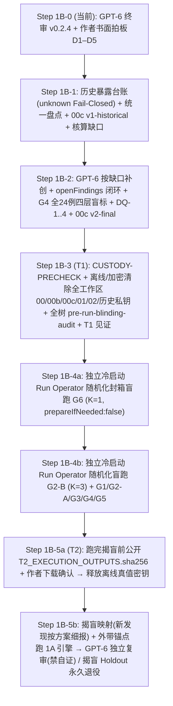

# P0-6-Stage-1B-Experiment-Design-v0.2.4
## P0-6 阶段 1B 完整实验设计方案：跨 Agent 混合建集、Data Custody、双评委定案与离线持钥盲测协议

> **文档版本**：`P0-6-Stage-1B-Experiment-Design-v0.2.4`（基于 `v0.2.3` Commit `a58e467cc6badf246d3db3c6a89253c27cb9fb48` 定点闭合 GPT-6 Comment `7219802018` 唯一阻断项 `Blocking 1` 及 3 项文档级非阻断改进）  
> **文档状态**：`DESIGN_V0_2_4_FINAL_CLOSURE_FOR_GPT6_ACCEPTANCE_AND_AUTHOR_SIGNOFF`（**当前仍处于设计审批阶段：历史素材盘点、GPT-6 补创、Gold Standard 标注、封箱与 A/B/C 盲测全部尚未授权启动；零修改 1A 统计引擎、零修改生产代码/R2、零改变 `08 v1.2.3` 任何冻结门槛**）  
> **前置基线**：`P0-6 阶段 1A` 统计裁决引擎与零泄漏检查器已于 `feat/r3-p0-controlled` Commit `2199c88c3b0723052832e60f9e3779bd0f0a4ab7` 获 GPT-6 第六轮正式 `ACCEPTED（仅限阶段 1A 工程交付）`（Issue `#10` Comment `7213091661`）。  
> **上位冻结规范**：[08-工程效率与文学质量双重验收方案.md](../review-v3/08-工程效率与文学质量双重验收方案.md)（`v1.2.3`）、[P0-Implementation-PRD.md](./P0-Implementation-PRD.md)（`P0-6`）、[P0-0-Baseline-Audit-Report.md](./P0-0-Baseline-Audit-Report.md)（附录 C）。  
> **接口锚点**：[eval_g1_g6_stats.mjs](../../../scripts/p0_prototypes/eval_g1_g6_stats.mjs)、[abc_orchestrator.mjs](../../../scripts/p0_prototypes/abc_orchestrator.mjs)、[review_pack_compiler.mjs](../../../scripts/p0_prototypes/review_pack_compiler.mjs)。

---

## v0.2.3 → v0.2.4 定点收口对照表（唯一阻断项 Blocking 1 + 非阻断改进 1–4）

| 编号 | GPT-6 Comment `7219802018` 条目 | v0.2.4 精准落实与定位 |
|---|---|---|
| **Blocking 1（1–5 全部闭合）** | 继承工作区全量盲态清除审计漏掉 `00`/`00b`/`00c`/`01-raw-corpus/` 等敏感路径；`Runner 盲态` 须绑定可信宿主运行时证据与完整文件访问审计 | §1.2、§5.2 & §6.3：① `pre-run-blinding-audit.json` 升级为扫描 Run Operator 在继承工作区中**实际可访问的完整文件树**（仓库目录 + `<ART_ROOT>` + `/tmp`/`$HOME` 缓存/隐藏目录），记录全量文件清单、目录权限、运行 UID 与可读性核验；② 盲跑前必须将 **`00`、`00b`、`00c-v1/v2`、`01-raw-corpus/`、`02-ground-truth-adjudication/`、`03` 含真值/来源清单、`P0-0` 历史私钥及全部缓存/索引/备份/临时副本/隐藏文件** 一并离线移出或作者独持密钥加密并从 VM 彻底清除明文；③ 明确 Run Operator 实际可读白名单**仅限** `04-anonymized-sandbox-copies/`、不可变匿名 `config-manifest.json`、匿名调度表及运行所需冻结代码（其余数据路径均须有不存在/不可读证据）；④ 任一数据路径无法完整枚举或证明不可访问时，`明文真值隔离` / `Runner 盲态` 一律标 `未验证` 并按 Fail-Closed 禁止正式盲跑；⑤ `Runner 盲态 = 已验证` 严禁仅凭模型输出 ID 或 `runId/contextId` 认定，必须绑定**平台级宿主生成子代理日志（`.system_generated/logs/transcript.jsonl` 完整文件访问审计）+ 宿主注入 `runtimeStageContexts`**，若平台未提供可信宿主运行时证据则诚实标 `未验证`。 |
| **Non-blocking 1** | G4 历史 9 案预注册抽样锁定确定性 PRNG 与规范排序 | §3.2：锁定与 1A 引擎一致的 `Mulberry32` PRNG、规范排序键 `sourceChapterId ASC, caseId ASC` 及索引确定性 tie-break，确保逐字节可复现。 |
| **Non-blocking 2** | §7.2 建集预算补计 G4-Plan A 3 个历史来源章的双评委复审调用 | §7.2：补计 G4-Plan A 的 `3` 个历史源章两步复审（`+3 × 4 = +12` 次评委 + `~2` 次仲裁）：主方案总调用上限由 `~361` 修正为 `~375`（`53` 章双评委 = `212` 次），B1 修正为 `~395`（`56` 章 = `224` 次），B2（`~381`）与 B3（`~401`）因 G4 全新 8 章已在新建数中故保持不变。 |
| **Non-blocking 3** | 预期正例被降级后的预注册 FIFO 补足与配额阻断规则 | §4.3：明确 T1 前按同题材/同类别预注册 FIFO 备用池顺位自动递补；若备用池耗尽致精确 `72/60` 配额仍未满足，`CUSTODY-PRECHECK` 强制 Fail-Closed 保持阻断，严禁人工挑选或静默凑数。 |
| **Non-blocking 4** | `P0-Implementation-PRD.md` §五 仍标 P0-5 为 `NOT_STARTED` | 严守本轮单文件纯设计提交边界（不顺带改 PRD）；已写入 §9 `Step 1B-1` 启动前必做管理同步清单，在启动阶段 1B 前单独提交 PRD 状态同步。 |

---

## 一、设计定位、前置基线、角色分权与不可突破红线

### 1.1 阶段 1A、阶段 1B 与数据质量门禁的职责隔离

| 维度 | 归属阶段 | 性质与不可逾越边界 |
|---|---|---|
| **G1–G6 统计裁决、B=2,000 聚类 Bootstrap 95% CI、方案 B 淘汰线、A/B/C 案例等价性、`K_rep` 协议元数据与外带清册哈希校验** | **阶段 1A（已 `ACCEPTED` @ `2199c88c`）** | 冻结复用 [eval_g1_g6_stats.mjs](../../../scripts/p0_prototypes/eval_g1_g6_stats.mjs)；**阶段 1B 严禁修改 1A 统计引擎代码或任何冻结 G1–G6 门槛**。 |
| **跨 Agent 混合建集、Data Custody、历史暴露核查、独立 Gold Standard 定案、作者离线持钥盲跑、1B 清册预检与真实执行日志归档** | **阶段 1B（本设计方案）** | 本方案的 **Gold Standard 数据质量门禁（`DQ-1`–`DQ-4`）** 与 **1B 清册预检（`CUSTODY-PRECHECK`）** 严格属于建集期数据治理控制，**与冻结 `08 v1.2.3` 中 G1–G6 验收门槛严格分开，绝非修改或替换 G1–G6**。 |
| **D1–D5 前置拍板 + 离线密钥保管 + T1/T2 见证确认 + 阶段授权与最终验收** | **作者书面拍板** | 任何 Agent 均不得越权替代作者决策或自行宣布实验通过。 |

### 1.2 阶段 1B 正式角色分权与协作边界（双方共同确认版）

> **共同协作红线**：GPT-6 不裁决自己创作章节的最终真值；Neon 主代理不替代独立 Run Operator；任何一方都不能自行宣布实验通过。

| 正式角色 | 承担方 | 权限与核心职责 | 严格信息隔离与禁止事项 |
|---|---|---|---|
| **1. 主组织与数据保管（Neon 主代理）** | **Neon（主工程师）** | 项目组织、历史素材盘点、全局分配清册维护、Data Custody 打包、运行编排与 T1/T2 锚点发布。 | 不替代独立 Run Operator 执行盲跑；盲跑期不接触已移交离线/加密的明文真值与敏感映射；不利用任何中间输出修改被测方案。 |
| **2. 补创与独立复审（GPT-6）** | **GPT-6** | ① **补充章节创作**（仅针对真实缺口，附 `creatorIntendedLabel`）；② **方法学复审与统计/证据链独立复核**（审计设计、全局分配清册、执行日志、防泄漏与去重证据链、`DQ-1..4`、1A 统计与探索性发现）。 | **利益冲突回避硬限制**：GPT-6 **不得裁决自己创作章节的最终真值**，**严禁将自创章节作为独立审稿证据进行自我认证**；不以 Neon 本地自测代替复审方独立核验。 |
| **3. 独立真值定案组（Independent Gold Standard Panel）** | 独立冷启动 **`Judge 1` / `Judge 2` / `Arbiter 3`** | 对全部新入库 Holdout 样本及 G4 全部 24 例执行两步独立盲审（Step A 开放盲审 + Step B 案例标定）与分歧仲裁，产出 `DQ-1..4` 原始盲标与定案记录。 | 评委零接触 `creatorIntendedLabel`、零接触 `corpusOrigin`、零接触历史原始标签与任何 A/B/C 输出；GPT-6 创作者不得介入定案。 |
| **4. 独立盲测执行者（Neon Run Operator）** | **强制独立的全新冷启动执行子代理** | 不继承 Neon 主代理的创作、标注与仲裁对话；仅接收匿名化只读沙箱输入与不可变配置清单；按随机化序列以 `prepareIfNeeded: false` 执行 A/B/C 全量盲跑，落盘宿主机运行日志、基础包哈希、Provider Request ID（如可得）与 `EXECUTION_OUTPUTS.sha256`。 | **作者离线持钥 + 全工作区明文清除盲化（§6.3）**：盲跑期间，Run Operator 在继承工作区中实际可读范围**仅限** `04-anonymized-sandbox-copies/`、匿名配置/调度表与冻结代码；`00`/`00b`/`00c`/`01`/`02`/历史私钥及一切缓存备份必须全量离线或加密清除，无法证明全树清除即禁止正式盲跑；全程禁止修改模板/提示词/阈值/代码；揭盲后本次 Holdout 永久退出调参。 |
| **5. 项目决策与密钥保管人（作者）** | **作者** | D1–D5 最终拍板、全局分配清册 `v2-final` 批准、`DQ-4` 强制人工复核、**离线保管敏感数据包或独持加密密钥**、T1 与 T2 双节点独立留存确认、释放真值密钥授权揭盲、阶段授权与最终验收。 | 解密密钥严禁进入 VM、Agent 上下文、环境变量、GitHub 仓库或运行日志；未完成 T2 留存确认前不释放密钥。 |

### 1.3 七条不可突破实施红线

1. **不修改 `08 v1.2.3` 冻结门槛**：原封不动保留 G1–G6 全部门槛、聚类统计口径、方案 B 淘汰线与平局决胜顺序。
2. **不修改阶段 1A 统计引擎**：[eval_g1_g6_stats.mjs](../../../scripts/p0_prototypes/eval_g1_g6_stats.mjs)（`2199c88c`）作为只读黑盒裁决器直接调用，不在 1A 内叠新逻辑。
3. **本轮纯设计修订，绝不提前动工**：不生成测试章节、不开始历史样本盘点、不开展 Gold Standard 标注、不执行 A/B/C。
4. **不修改生产模板、R2 或其他生产代码**：零触碰 `SKILL.md`、非 `prototypes/` 的 `references/**`、R2 脚本、`scripts/r3_review_kernel.mjs` 及 `.github/**`。
5. **不提前进入阶段二**：未获 GPT-6 阶段 1B 最终 `ACCEPTED` 及作者书面放行前，禁止启动阶段二文学盲评，维持 `allowProductionMerge: false`。
6. **严守 `DEC-11` 正文不入主仓**：任何来源的原始小说正文仅存仓外 Data Custody Vault，主仓 0 字节原文。
7. **新增数据质量门禁与冻结 G1–G6 严格分开表述**：所有报告均显式隔离「`DQ-1..4` 数据质量门禁」与「冻结 `08 v1.2.3` G1–G6 模型统计门禁」。

---

## 二、动工前须作者书面拍板的 5 项前置决策（D1–D5）

### D1 · `G2-B` 独立 Holdout 正例 Cohort 规模与构成（**主推荐：`D1-B`**）

- **1A 引擎边界说明**：[eval_g1_g6_stats.mjs](../../../scripts/p0_prototypes/eval_g1_g6_stats.mjs#L1327-L1381) 仅强制校验 `totalPositives > 0`、`positiveCohortApproved === true`、非空 `positiveCohortApprovalRef` 与 `positiveCohortApprovedManifestSha256 === computedManifestSha256 === expectedG2BManifestSha256`，**并未硬编码 `60` 或 `72`**。因此，阶段 1B 独立清册预检（`CUSTODY-PRECHECK`）必须在封箱前强制验证作者最终批准的精确正负例数。
- **三轮（`K = 3`）离散整数 `TP / FP` 实际门槛敏感度分析（固定每轮 `N_neg = 60`，三轮共 `180` 负例-轮）**：
  - 冻结 `3 轮均值 FPR <= 13.0%` → 三轮整数总 `FP <= 23 / 180`（`12.78%`；`24 / 180 = 13.33%` FAIL）；
  - 冻结 `单轮最大 FPR <= 15.0%` → 单轮整数 `FP <= 9 / 60`（`15.00%`；`10 / 60 = 16.67%` FAIL）；
  - 冻结 `Clear-tier FP = 0`（每轮）；冻结 `3 轮均值 Precision >= 88.00%`。

| 候选规格 | 样本结构（20 独立源章，4 题材 × 5 章，`K = 3`） | 典型三轮整数情景（`TP_1,TP_2,TP_3` / `FP_1,FP_2,FP_3`） | 3 轮均值 Recall | 3 轮均值 FPR（单轮 max） | 3 轮均值 Precision | 裁决与余量评估 |
|---|---|---|---:|---:|---:|---|
| **`D1-B`（主推荐）** | **`N_pos = 72`**（建议 `18` BLOCKER + `54` MAJOR）<br>**`N_neg = 60`**（`30` CLEAR + `30` BORDERLINE）<br>正负比 `72 : 60 = 1.20 : 1`（贴近 G2-A `40 : 33 = 1.212 : 1`） | 高召回+稳态误报：`TP=(68,69,68)` / `FP=(6,6,6)` | `94.91%` | `10.00%` (`10.00%`) | **`91.93%`** | ✅ PASS（`+3.93 pp`） |
| | | 高召回+贴线误报：`TP=(68,69,68)` / `FP=(7,8,8)` | `94.91%` | `12.78%` (`13.33%`) | **`89.92%`** | ✅ PASS（**`+1.92 pp`**） |
| | | 高召回+波动贴线：`TP=(68,69,68)` / `FP=(6,8,9)` | `94.91%` | `12.78%` (`15.00%`) | **`89.94%`** | ✅ PASS（**`+1.94 pp`**） |
| | | 边界召回+贴线误报：`TP=(65,65,65)` / `FP=(7,8,8)` | `90.28%` | `12.78%` (`13.33%`) | **`89.45%`** | ✅ PASS（**`+1.45 pp`**，不互相挤兑） |
| **`D1-A`（备选）** | **`N_pos = 60`**（`15` BLOCKER + `45` MAJOR）<br>**`N_neg = 60`**（`30` CLEAR + `30` BORDERLINE）<br>正负比 `1 : 1` | 高召回+稳态误报：`TP=(57,57,57)` / `FP=(6,6,6)` | `95.00%` | `10.00%` (`10.00%`) | **`90.48%`** | ✅ PASS（`+2.48 pp`） |
| | | 高召回+贴线误报：`TP=(57,57,57)` / `FP=(7,8,8)` | `95.00%` | `12.78%` (`13.33%`) | **`88.15%`** | ✅ PASS（仅 `+0.15 pp`，极度贴线） |
| | | 边界召回+贴线误报：`TP=(54,54,54)` / `FP=(7,8,8)` | `90.00%` | `12.78%` (`13.33%`) | **`87.57%`** | ❌ **FAIL**（被 Precision 击穿，总 FP 被迫压至 `<= 22/180`） |
| **`D1-C`（不推荐）** | `N_pos = 40`, `N_neg = 60`（`0.67 : 1`） | 高召回+稳态误报：`TP=(38,38,38)` / `FP=(6,6,6)` | `95.00%` | `10.00%` (`10.00%`) | **`86.36%`** | ❌ **FAIL**（总 FP 被迫压至 `<= 15/180 = 8.33%`） |

- **`D1-B` 逐章精确配额（冻结，保证正例有效聚类数 `= 20`，由 `CUSTODY-PRECHECK` 强制校验）**：
  - **72 个正例（`18` BLOCKER + `54` MAJOR，分布于全部 `20` 个独立章节，每章 `3–4` 正例）**：
    - `12` 章：每章 **`1` BLOCKER + `3` MAJOR**（小计 `12` B + `36` M = `48` 正例）；
    - `6` 章：每章 **`1` BLOCKER + `2` MAJOR**（小计 `6` B + `12` M = `18` 正例）；
    - `2` 章：每章 **`0` BLOCKER + `3` MAJOR**（小计 `0` B + `6` M = `6` 正例）；
    - 合计：`12 + 6 + 2 = 20` 章、`18` BLOCKER + `54` MAJOR = **`72` 正例**（正例有效章节聚类数严格 `= 20`，避免正例集中导致聚类 Bootstrap 缩水）。
  - **60 个非阻断负例（`30` CLEAR + `30` BORDERLINE，每章严格精确 `3` 个负例）**：
    - `10` 章：每章 **`2` CLEAR + `1` BORDERLINE**（小计 `20` C + `10` B = `30` 负例）；
    - `10` 章：每章 **`1` CLEAR + `2` BORDERLINE**（小计 `10` C + `20` B = `30` 负例）；
    - 合计：`20` 章、`30` CLEAR + `30` BORDERLINE = **`60` 负例**（各题材内均衡分配）。

---

### D2 · `G2-B` 与 `G6` 独立性（**保留 `D2-A` 并锁定来源作品级 6 维互斥与分层去重处置**）

- **`D2-A`（主推荐 — 来源作品级 6 维完全互斥）**：
  - 严禁仅凭章节 ID 不同和原始哈希不同宣称 `G2-B` 与 `G6` 完全独立；必须同时满足 **6 维隔离**（`sourceWorkId`、`sourceChapterId`、`rawContentSha256`、`normalizedContentSha256`、近似重复/改写检测、`caseId`），确保每个 Holdout 来源作品唯一性（默认 `G2-B` 与 `G6` 跨集零同作品复用）。
  - **分层处置规则（v0.2.1 细化，防误杀正常题材表述）**：
    1. **精确重复**（`rawContentSha256` 或 `normalizedContentSha256` 跨集/命中历史暴露库）→ **自动硬拒绝**；
    2. **相同来源作品**（`sourceWorkId` 跨集重复）→ **自动硬拒绝跨集复用**；
    3. **近似重复命中**（字符 5-gram Jaccard、LCS 比例或专有名词/实体重叠超过预警线）→ **交人工复核，不自动判定污染**；
    4. **经人工复核确认属改写或复制** → **拒绝入库并记入审计日志**（若人工核实为独立创作的行业常规表达，须书面记录放行依据）。
  - **阈值预校准与 LCS 分母定义（v0.2.1 明确）**：
    - 字符 5-gram Jaccard 与 LCS 比例预警阈值**必须在非 Holdout 样本上预先校准确定**（例如使用历史已知同章不同 Arm 改写对 vs 历史不同独立作品章节对做正负分离标定后再冻结预警阈值，严禁拍脑袋硬编码）；
    - **最长公共子串（LCS）比例计算分母明确锁定为**：对规范化去空白正文计算 $\text{LCS\_ratio}_{\min} = \frac{\text{len}(\text{LCS}(A, B))}{\min(\text{len}(A), \text{len}(B))}$（防止短章被长章分母稀释漏检），并同步辅报 $\text{LCS\_ratio}_{\max} = \frac{\text{len}(\text{LCS}(A, B))}{\max(\text{len}(A), \text{len}(B))}$ 供人工复核参考。
- **`D2-B`（低预算备选，不推荐）**：`G6` 与 `G2-B` 共享 12 章，须先封箱跑 `G6 (K=1)` 且报告降级声明为「共享 Holdout 章节的关联多门禁评估（非两份独立 Holdout 证明）」。

---

### D3 · 跨 Agent 混合语料来源路径（**`D3-C` 为主推荐**）

结合「优先复用 Neon 已有合规子代理作品、由 GPT-6 按实际缺口补创、再由 Neon Run Operator 独立盲测」的分工，将 **`D3-C`（跨 Agent 混合语料）** 定义为以下三级优先级：

| 优先级 | 语料来源类别（Data Custody 必填 `corpusOrigin`） | 准入核查与交付规范 | 诚实方法学边界与 Fail-Closed 禁入红线 |
|---|---|---|---|
| **Priority A（首选盘点复用）** | **Neon 历史子代理作品**<br>(`neon_historical_subagent_eligible`) | 1. 在 `Step 1B-1` 恢复并盘点此前子代理创作的章节与原始交付物；<br>2. **不因创作者曾是 Neon 子代理而自动判定污染**；<br>3. **上下文压缩既不等于历史暴露自动消失，也不等于样本自动失效**；<br>4. 逐章核查其是否曾用于 **R3 规则调优、审稿反馈、误报校准或模型修正**，以及是否命中退役黑名单/历史暴露库；<br>5. **仅有可核查证据支持独立性资格者**，方可申请进入 `G2-B` / `G6`（或辅助门禁），同样须经两步双评委+仲裁定案。 | ① 凡存在历史调参/审稿反馈记录或命中黑名单者归态 `EXCLUDED_EXPOSED`，一律硬拒入 Holdout；<br>② **Fail-Closed 硬红线（Blocking 2）**：凡不可追溯核查而标为 `exposureAuditStatus = unknown` 者归态 `EXCLUDED_UNKNOWN`，**严禁进入 `G2-B` / `G6`，不得计入独立 Holdout 有效样本数**（仅可另行评估标注用于非 Holdout 回归或探索性分析）。 |
| **Priority B（缺口定向补创）** | **GPT-6 新创作挑战语料**<br>(`gpt6_controlled_challenge`) | 1. **仅在 Priority A 盘点确认合格素材不足时按实际缺口补充**（正例与反例均可创作）；<br>2. 交付完整测试输入：**正文、细纲切片、账本切片、硬约束、预期案例位置、预期严重程度与判定依据**；<br>3. GPT-6 提供的预期标签仅登记为 **`creatorIntendedLabel`（创作者意图）**，**绝不直接作为最终 Gold Standard**——最终 Gold Standard 必须同样经过独立双评委+第三仲裁定案。 | 显式标注为 **`GPT-6 受控合成挑战语料`**，**不宣称代表自然连载语料分布**；不得声称 AI 生成语料 100% 无版权风险；提示词隔离不等于证明基础模型预训练阶段未接触相似内容（`pretraining_exposure_unknown`）。 |
| **Priority C（可选补充）** | **作者提供的未揭盲素材**<br>(`author_unblinded_original`) | 可选补充，**不作为实验启动的必要条件**；若提供，执行与 A/B 相同的 6 维防泄漏检查与两步双评委定案。 | 原始正文按 `DEC-11` 仅存仓外 Vault，不入公开主仓。 |

> **严格盲化纪律**：Data Custody 内部必须逐章标记 `corpusOrigin`（A/B/C），但**在交付给 Neon Run Operator 的盲测输入包中，严禁泄露 `corpusOrigin`、`creatorIntendedLabel` 与任何 Gold Labels**，避免执行期产生来源偏置。

---

### D4 · 受测模型不可变配置清单与双评委 + 第三仲裁配置（v0.2.3 细化）

- **`D4-A`（推荐）**：
  - **A / B / C 不可变配置清单（`configManifestSha256`，Supplement 2）**：A / B / C 三方案共用完全相同的基座模型与推理参数，但**严禁将三套方案提示词混为同一配置哈希**；运行前必须冻结 `config-manifest.json` 并计算 `configManifestSha256`（写入 T1 锚点），至少记录：
    1. 精确模型快照 ID 及供应商版本（`modelId` / `providerModelVersion`）；
    2. 完整推理/解码参数（`temperature`、`topP`、`maxTokens`、推理深度等）；
    3. **各方案各自独立的 Prompt / Template SHA-256**（`schemeATemplateSha256`、`schemeBPass1TemplateSha256`、`schemeBPass2TemplateSha256`、`schemeCStage1TemplateSha256`、`schemeCStage2TemplateSha256`）；
    4. Adapter / 编排与运行代码 Git Commit SHA；
    5. 运行时版本（Node.js / 宿主机 OS 版本）。
  - **独立评委组配置归档（Supplement 3）**：独立冷启动 `Judge 1`、`Judge 2`、`Arbiter 3` 均须分别归档**模型与精确版本、Rubric 文件 SHA-256、独立会话标识及原始评审输出 SHA-256**；**若 `Judge 1` 与 `Judge 2` 实际使用同一模型家族，报告必须显式披露判断相关性限制，不得仅以冷启动会话不同等同于完全独立的评判能力**；
  - **作者强制人工复核范围**：**100% 仲裁案例 + 100% `BLOCKER` 正例 + 100% `CLEAR` 负例 + 其余案例 `>= 20%` 分层随机抽核**。

---

### D5 · GitHub Issue `#10` 生命周期处置

- **`D5-A`（推荐）**：保持 `#10` 为 `OPEN`，追踪阶段 1B 盘点、建集与盲跑直至 P0-6 全案收口；
- **`D5-B`**：按阶段 1A 交付关闭 `#10`，另开独立 Issue 追踪阶段 1B。

---

## 三、全门禁样本目标、历史复用与预注册选样规则（G1–G6）

### 3.1 全门禁目标规模与主/备建设路径（按推荐 `D1-B` + `D2-A` [`G6 = 16 章`] + `D3-C`）

| 门禁 | 冻结门槛（`08 v1.2.3` & 1A 引擎） | 历史基线核实 | 阶段 1B 样本构造规则（主方案 vs 兜底） |
|---|---|---|---|
| **G1** | Track 2：`N_ch >= 9, N_pos >= 40, K = 3`<br>Reg 7：`N_ch >= 7, K = 1`<br>Recall `>= 95%`；7 章 `100%`；已知 BLOCKER 漏检 `= 0` | 已齐（9 章 / 40 正例 + 7 章回归） | 从历史私钥导出逐案例 `cases[]` 清册，对 A/B/C 实跑 `K = 3` / `K = 1` |
| **G2-A** | **精确冻结 `9` 章 / `40` 正例 / `33` 负例，`K = 3`**；Clear-FP `= 0`；均值 FPR `<= 13%`；单轮 `<= 15%`；Precision `>= 88%`；外带 `--expected-g2a-manifest-sha256` | 已齐（73 条定论，不含争议 `ORIG-18`） | 冻结为 `manifestVersion: "g2a-p00-frozen-v1"`，外带登记 `expectedG2AManifestSha256`，实跑 `K = 3` |
| **G2-B** | `N_ch >= 20`、`N_neg >= 60`（单章 `<= 3` 负例）、`>= 3` 规范题材、`K = 3`、0 历史重叠；Clear-FP `= 0`、均值 FPR `<= 13%`、单轮 `<= 15%`、Precision `>= 88%`；外带锚点 + 作者审批绑定哈希 | `0` 章（`underpowered`） | **目标（按 `D1-B` 精确逐章配额）**：**`20` 个独立来源作品 × 1 章**（`4` 规范题材 × `5` 章）；**正例 `72` 案**（`12 章×(1B+3M) + 6 章×(1B+2M) + 2 章×(3M) = 18B+54M`，正例有效聚类 `= 20`）；**负例 `60` 案**（`10 章×(2C+1B) + 10 章×(1C+2B) = 30C+30B`，每章精确 `3` 负例）；仅允许有可核查清白证据的素材入库（`unknown` 严禁入库）；1B 独立清册预检强锁上述逐章配额。 |
| **G3** | `N_ch >= 10` **独立故事来源章**（每章 `1–2` 段）、`N_case >= 15` 清白段、`K = 3`；非阻断 `100%`，`NO_ISSUE >= 90%` | 历史 `S4`：`9` 条引文（9 个精确哈希），但源于 3 Arm × 3 章，**实际仅 `3` 个独立来源章（`QHL-CH1..3`）** | **主方案（`G3-Plan A`）**：先对 9 条历史段落做规范化哈希与近似重复核查 → 保留历史 `3` 个独立来源章（每源章取去重确认的 `1–2` 段，严守 `<= 2` 段/源章）+ 补充 **`7` 个独立来源章**（优先合格子代理作品，缺口由 GPT-6 补创）→ 最终 `>= 10` 独立来源章、`>= 15` 正文去重清白段落（不足 15 段再补段）。<br>**保守兜底（`G3-Plan B`）**：若历史段落独立性无法证明，则全量使用 `10` 个全新独立来源章 × `2` 段 = `20` 清白段。 |
| **G4** | `>= 8` **独立来源章**、**精确 `N_case === 24`**（四级全覆盖）、`K = 2`；$\kappa_w >= 0.85$、`SUGGESTION` 进闭环 `= 0` | `four-class-24.json` 真实分布：**`4` BLOCKER（均合成）+ `8` MAJOR（真实）+ `6` MINOR（真实）+ `6` SUGGESTION（真实）**（20 真实 + 4 合成），仅 `3` 独立来源章（`QHL-CH1..3`） | **主方案（`G4-Plan A`）**：严格按 **§3.2 预注册选样规则** 从 `QHL-CH1..3` 锁定 `9` 个历史真实案例（**严禁为凑 6/6/6/6 修改任何历史真值**）+ 补充 **`5` 个独立来源章共 `15` 个新案例**（优先合格子代理作品，缺口由 GPT-6 补创）→ 精确 `24` 案例、`8` 独立来源章、四级全覆盖、`K = 2`。<br>**保守兜底（`G4-Plan B`）**：若无法构造合法的 `9 + 15` 方案，则重建完整 `8` 独立来源章 × `3` 案 = `24` 探针数据集。 |
| **G5** | `>= 3` **独立大纲死锁章**（`100%` `PLANNING_CONFLICT_BLOCK`、`0%` 漂白）+ 合法桥段 `0%` 误阻断 + `s1CompatPassed` & `engFixP1Passed` + `compatEvidenceRef.{s1CompatTest, engFixP1Test}`；`K = 1` | `1` 历史死锁章（`V22-H4`）+ `3` 历史合法桥段（`CAL-49/62/11`） | **冻结最低要求**：保留 `V22-H4` + 补齐 **`2` 个独立大纲死锁章**（`S1B-G5-DL-02`、`S1B-G5-DL-03`）+ `CAL-49/62/11` 补齐真实来源映射后作为合法桥段参考。<br>**可选增强项（非冻结最低要求）**：可另增 `3` 条合法桥段作增强参考并分开汇报。<br>**实跑证据**：`compatEvidenceRef` 仅为测试路径锚点，另行保存两套测试完整运行日志与退出码。 |
| **G6** | `4–6` 规范题材 × `12–16` 独立未揭盲整章（每题材 `>= 2` 章，默认预算上限 `<= 6` 题材且 `<= 16` 章）、`N_pos >= 30`、`N_neg >= 40`（单章 `<= 5` 案免权重披露）、**精确 `K = 1`**；BLOCKER 漏检 `= 0`、综合 Recall `>= 90%`（95% CI 下界 `>= 75%`）、FPR `<= 13%`、Clear-FP `= 0` | `0` 章（`underpowered`） | **目标（按 `D2-A`）**：**`16` 个独立来源作品 × 1 章**（`4` 规范题材 × `4` 章，与 G2-B 满足 6 维作品级完全互斥；每章精确 `2` 正例 + `3` 负例 = `5` 案 → `N_pos = 32` [10 BLOCKER + 22 MAJOR] + `N_neg = 48` [24 CLEAR + 24 BORDERLINE]）；**同样遵循 `D3-C` 优先复用合格历史子代理作品、仅对缺口由 GPT-6 定向补创**；预算内无需 `--approve-g6-budget-expansion`。 |

> **关于 `G3` / `G4` 历史来源交叉的透明披露（v0.2.1 新增）**：当 `G3` 与 `G4` 均采用 `Plan A` 复用历史资产时，两者均涉及历史故事来源章 `QHL-CH1..3`。本方案明确声明：**这是允许披露的跨门禁历史回归资产交叉，不代表两套彼此独立的来源证据**；不为此额外制造章节，亦不改变 `08 v1.2.3` 任何冻结门槛。与此同时，`G3` / `G4` / `G5` 的全部章节（含历史与新增）均登记进非 Holdout 暴露库，与 `G2-B` / `G6` 保持严格的来源作品级零交集。

### 3.2 `G4` 历史 9 个真实案例的预注册选择规则（含确定性 PRNG 规范）

为彻底杜绝任何事后挑样嫌疑，`G4-Plan A` 从历史 `four-class-24.json` 的 `20` 条真实案例（全部来自 `QHL-CH1..3`：`8` MAJOR / `6` MINOR / `6` SUGGESTION；4 条 BLOCKER 均为合成故不纳入“历史真实案例”池）中挑选 `9` 条时，必须在首次运行任何模型前执行以下预注册流程：

1. **分层结构与规范排序**：先按 **`sourceChapterId ASC, caseId ASC`**（UTF-8 字典序，统一大写规范化 ID）对全部 `20` 条历史真实案例做确定性规范排序，再按 `sourceChapterId`（`QHL-CH1` / `QHL-CH2` / `QHL-CH3`，每章 3 条）× 原始真值类别（`MAJOR` / `MINOR` / `SUGGESTION`）分层；
2. **锁定 PRNG 算法与同值 Tie-Break**：使用与阶段 1A 引擎 [eval_g1_g6_stats.mjs](../../../scripts/p0_prototypes/eval_g1_g6_stats.mjs#L196-L200) 一致的 **`Mulberry32` 确定性 PRNG**（冻结种子 `g4HistSelectionSeed = 20261128`）对各分层执行 Fisher-Yates 洗牌后取前 $k$ 条；若产生同值打分/权重比较，严格按规范排序索引升序（`caseId ASC`）做确定性 tie-break，保证同一清册与种子逐字节复现；
3. **双清册完整留痕**：同步保存 **`g4-hist-selected-9.json`（入选清册）** 与 **`g4-hist-unselected-11.json`（未入选清册）** 及其哈希；
4. **两条绝对禁令**：**严禁根据任何 A/B/C 运行结果选择或替换历史案例**；**严禁为凑成 6/6/6/6 篡改任何一条历史案例的原始真值**（四级缺额——尤其是真实 `BLOCKER` 探针——仅通过新增的 `5` 个独立来源章共 `15` 个新案例补齐）；
5. **自动降级兜底**：若经上述固定规则仍无法构造合法的 `9 + 15` 组合（例如某历史源章分层不足导致无法满足四级覆盖与源章均衡），自动切换为 `G4-Plan B`（全量新建 `8` 独立来源章 × `3` 案 = `24` 探针）。

---

## 四、独立 Gold Standard 定案协议与数据质量门禁（`DQ-1`–`DQ-4`）

> **治理隔离声明**：`DQ-1`–`DQ-4` 均为**阶段 1B 建集期数据质量门禁**，与冻结 `08 v1.2.3` 中的 G1–G6 模型验收门禁完全分开表述，绝不修改 G1–G6 任何门槛。

### 4.1 两步盲审流程、Step A 开放发现闭环与评委归档（Blocking 3 + Supplement 3）

- **适用范围**：全部新入库 Holdout 样本（`G2-B` / `G6`，含历史合格复用与 GPT-6 补创）、辅助门禁新样本，以及 **`G4` 全部 `24` 个探针案例（含 `G4-Plan A` 入选的 `9` 个历史真实案例，隐藏原标签独立重评）**。
- **评委配置归档（Supplement 3）**：`Judge 1`、`Judge 2`、`Arbiter 3` 均须在 `02-ground-truth-adjudication/judge-config-manifest.json` 中分别记录**模型与精确版本、Rubric SHA-256、独立会话标识及原始评审输出 SHA-256**；若 `Judge 1` 与 `Judge 2` 使用同一模型家族，强制披露判断相关性限制。
- **两步盲审与 Step A `openFindings[]` 完整闭环（Blocking 3①）**：
  1. **Step A · 完整章节无锚点开放盲审**：`Judge 1` 与 `Judge 2`（独立冷启动，**零接触 `creatorIntendedLabel`、`corpusOrigin`、历史原标签与任何 A/B/C 输出**）仅读章节正文 + 细纲切片 + 账本切片，独立输出全章开放发现 `openFindings[]` 并锁盘哈希；
  2. **Step A → Step B 独立新发现归并闭环（消除候选清单偏置）**：
     - 凡任一评委在 Step A `openFindings[]` 中发现、且**未出现在初始候选定位清单中**的客观缺陷，不得忽略，必须进入确定性归并流：**`independent_open_finding` → 段落/引文归并去重 → 分配临时候选 ID（`PROV-CASE-NNN`）→ 并入 Step B 候选池由 `Judge 1` 与 `Judge 2` 双评委复标 → 分歧交 `Arbiter 3` 仲裁 → 在首轮模型运行（T1 封箱）前完成定案**；
     - **配额与分母硬规则**：新增定案的客观发现是否纳入主统计样本，严格依据**运行前预注册的逐章配额、替补与排除规则**在 T1 前一次性决定；若某章已达冻结配额（例如 G2-B `72/60` 逐章配额或 G6 `<= 5` 案/章），超出主配额的额外客观定案**单独归档为补充结果报告，严禁在揭盲后修改主样本分母**；
  3. **Step B · 案例级结构化标定**：对合并后的完整候选池（初始候选 + `PROV-CASE-NNN`，仍不含任何 `creatorIntendedLabel` 或历史原标签），双评委逐条输出 `verdictClass`、`derivedTruthClass`、`nonBlockingTier`、`wasFoundInStepA` 与 `rationale`。

### 4.2 G4 全部 24 例四层不可变记录与 `DQ-2` 完整分母规范（Blocking 3②）

为兼顾「保留历史原始真值永不覆盖」与「`DQ-2` 在全部 24 例上完整计算」，G4 全部 `24` 个探针案例（含 `G4-Plan A` 保留的 `9` 个历史真实案例 + `15` 个新案例）均采用**四层不可变数据结构**记录：

| 字段 | 含义与不可变边界 |
|---|---|
| `historicalOriginalTruth` | 历史原始真值（`9` 个历史入选案例永久原样保留，**严禁覆盖**；`15` 个新案例为 `null`） |
| `judge1Label` | `Judge 1` 本轮在零接触原始标签、仲裁史与来源身份下的独立盲标结果（全部 `24` 例必填） |
| `judge2Label` | `Judge 2` 本轮在零接触原始标签、仲裁史与来源身份下的独立盲标结果（全部 `24` 例必填） |
| `stage1bReassessmentTruth` | 本轮分歧仲裁结果（独立字段保存，**绝不覆盖 `historicalOriginalTruth`**） |

- **`DQ-2` 严格计算口径**：
  1. `G4` 全部 `24` 例必须全部经 `Judge 1` 与 `Judge 2` 盲态独立标注（9 个历史案例隐藏原标签、原仲裁记录与来源身份）；
  2. **`DQ-2` 二次加权 $\kappa_w$ 严格使用全部 `24` 例的原始独立标注对 `(judge1Label, judge2Label)` 计算，严禁使用仲裁后的标签计算**；
  3. 报告同步完整披露 **`24` 例的 4×4 混淆矩阵、四级类别分布、历史 9 例 `historicalOriginalTruth` vs `stage1bReassessmentTruth` 一致性对照以及 24 例样本量限制**。

### 4.3 争议仲裁、预期改判留痕与预注册 FIFO 替补边界

1. **强制交 `Arbiter 3`（独立冷启动）仲裁**：阻断/非阻断分歧、任一评委判 `BLOCKER` 引发的分歧、`CLEAR` vs `BORDERLINE` 分歧、G4 四级任两级分歧；
2. **预期正例被判为非阻断的留痕与预注册 FIFO 配额补足规则（禁止静默删除或人工挑替补）**：
   - 无论样本来自 Neon 历史子代理还是 GPT-6 补创，若评委将原本的 `creatorIntendedLabel`（预期正例）判定为非阻断（或降级），**必须完整保留其原始判定记录、创作者原意图与仲裁记录，严禁直接从记录中静默删除**；
   - 该案例按真实定案结果如实归档于 `adjudication-audit-log.jsonl`；若降级导致某章或整集无法满足冻结配额（如 `D1-B` 的精确 `72` 正例 / `60` 负例及逐章配额），仅允许在 **T1 封箱前** 按**预注册备用清册中同题材、同类别的 FIFO 既定顺位**自动递补（全量记入 `changeEvents[]` 禁止人工挑选）；**若预注册备用顺位耗尽后仍不满足冻结配额，`CUSTODY-PRECHECK` 强制保持 Fail-Closed 阻断，严禁为凑数静默替换或放宽配额**；
3. **严格限定排除替补触发条件（`DQ-3`）**：
   - **仅当案例明确满足预注册排除条件**（例如：文本本身存在不可消解的设定矛盾或语义歧义，经 `Arbiter 3` 正式判定为 `AMBIGUOUS_EXCLUDED`；或经 6 维防泄漏复核确认存在改写污染）时，**才允许**在 T1 封箱前按预注册备用清册的 **FIFO 既定顺位** 替补；
   - 一旦完成 T1 封存并启动任何 A/B/C 运行，永久禁止替补、剔除或修改主 Gold Standard。

### 4.4 独立 Gold Standard 数据质量门禁（`DQ-1`–`DQ-4`）

| 数据质量门禁 | 检验对象与统计口径 | 封箱前强制门槛 | 关键口径说明 |
|---|---|---|---|
| **`DQ-1` · 二分类盲标一致性（分门禁独立达标）** | 仲裁前 `Judge 1` vs `Judge 2` 阻断/非阻断二分类 | **`G2-B` 单独计算**：Cohen's $\kappa \ge 0.80$ 且原始一致率 $\ge 90.0\%$<br>**`G6` 单独计算**：Cohen's $\kappa \ge 0.80$ 且原始一致率 $\ge 90.0\%$ | **不允许仅提供 G2-B+G6 混合总值**；**`G3` 全部为清白样本（单类退化），不强制计算无意义的二分类 $\kappa$**，改为报告 G3 原始一致率、清白确认率与逐条分歧仲裁记录。 |
| **`DQ-2` · G4 四级有序一致性（全 24 例原始盲标）** | **全部 `24` 例**（含历史 9 案盲标）的仲裁前原始 `(judge1Label, judge2Label)` 四级分类 | **二次加权 $\kappa_w \ge 0.85$** | **严禁使用仲裁后标签计算**；同步披露 4×4 混淆矩阵、类别分布与样本量限制；不覆盖 `historicalOriginalTruth`；与模型 G4 门禁分开汇报。 |
| **`DQ-3` · 预注册排除、开放发现与替补审计** | Step A 新发现归并、`AMBIGUOUS_EXCLUDED` 判定、预期正例改判与 FIFO 替补日志 | 开放新发现 100% 闭环定案；仅预注册排除条件可替补；预期改判 100% 留痕不静默删除；100% 在 T1 前完成 | 杜绝候选清单偏置、cherry-picking 与揭盲后改分母。 |
| **`DQ-4` · 作者强制人工复核签封** | 作者人工核验覆盖率 | **100% `Arbiter 3` 仲裁案** + **100% `BLOCKER` 正例** + **100% `CLEAR` 负例** + **其余案例 $\ge 20\%$ 分层随机抽核** | 100% 锁定零容忍红线后由作者批准 `v2-final` 清册并完成 T1 见证留存。 |

---

## 五、Data Custody、历史暴露 Fail-Closed 红线与 T1/T2 双节点外部见证

### 5.1 历史暴露注册表与 `unknown` Fail-Closed 禁入红线（Blocking 2）

`00-historical-exposure-registry.json` 汇总全部可核查的历史暴露源：`P0-0` 附录 C（18 核心文件 + 62 引用稿件）、历史仓库分支 `c0966b12`、本机可访问的 Artifact/scratch 记录、GitHub Issue `#4`–`#11` 及阶段 1B 新增非 Holdout 辅助章节（`G3`/`G4`/`G5`），每条记录登记 **`rawContentSha256` + `normalizedContentSha256` + 近似重复索引**。

- **诚实边界声明**：对于因历史会话未归档、上游平台不可访问或缺乏可验证日志而无法直接查验的历史来源，必须显式标记 `exposureAuditStatus: "unknown"`，**严禁宣称无法证明的「全渠道 100% 零暴露」**。
- **`unknown` 素材 Fail-Closed 禁入硬红线（Blocking 2）**：
  - 无法证明曾经暴露，**绝不等于**证明从未暴露；
  - 凡 **`exposureAuditStatus = "unknown"`** 的素材，在全局分配清册中一律归态 **`EXCLUDED_UNKNOWN`**，**严格执行 Fail-Closed——严禁进入 `G2-B` 或 `G6`，不得计入独立 Holdout 的有效样本数（$N_{\text{ch}}$ / $N_{\text{case}}$）**；
  - 仅在有**可核查证据**支持独立性资格时，素材方可进入 `G2-B` / `G6`；`unknown` 素材如另行评估用于非 Holdout 回归或探索性分析，必须单独标注并完全隔离。

### 5.2 仓外 Vault、两阶段清册目录与 T1/T2 双节点见证协议

```text
# 1) 仓库外独立 Data Custody Vault（不入 Git）
# 【Blocking 1 盲跑期全量清除边界】：标有 [盲跑前全量移出/作者密钥加密清除明文] 的全部文件与目录，
# 连同 P0-0 历史私钥（scratch/phase1-*private-key* 等）及全部缓存/索引/备份/临时副本/隐藏目录，
# 均必须在 T1 前从 Run Operator 可访问的完整工作区文件树中彻底移出或作者独持密钥加密并清除明文！
<ART_ROOT>/stage1b-custody-vault/
├── 00-historical-exposure-registry.json                 # [盲跑前全量移出/加密清除] 历史暴露双哈希与近似重复索引
├── 00b-historical-subagent-inventory.json               # [盲跑前全量移出/加密清除] 统一盘点表（含 5 态与来源身份）
├── 00c-global-asset-allocation-v1-historical.json       # [盲跑前全量移出/加密清除] 全局分配清册 v1
├── 00c-global-asset-allocation-v2-final.json            # [盲跑前全量移出/加密清除] 全局分配清册 v2
├── 01-raw-corpus/                                       # [盲跑前全量移出/加密清除] 全量原文+切片+corpusOrigin
├── 02-ground-truth-adjudication/                        # [盲跑前全量移出/加密清除] Step A/B、openFindings、Arbiter 3、G4 四层表、评委配置
├── 03-sealed-manifests/
│   ├── sensitive-truth-manifests/                       # [盲跑前全量移出/加密清除] 含真值/来源/门禁映射的完整冻结清册
│   └── blind-runner-public/                             # 【盲跑期仅保留只读】：匿名 config-manifest.json、匿名调度表、T1_SEALED_ANCHORS.sha256
├── 04-anonymized-sandbox-copies/                        # 【盲跑期仅保留只读】：匿名化独立沙箱副本（剥离来源/预期/真值，预冻结后只读）
└── 05-host-execution-logs/                              # 【盲跑期唯一可写输出】：pre-run-blinding-audit.json、宿主机日志、Provider Request ID、T2_EXECUTION_OUTPUTS.sha256、G5 实跑日志

# 2) 主仓脱敏交付目录（0 字节小说原文，仅在阶段 1B 获批执行后提交）
docs/r3/p0-implementation/stage1b/
├── P0-6-Stage1B-Global-Allocation-Sanitized.json        # 脱敏全局分配清册（v1-historical + v2-final + exceptionAssignments 校验记录）
├── P0-6-Stage1B-Custody-Manifest-Sanitized.json         # 脱敏清册（含 T1 输入预冻结锚点 + T2 运行输出封存锚点，分列两个时间点！）
├── P0-6-Stage1B-Config-And-Judge-Manifest.json          # 不可变 configManifestSha256（分方案模板哈希）+ Judge 1/2/Arbiter 3 配置与同家族披露
├── P0-6-Stage1B-GoldStandard-IRR-Report.json            # DQ-1(分 G2-B/G6) + DQ-2(全 24 例原始盲标 & 4×4 矩阵) + DQ-3/4 + G3 一致率
├── P0-6-Stage1B-Blinding-Audit-Report.json              # pre-run-blinding-audit 全工作区枚举摘要 + 4 项诚实隔离状态表
├── P0-6-Stage1B-Author-Approval-Record.json             # D1–D5 决议 + v2-final 批准 + positiveCohortApprovalRef + T1/T2 作者确认记录
├── P0-6-Stage1B-Eval-Input-Sanitized.json               # eval_g1_g6_stats.mjs 正式输入（0 字节正文）
├── P0-6-Stage1B-Exploratory-Findings.json               # 未匹配新发现（按 A/B/C 分报数量、严重度分布与人工复核结论）
└── P0-6-Stage1B-Final-Adjudication-Report.md            # 正式统计裁决与四层证据边界报告
```

- **T1 / T2 双节点外部见证与作者持钥放行门（不强制接入外部 RFC 3161 TSA）**：
  - **`T1` · 首跑前输入预冻结锚点（`T1_SEALED_ANCHORS.sha256`）**：
    - **必须锁定清单**：① 匿名化盲测输入清册；② `G2-A`/`G2-B`/`G6`（及 `G1`/`G3`/`G4`/`G5`）冻结样本清册与全局分配清册 `v2-final`；③ A/B/C 不可变配置及分方案提示词清单（`configManifestSha256`）；④ 运行代码与模板 Git Commit SHA；⑤ `G2-B` 正例 Cohort 审批绑定哈希（`positiveCohortApprovedManifestSha256`）。
    - **见证动作**：通过 GitHub Issue 公开记录全部 64 位 SHA-256，并由**作者独立下载保存只读副本**确认；同时完成全部敏感目录离线移出/作者密钥加密清除及全工作区 `pre-run-blinding-audit.json` 核验通过后，方可启动盲跑。
  - **`T2` · 跑完后、揭盲前运行输出封存锚点（`T2_EXECUTION_OUTPUTS.sha256`）**：
    - **必须锁定清单**：① `EXECUTION_OUTPUTS.sha256`（全部原始模型输出逐次 64 位 SHA-256）；② 完整宿主机运行日志清单；③ Provider Request ID 记录（如运行时可获得，否则诚实标 `not_exposed_by_runtime`）；④ 最终运行清册（含随机化调度顺序）；⑤ A/B/C 各方案实际运行记录。
    - **见证与放行硬门**：全部盲跑结束、**尚未揭盲前**，将上述 T2 全部哈希再次通过 GitHub Issue 公开记录，并由**作者独立下载保存并书面确认留存**；**只有 T2 完成且作者确认留存后，作者才可释放离线真值密钥授权揭盲与 1A 统计计算**。
  - **诚实证据边界声明**：
    - 报告必须**分别披露「T1 输入预冻结锚点」与「T2 运行输出封存锚点」两个独立时间点**，严禁混为一谈；
    - 本项目威胁模型为开源技能离线评测，**不强制接入外部 RFC 3161 TSA 或司法级第三方公证**；`chmod -R a-w` 仅属本地误写保护；**GitHub Issue 公开记录 + 作者独立离线留存与持钥放行门**构成适度的双节点证据保全机制，**明确不等同于 RFC 3161 独立可信时间戳，亦绝不宣称“绝对不可篡改”**。

---

## 六、宿主机执行安全与作者离线持钥全工作区盲化协议（Blocking 1 闭合版）

### 6.1 端到端 T1/T2 双节点封箱流水线



### 6.2 代码级工程安全硬约束与不可变配置清单

1. **`review_pack_compiler.mjs` 独立匿名副本 + `prepareIfNeeded: false`**：
   - [review_pack_compiler.mjs](../../../scripts/p0_prototypes/review_pack_compiler.mjs#L343-L368) 默认 `prepareIfNeeded = true` 会在未冻结时调用 `prepareR3Review(..., {dryRun: false})` 写盘；
   - 阶段 1B 强制先在 `04-anonymized-sandbox-copies/` 独立副本内完成一次预冻结，随后**全部正式盲跑必须显式传入 `{prepareIfNeeded: false}`**，严禁对 `01-raw-corpus/` 或生产目录直接调用；
   - **基础包字节级一致性校验**：对每章计算 `compileSharedReviewBasePack()` 规范 JSON 的 `basePackSha256`，强断言 A/B/C 消费字节 100% 一致。
2. **不可变配置清单（`configManifestSha256`）**：
   - 每次运行绑定不可变 `configManifestSha256`，明确记录精确模型快照/供应商版本、推理参数、**A/B/C 各自独立的 Prompt/Template SHA-256（含 B Pass 1/2 与 C Stage 1/2，严禁混为同一配置哈希）**、Adapter/代码 Commit SHA 及运行时版本。
3. **`abc_orchestrator.mjs` 身份交叉核验与真实证明等级**：
   - [`runtimeStageContexts`](../../../scripts/p0_prototypes/abc_orchestrator.mjs#L103-L181) 达到 `proofLevel: 'runtime_metadata_cross_checked'` 仅能验证宿主机注入元数据与报告身份一致，**不能单凭此宣称已证明外部 Provider 服务端物理会话隔离**；
   - 宿主机逐次记录进程 ID、`runId`、`contextId`、`latencyMs`、**Provider Request ID（若运行时可得，否则诚实标 `not_exposed_by_runtime`）**，并在每次响应落盘瞬间追加 64 位 SHA-256 至只增不改的 `EXECUTION_OUTPUTS.sha256`。

### 6.3 作者离线持钥 + 继承工作区全量明文清除盲化协议（v0.2.4 闭合 Blocking 1 全部 5 项要求）

> **撤回夸大表述**：当前 Antigravity 远端 VM 子代理采用 `workspace: inherit`，平台不提供 OS 级零挂载容器隔离；本设计**正式撤回「物理隔离」「零挂载」表述**，改用**「作者离线持钥 + 继承工作区全量敏感明文清除」**，确保 Run Operator 在其继承工作区中实际可访问的全部文件树内**彻底不存在任何敏感真值、来源或门禁分配明文**。

1. **八项强制执行要求（全部验证通过方可启动正式盲跑）**：
   1. **全量敏感数据打包离线或作者独持加密**：必须将以下**全部**敏感目录与文件一并移出 VM 交作者离线保管，或使用作者独持密钥加密后彻底删除 VM 端全部明文（**不得仅以“未作为正式输入传递”视为不可访问**）：
      - `00-historical-exposure-registry.json`；
      - `00b-historical-subagent-inventory.json`；
      - `00c-global-asset-allocation-v1-historical.json` 与 `00c-global-asset-allocation-v2-final.json`；
      - `01-raw-corpus/`（含全量原文、切片及 `corpusOrigin`）；
      - `02-ground-truth-adjudication/`（含 Gold Standard、`creatorIntendedLabel`、Step A/B、仲裁记录、G4 四层表与评委配置）；
      - `03-sealed-manifests/sensitive-truth-manifests/`（含真值、来源或门禁映射的冻结清册）；
      - 本机既有 `P0-0` 历史私钥与仲裁记录文件（`<ART_ROOT>/scratch/phase1-*private-key*`、`phase1-cal-r*`、`phase1-r3-arbitration*` 等）；
      - 上述文件的全部**缓存、索引、备份、临时副本（`/tmp`、`scratch/`）及隐藏目录/隐藏文件（`.*`）**。
   2. **密钥零入环境**：解密密钥**严禁**进入 VM、任何 Agent 上下文、环境变量、GitHub 仓库或运行日志；
   3. **Run Operator 实际可读范围严格白名单**：在盲跑期间，Run Operator 继承工作区与 `<ART_ROOT>` 内实际可读的业务/实验数据路径**仅允许包含**：
      - `04-anonymized-sandbox-copies/`（预冻结匿名只读沙箱副本，零 `corpusOrigin`/预期标签/真值/门禁映射）；
      - `03-sealed-manifests/blind-runner-public/`（仅含匿名 `config-manifest.json`、匿名调度表与 `T1_SEALED_ANCHORS.sha256`）；
      - 冻结 Commit 下的 Git 仓库运行代码与原型模板（0 字节正文、0 真值）；
      - 唯一可写输出目录 `05-host-execution-logs/`；
      - **其余一切敏感数据路径均必须提供「文件已不存在（ENOENT）或经验证无读取权限（EACCES）」的实测拒绝访问证据**。
   4. **全新冷启动执行子代理**：Neon Run Operator 必须在**全新冷启动上下文**中独立执行，**严禁继承** Neon 主代理的创作、标注与仲裁对话（不依赖同一主 Agent 自我约束）；
   5. **全工作区文件树盲态清除核验记录（`pre-run-blinding-audit.json`）**：在开跑前，由独立审计脚本扫描 Run Operator 在继承工作区中**实际可访问的完整文件树**（覆盖整个 Git 工作区、完整 `<ART_ROOT>`、`$HOME` 非系统隐藏/缓存目录及 `/tmp` 临时区），而非仅扫描单个指定目录；完整记录：
      - ① 运行身份（`uid`、`gid`、`user`、`cwd`）；
      - ② 完整可访问文件树清单与目录权限快照（含隐藏文件与符号链接目标）；
      - ③ 对全部禁止路径（`00`/`00b`/`00c`/`01`/`02`/`03-sensitive`/`P0-0` 私钥及备份缓存）的逐项不存在/拒绝读取验证结果（`ENOENT` / `EACCES` 实测证据）；
      - ④ 残留敏感字段扫描（校验可读目录内零 `creatorIntendedLabel`、`corpusOrigin`、`historicalOriginalTruth`、`truthClass` 残留）。
   6. **Fail-Closed 阻断门禁**：**若无法完整枚举可访问文件树，或无法证明任何一项敏感数据路径在盲跑期不可访问，`明文真值隔离` 与 `Runner 盲态` 必须标记为 `未验证`，并按 Fail-Closed 严格禁止正式盲跑。**
   7. **`Runner 盲态 = 已验证` 的可信证据绑定要求（禁止自证）**：`Runner 盲态 = 已验证` **严禁**仅凭模型输出的会话 ID 或 JSON 内不同的 `runId`/`contextId` 作出；必须同时满足：① 绑定平台级宿主生成的不可伪造子代理运行日志（Antigravity 宿主自动落盘的 `<appDataDir>/brain/<subagent-conversationId>/.system_generated/logs/transcript.jsonl` 完整工具调用与文件访问审计，核验零越界读取）+ 宿主运行时注入的 `runtimeStageContexts`（`proofLevel: 'runtime_metadata_cross_checked'`）；② 与 `pre-run-blinding-audit.json` 全工作区零明文核验联合佐证。**若运行平台无法提供可信宿主运行时日志与完整文件访问审计，必须诚实将 `Runner 盲态` 标记为 `未验证` 并按 Fail-Closed 阻止正式盲跑。**
   8. **运行期只读锁死与揭盲后永久退役**：全程严禁修改模板、提示词、阈值或代码；仅在 **T2 外部见证完成且作者下载确认后** 方可释放离线密钥揭盲；揭盲后的 Holdout **永久退役**，严禁用于后续调参。

2. **最终报告必须如实披露的四项隔离状态表（严禁把逻辑/密钥隔离宣传成物理隔离）**：

| 隔离维度 | 报告必填状态枚举 | 判定依据与 Fail-Closed 门禁 |
|---|---|---|
| **物理隔离** | **`未实现 / 不适用`** | 如实披露当前平台无独立 OS 容器/零挂载边界 |
| **明文真值隔离** | `已验证` / `未验证` | 依据全工作区 `pre-run-blinding-audit.json`（覆盖 `00`/`00b`/`00c`/`01`/`02`/历史私钥/缓存隐藏目录）核验填写；`未验证` 强制禁止正式盲跑 |
| **作者持钥控制** | `已验证` / `未验证` | 依据 T1 离线移交/加密确认与 T2 后作者释放密钥记录填写；`未验证` 强制禁止正式盲跑 |
| **Runner 盲态** | `已验证` / `未验证` | 必须绑定可信宿主运行时注入信息（`runtimeStageContexts`）+ 平台级宿主生成日志（`transcript.jsonl` 完整文件访问审计）+ 全工作区白名单核验；不得仅凭模型自报会话 ID 认定；`未验证` 强制禁止正式盲跑 |

3. **运行顺序随机化与未匹配探索性发现的按方案细化披露**：
   - 使用运行前冻结的调度种子对每批次内 `(scheme, chapterId)` 顺序分层洗牌并留痕；优先封箱运行 `G6 (K = 1)`，随后完成 `G2-B (K = 3)` 与 `G1/G2-A/G3/G4/G5`。
   - **未匹配到任何预注册 `caseId` 的额外新发现**：继续与主 G1–G6 统计严格隔离，**严禁事后回改主 Gold Standard 或主门禁得分**；在 `P0-6-Stage1B-Exploratory-Findings.json` 中**必须按方案（A / B / C）分别报告**：**① 未匹配发现总数、② 严重程度分布（`BLOCKER`/`MAJOR`/`MINOR`/`SUGGESTION`）、③ 人工复核分类结果（真漏标客观缺陷 / 合理次要润色意见 / 模型过度联想噪声）**。

---

## 七、全局唯一分配清册（两阶段 Append-Only）、动态预算与调用量公式（Blocking 1 + Supplement 4）

> **核心定位**：原 `v0.2` 中的 `50` 新章（及 `53`/`56` 变体）+ `4` 备用章，明确作为 **「零历史子代理素材复用情景下的理论预算上限（Upper Bound）」**，不再作为固定必做创作任务。

### 7.1 `00c` 全局素材分配清册数据结构、状态枚举与两阶段 Append-Only 生命周期（Blocking 1）

为彻底消除“单值 `assignedGate` 与 `QHL-CH1..3` 交叉例外矛盾”以及“先冻结后补创时序缺失”，`00c` 全局分配清册采用以下**机器可校验数据结构与两阶段 append-only 生命周期**：

1. **全量素材五态枚举（每条盘点/新创资产必须有唯一审计去向，零遗漏）**：
   - `ELIGIBLE_ASSIGNED`：通过暴露与 6 维独立性核查，已分配至唯一门禁；
   - `EXCLUDED_EXPOSED`：确认存在历史暴露/调参/黑名单命中，硬拒入 Holdout；
   - `EXCLUDED_UNKNOWN`：`exposureAuditStatus = "unknown"`，按 Blocking 2 Fail-Closed 硬拒入 `G2-B`/`G6`；
   - `RESERVE`：通过资格核查，纳入预注册备用池（FIFO 顺位）；
   - `UNASSIGNED`：通过资格核查但本轮暂未启用（留存去向审计）。
2. **普通唯一分配与显式例外分离结构（消除自相矛盾）**：
   - **`assignments[]`（普通素材）**：每条记录严格绑定唯一 `sourceWorkId`、上述 5 态之一 `allocationStatus`，且当状态为 `ELIGIBLE_ASSIGNED` 时**单值** `assignedGate ∈ {"G2-B", "G6", "G3", "G4", "G5"}`（机器强断言：同一 `sourceWorkId` 在 `assignments[]` 中至多出现 1 次，杜绝跨门禁重复计额）；
   - **`exceptionAssignments[]`（独立显式例外数组）**：专门表达唯一允许的历史回归交叉——包含固定 `exceptionId: "EXC-HIST-QHL-G3-G4"`、`sourceChapterIds: ["QHL-CH1", "QHL-CH2", "QHL-CH3"]`、`allowedGates: ["G3", "G4"]` 与原因声明；校验脚本执行**白名单强断言**：`exceptionAssignments[]` 只允许包含 `EXC-HIST-QHL-G3-G4` 且 `allowedGates` 仅限 `["G3", "G4"]`，任何其他跨门禁例外一律 `exit 2` 拒绝。
3. **两阶段 Append-Only 版本生命周期（严禁覆盖历史版本）**：
   - **版本 1 · `00c-global-asset-allocation-v1-historical.json`（`Step 1B-1`）**：完成全部历史素材盘点、5 态归类与初始跨门禁唯一分配（`previousVersionSha256: null` + 初始 `changeEvents[]`），锁定各门禁互斥可复用章数 $R_g$，从而精确核算真实缺口：
     $$\Delta N_g = \max(0, \; T_g - R_g), \quad g \in \{\text{G2-B}, \text{G6}, \text{G3}, \text{G4}, \text{G5}\}$$
     （主方案目标：$T_{\text{G2B}} = 20,\; T_{\text{G6}} = 16\;(\text{或 } 12),\; T_{\text{G3}} = 7\;(\text{Plan B 为 } 10),\; T_{\text{G4}} = 5\;(\text{Plan B 为 } 8),\; T_{\text{G5}} = 2$）；
   - **版本 2 · `00c-global-asset-allocation-v2-final.json`（`Step 1B-2` 末 / `Step 1B-3` T1 前）**：在 GPT-6 仅按真实缺口 $\sum \Delta N_g$（加按需备用 $\Delta N_{\text{rsv}} \le 4$）补创并完成独立双评委定案与 `DQ-1..4` 达标后，以 **append-only 新版本**追加登记全部新创作品 `sourceWorkId` 与分配结果，显式记录 **`previousVersionSha256`（指向 `v1-historical` 64 位哈希）与完整 `changeEvents[]`**（绝不修改或覆盖 `v1-historical`）；
   - **正式盲跑前置硬闸门**：`v2-final` 必须通过 `CUSTODY-PRECHECK` 白名单与配额校验、**经作者书面批准并纳入 T1 封存锚点后，才允许启动正式盲跑**。
4. **按真实缺口代入调用量公式**：
   - **GPT-6 补创**：仅针对 $\sum \Delta N_g + \Delta N_{\text{rsv}}$ 章创作（复用章节 0 创作调用）；
   - **独立两步双评委定案**：对全部新入库 Holdout 章与 G4 全 24 例按两步盲审 + 约 10%–15% 分歧仲裁核算；
   - **A / B / C 盲跑**：无论素材来自历史合格复用还是 GPT-6 补创，盲跑待测单元总数固定（见 §7.3）。

### 7.2 零历史子代理复用情景下的建集预算上限参考表（Upper Bound Only，已含 G4-Plan A 历史 3 章复审）

> 下表仅作为 **$R_g = 0$（最坏零复用）时的封顶预算参考**；实际调用量将随 `v1-historical` 合格复用率同比下降。因 `G4-Plan A` 要求全部 `24` 例（含 `3` 个历史来源章 `QHL-CH1..3` 的 9 案）由 `Judge 1/2` 独立重评，表内双评委章数已显式计入该 `3` 个历史章的两步盲审调用（`+3 × 4 = +12` 次评委 + `~2` 次仲裁）。

| 零复用情景（$R_g = 0$ 上限） | 新创章数上限（不含备用 4 章） | 双评委盲审总章数（新章 + G4 历史复审章） | 创作上限（2 次/章） | 两步双评委（4 次/章） | 第三仲裁（估算） | 预注册备用池（4 章上限） | 建集调用量上限 |
|---|---:|---:|---:|---:|---:|---:|---:|
| **主方案上限**（`G3-Plan A +7` / `G4-Plan A +5`） | `50` 章 | `50 + 3 = 53` 章 | `100` | `212` | `~37` | `~26` | **`~375` 次** |
| **情景 B1 上限**（`G3-Plan B +10` / `G4-Plan A +5`） | `53` 章 | `53 + 3 = 56` 章 | `106` | `224` | `~39` | `~26` | **`~395` 次** |
| **情景 B2 上限**（`G3-Plan A +7` / `G4-Plan B +8`） | `53` 章 | `53 + 0 = 53` 章 | `106` | `212` | `~37` | `~26` | **`~381` 次** |
| **情景 B3 上限**（`G3-Plan B +10` / `G4-Plan B +8`） | `56` 章 | `56 + 0 = 56` 章 | `112` | `224` | `~39` | `~26` | **`~401` 次** |

*(若 `G6` 选 `12` 章，各行上限减少 `4` 章 / 约 `~27` 次调用。)*

### 7.3 A / B / C 三方案隔离盲跑调用量与精确比例公式（Supplement 4）

> **诚实标注**：下表中 **方案 C 各门禁 Stage 2 触发率明确标记为 `[预算假设，非已验证实测数据]`**。

| 门禁 | 实际章节运行单元（`N_ch_run × K_rep`） | 单方案单元数 | 方案 A（`1x`） | 方案 B（`2x`） | 方案 C（Stage 1 必跑 + Stage 2 条件触发；**触发率均为 `[预算假设]`**） |
|---|---|---:|---:|---:|---|
| **G1 Track 2** | `9 章 × K=3` | `27` | `27` | `54` | `27 + ~24 = ~51` *(Stage 2 假设触发 90%)* |
| **G1 Regression 7** | `7 章 × K=1` | `7` | `7` | `14` | `7 + 7 = 14` *(假设 100%)* |
| **G2-A** | `9 章 × K=3`（与 G1 Track 2 同批 9 章报告抽取，报告透明披露） | `0` *(复用)* | `0` | `0` | `0` |
| **G2-B** | `20 章 × K=3` | `60` | `60` | `120` | `60 + ~54 = ~114` *(假设 90%)* |
| **G3** | `10 独立源章 × K=3` *(Plan A 每历史源章取 1 冻结代表稿维持 10 单元)* | `30` | `30` | `60` | `30 + ~3 = ~33` *(假设 10%)* |
| **G4** | `8 独立源章 × K=2`（精确 24 探针） | `16` | `16` | `32` | `16 + ~12 = ~28` *(假设 75%)* |
| **G5（最低要求）** | `3` 死锁章 + `3` 历史合法桥段所属源章（`CAL-49/62/11`）× `K=1` | `6` | `6` | `12` | `6 + ~3 = ~9` *(假设 50%)* |
| **G6（优先封箱）** | `16 章 × K=1` *(若 `12` 章则减 4 单元)* | `16` | `16` | `32` | `16 + ~14 = ~30` *(假设 90%)* |
| **盲跑合计（不含 G5 可选增强）** | — | **`162` 单元/方案** | **`162` 次** | **`324` 次** | **Stage 1 `162` 次 + Stage 2 `~117` 次 = `~279` 次** |
| *可选附加：G5 增强合法桥段* | *若额外增跑 `3` 个新合法桥段源章 × `K=1`* | *`+3` 单元/方案* | *`+3`* | *`+6`* | *`3 + ~1 = ~4` (假设 25%)* |

- **方案 C 预算比例精确公式（Supplement 4，均属 `[预算假设]`）**：
  - **Stage 2 相对于 Stage 1 的额外调用比例**：`117 / 162 = 72.2%`；
  - **方案 C 相对于方案 B 的总调用量比例**：`279 / 324 = 86.1%`。

---

## 八、确定性统计裁决、停机规则与阶段二解锁门禁

### 8.1 唯一官方裁决命令（只读复用 1A 引擎 + 外带锚点）

```bash
node scripts/p0_prototypes/eval_g1_g6_stats.mjs evaluate \
  --input docs/r3/p0-implementation/stage1b/P0-6-Stage1B-Eval-Input-Sanitized.json \
  --out docs/r3/p0-implementation/stage1b/P0-6-Stage1B-Stats-Output.json \
  --seed 20261126 \
  --expected-g2a-manifest-sha256 <PRE_RUN_SEALED_G2A_SHA256> \
  --expected-g2b-manifest-sha256 <PRE_RUN_SEALED_G2B_SHA256>
```

- `G6` 在 `12–16` 章 × `4–6` 题材预算内，**严禁**传入 `--approve-g6-budget-expansion`。
- `G5` 同步提交 `s1CompatTest` 与 `engFixP1Test` 实际执行完整日志与退出码，不以 `compatEvidenceRef` 路径替代实跑证明。

### 8.2 Go / No-Go 裁决与停机规则（严格遵循冻结 `08 v1.2.3`）

1. **前置阻断（exit code `2`）**：任一 `LEAKAGE_REJECTED` 或 `INVALID_DESIGN` → 裁决无效，立即停机。
2. **样本不足（`BLOCKED_UNDERPOWERED`）**：维持 `winner: null`、`allowProductionMerge: false`。
3. **方案 B 硬淘汰**：G1 或 G6 任 `1` 例 `BLOCKER` 漏检，或召回落后 A/C `> 1.0 pp` → 自动硬淘汰。
4. **全灭停机（`NO_GO_ALL_SCHEMES_FAILED`）**：三方案均未全过 G1–G6 → 立即停机归因，禁止合入主干；**已揭盲的本次 G2-B / G6 永久退役进黑名单，严禁在原 G6 上重复刷分**。
5. **候选胜出（`GO_CANDIDATE_SELECTED`）**：多方案全过按锁定优先级排序（① G6 召回最高且 BLOCKER 零漏检 → ② G2-B 3 轮均值 FPR 最低 → ③ G2-B 3 轮 FPR 方差最小 → ④ `avgReviewLatencyMs` 最低）；仍锁定 `allowProductionMerge: false`，**必须先后获得 GPT-6 阶段 1B 独立复审 `ACCEPTED` 与作者书面放行，方可进入 P1 / 阶段二文学盲评**。

---

## 九、实施里程碑（Step 1B-0 至 Step 1B-5）与作者最终签字确认单

| 里程碑 | 核心交付物 | 退出门禁（Exit Gate） |
|---|---|---|
| **Step 1B-0（当前）** | **`P0-6-Stage-1B-Experiment-Design-v0.2.4`**（已对照 `08 v1.2.3` 与 `P0-6` PRD 核验零降低任何冻结门槛） | **提交 GPT-6 复审确认 `ACCEPTED` + 作者书面批准 D1–D5（历史盘点、GPT-6 补创、Gold Standard 标注、封箱与 A/B/C 盲测全部尚未授权启动）** |
| **Step 1B-1** | ① **管理状态前置同步**：将 `P0-Implementation-PRD.md` §五 中 `P0-5` 状态由 `NOT_STARTED` 同步为已 `ACCEPTED`（Issue `#9` Comment `7209790256`）；<br>② 历史暴露台账（`unknown` Fail-Closed 禁入 G2-B/G6）+ 候选作品统一盘点表（5 态枚举）+ **`00c-global-asset-allocation-v1-historical.json`**（`exceptionAssignments` 白名单仅限 `QHL-CH1..3`）+ 非 Holdout 近似重复阈值校准 + 真实缺口与动态预算单 + G4 9 案确定性 `Mulberry32` 预注册双清册 | 全局唯一分配 `v1-historical` 完成，明确各门禁互斥真实缺口 $\Delta N_g$ 与 G3/G4 路线；动态预算单获作者确认后再启动补创 |
| **Step 1B-2** | **GPT-6 仅按真实缺口补创挑战语料** + 6 维去重与人工复核留痕 + 预注册 FIFO 备用清册 + **独立评委组两步盲审（含 Step A `openFindings[]` 闭环、G4 全 24 例四层原始盲标、评委配置归档与同家族披露，GPT-6 不介入自创章节定案）** + 作者人工复核 + append-only **`00c-global-asset-allocation-v2-final.json`** | `DQ-1`（G2-B 与 G6 **分别**达标 $\kappa \ge 0.80$, 一致率 $\ge 90\%$；G3 报告一致率）、`DQ-2`（**全 24 例原始独立盲标** $\kappa_w \ge 0.85$ & 4×4 矩阵）、`DQ-3`（开放新发现/预期改判/FIFO 审计全留痕，配额不足保持阻断）、`DQ-4`（100% 仲裁/BLOCKER/CLEAR + >=20% 抽核）全绿；`v2-final` 获作者批准 |
| **Step 1B-3（`T1` 节点）** | `CUSTODY-PRECHECK` 通过（强锁 G2-B 逐章配额与 `00c` 白名单）+ 不可变 `configManifestSha256`（分方案模板哈希）+ 匿名化独立副本预冻结 + **作者离线持钥/加密并清除继承工作区全量敏感明文（`00`/`00b`/`00c`/`01`/`02`/`03-sensitive`/`P0-0` 私钥/缓存/备份/隐藏目录）** + 全树 `pre-run-blinding-audit.json` + **T1 GitHub 公开见证与作者独立保存只读副本** | 任一敏感数据路径无法完整枚举或证明不可访问即 Fail-Closed 禁止盲跑；T1 全部输入/配置/清册锚点获作者确认留存 |
| **Step 1B-4** | **独立冷启动 Run Operator 子代理**随机化优先封箱盲跑 `G6 (K=1)` → 其余门禁盲跑（全程 `prepareIfNeeded: false`、全树零敏感明文、零调参）+ G5 兼容测试实跑日志 | `basePackSha256` 字节一致；绑定平台级宿主生成 `transcript.jsonl` 文件访问审计 + `runtime_metadata_cross_checked` + Provider Request ID（如可得）+ `EXECUTION_OUTPUTS.sha256` 封存完毕 |
| **Step 1B-5（`T2` 节点与揭盲）** | **先完成 T2 公开见证（`T2_EXECUTION_OUTPUTS.sha256` + 运行日志清单等）并获作者下载确认 → 作者释放离线真值密钥** → 揭盲映射（未匹配探索性新发现按方案细报数量/严重度/复核结论）+ 外带锚点跑 1A 引擎 + 脱敏报告（含 T1/T2 分列锚点与 4 项诚实隔离状态表）提请 **GPT-6 独立复审（限定审计设计/日志/统计/证据链，严禁自证其创作章节）** | 0 字节正文入仓；四层证据边界与 T1/T2 证据边界诚实准确；揭盲 Holdout 永久退役；维持 `allowProductionMerge: false` 直至 GPT-6 `ACCEPTED` + 作者放行 |

---

### 作者最终拍板确认单（Neon 与 GPT-6 均一致推荐以下首选项；待 GPT-6 确认 `v0.2.4` `ACCEPTED` 后由作者签字授权启动）

- **D1（G2-B 正例 Cohort 与逐章配额）**：`[ ] D1-B（双方一致推荐：20 章 / 72 正例 [12×(1B+3M)+6×(1B+2M)+2×(3M)=18B+54M] / 60 非阻断 [10×(2C+1B)+10×(1C+2B)=30C+30B]，1B 独立预检强锁）` / `[ ] D1-A（备选：60 / 60）`
- **D2（G2-B 与 G6 独立性）**：`[ ] D2-A（双方一致推荐：来源作品级 6 维互斥 + 近似重复人工复核，G6 = 16 章）` / `[ ] D2-A 精简（G6 = 12 章）` / `[ ] D2-B（共享 12 章，降级关联评估）`
- **D3（语料来源路径）**：`[ ] D3-C（双方一致推荐：跨 Agent 混合 — A. 统一盘点与 `00c v1-historical` 全局唯一分配 [`unknown` 禁入 G2-B/G6] → B. GPT-6 仅按缺口补创并追加 `v2-final` → C. 作者素材可选）`
- **D4（模型配置、全工作区离线持钥盲测与评委归档）**：`[ ] D4-A（双方一致推荐：不可变 `configManifestSha256` 分方案模板哈希 + 作者离线持钥/继承工作区全量敏感明文清除 + 独立冷启动 Run Operator 子代理与平台日志审计 + 独立双评委/第三仲裁 [G4 全 24 例原始盲标 & 同家族相关性披露] + 作者 100% 复核仲裁/BLOCKER/CLEAR 及 >=20% 其余抽核）`
- **D5（Issue `#10` 处置）**：`[ ] D5-A（双方一致推荐：保持 #10 OPEN 追踪阶段 1B）` / `[ ] D5-B（关闭 #10，另开阶段 1B 新 Issue）`
