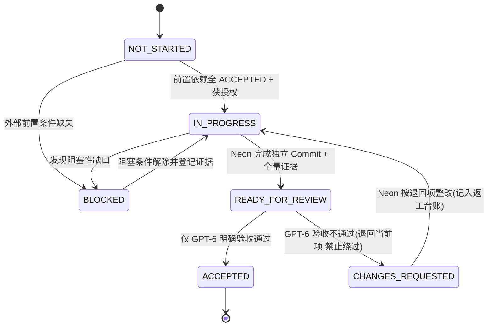
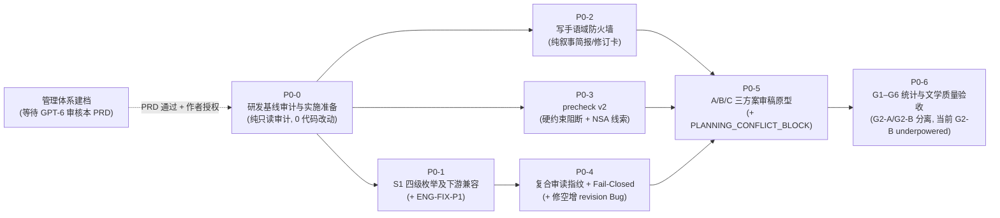

# R3 审核体系 v3 · P0 受控研发实施管理 PRD

> **文档版本**：`P0-PRD v1.0.1 (GPT-6 ACCEPTED · 2026-11-26 · 审核基线 e52105ad)`  
> **所属分支**：`feat/r3-p0-controlled`（基于 `feat/r3-migration` @ `b5572a943f9157cda07faa7910dcbfd20b1a3ba5`；初始化 Commit `95b0951d021eddf5d23a1710944550ccc38ca1ff` [GitHub 提交时间 `2026-11-25T17:12:50Z`]；`v1.0.1` 内容修订 Commit `a12774f50956c5081252fe1722333893331ded5e` [GitHub 提交时间 `2026-11-25T17:23:04Z`]；元数据追溯补齐及验收基线 Commit `e52105adca3f994fca3cbdeef9aa935479ceaf9b` [GitHub 提交时间 `2026-11-25T17:44:23Z`]，*均非实际研发开始时间*）  
> **架构冻结基线**：`docs/r3/review-v3/` `v1.2.3 (Freeze-Ready Final)`（PR #3 Merge Commit `b5572a943f9157cda07faa7910dcbfd20b1a3ba5`）；全仓库长期上下文见 [`docs/PROJECT-CONTEXT.md`](../../PROJECT-CONTEXT.md)  
> **实施授权状态**：**本管理 PRD `v1.0.1` 已于 `2026-11-26` 基于审核基线 `e52105ad` 获 GPT-6 最终验收（`ACCEPTED`），管理 PRD 正式冻结。特别注意：管理 PRD 验收通过不代表 `P0-0` 已获得启动授权；`P0-0` ~ `P0-6` 全部继续保持 `NOT_STARTED`，严禁未经作者单独授权擅自开始编码、修改 Skill/R2/测试或开展新的小说实验。**

---

## 一、架构冻结约束与权威引用

本实施 PRD 严格服从已合并冻结的 `v1.2.3` 架构文档（`docs/r3/review-v3/`），**仅细化日常实施管理、文件边界、测试执行与验收治理，绝不重新设计已冻结架构，绝不降低任何工程或统计学验收标准**：

| 冻结架构文档（只读，禁止修改） | 对 P0 实施的强制约束 |
|---|---|
| [`03-R3审核体系v3总体架构设计.md`](../review-v3/03-R3审核体系v3总体架构设计.md) | 写手语域防火墙规范（2.1 节）；A/B/C 三方案对照架构与防 Pass 1 漏检四重兜底（议题 1）；不预设双阶段必胜；严禁向写手透传治理词/限时压迫词 |
| [`04-四层审核生命周期与状态流转图.md`](../review-v3/04-四层审核生命周期与状态流转图.md) | L1 单章创作与审核闭环流转（含 `precheck v2` 仅文件破损与作者显式硬约束阻断、不空增 `revision`、`PLANNING_CONFLICT_BLOCK` 分流） |
| [`06-审核修复复审及版本失效协议.md`](../review-v3/06-审核修复复审及版本失效协议.md) | `PrecheckV2Output` 契约、五元组 `reviewFingerprint`、`Pass1DiscoveryReport` 与 `FinalCalibrationReport` 契约、Fail-Closed（exit code 2）、S1 四级枚举、`impactScope` 硬拦截与 `OR6` 终极分层 |
| [`07-P0-P1-P2开发任务与依赖关系.md`](../review-v3/07-P0-P1-P2开发任务与依赖关系.md) | `P0-1` ~ `P0-6` 既定架构范围、依赖拓扑与“明确不做”红线（本次仅前置增加 `P0-0` 实施准备阶段，**不改变 `P0-1` ~ `P0-6` 的冻结任务定义**） |
| [`08-工程效率与文学质量双重验收方案.md`](../review-v3/08-工程效率与文学质量双重验收方案.md) | Track E（E1/E2/E5）与 Track L（G1–G6 完整样本三元组 `$N_{\text{ch}}/N_{\text{case}}/K_{\text{rep}}$`、**`G2-A` 与 `G2-B` 严格分离且 `G2-B` 当前保持 `underpowered` 标记**、章节级聚类 Bootstrap 95% CI、二次加权 Kappa $\kappa_w \ge 0.85$、阶段二多评委绝对一致性 `ICC` 与无空白三带裁决） |

**全阶段不可突破红线**：
1. **R2 零破坏**：严禁改动既有 R2 项目状态机、门禁语义与历史报告读取兼容性。
2. **禁止擅改生产主模板**：在 `P0-6` 经 GPT-6 验收通过并获作者准入批准前，`P0-5` 原型严禁替换 `references/v3/review-agent-template.md` 或主流程 Skill 路由。
3. **G2 严禁混算与 `underpowered` 诚实保留**：`G2-A Regression/Calibration` 与 `G2-B Independent Holdout` 必须严格分轨报告原始 `TP / FP / FN / TN`、Precision、FPR 与章节级聚类 Bootstrap 95% CI；**历史校准集通过 ≠ 独立 Holdout 通过**；`G2-B` 当前处于 **`underpowered`（0/20 章、0/60 案例，缺口 `+20 章 / +60 案例`）**，未补齐独立未见样本并独立过线前绝不降低门槛或包装为通过。
4. **反虚报分层**：严禁把自动化单测通过描述为“文学质量提升”，严禁将测试集 Precision 外推生产，严禁将 G6 有限预算工程准入筛查宣称为统计学证明生产召回率 90%。

---

## 二、验收权限、状态机与提交治理规则

### 1. 标准任务状态枚举（仅限以下 6 态）

| 状态 | 含义 | 允许设置角色 | 允许流转的下一状态 |
|---|---|---|---|
| `NOT_STARTED` | 尚未启动（等待前置依赖全部 `ACCEPTED` 及授权） | 初始态 | `IN_PROGRESS` / `BLOCKED` |
| `IN_PROGRESS` | 正在实施（仅当所有前置依赖均已 `ACCEPTED`） | Neon | `READY_FOR_REVIEW` / `BLOCKED` |
| `READY_FOR_REVIEW` | 实施与自测完成，已独立提交 Commit 并附齐证据，提交 GPT-6 验收 | **Neon（Neon 最高权限状态）** | `ACCEPTED` / `CHANGES_REQUESTED` / `BLOCKED` |
| `CHANGES_REQUESTED` | GPT-6 验收未通过，明确列出缺陷并退回整改 | **GPT-6** | `IN_PROGRESS` / `BLOCKED` |
| `ACCEPTED` | GPT-6 明确审核验收通过，允许解锁依赖本任务的下游任务 | **仅限 GPT-6（严禁 Neon 自行设置）** | 终态（仅重大回归事故由作者/GPT-6 重新打开） |
| `BLOCKED` | 命中硬前置阻塞（如 `G2-B` 独立样本未就绪导致 `underpowered`） | Neon（申报）/ GPT-6 / 作者 | `IN_PROGRESS`（仅当解除阻塞条件满足并记录） |

### 2. 四条刚性研发纪律
1. **单向验收权限**：**Neon 只能将任务提交为 `READY_FOR_REVIEW`，绝不得自行宣布验收通过或将状态置为 `ACCEPTED`。** `ACCEPTED` 只能在 **GPT-6 明确验收通过**后设置。
2. **一任务一独立 Commit**：每项任务（`P0-0` ~ `P0-6`）必须对应独立 Git Commit（若发生 `CHANGES_REQUESTED` 返工，整改提交亦须单独记录并与原任务绑定），**严禁将多个未验收任务混在同一个 Commit 中**。
3. **证据强制完备**：提交 `READY_FOR_REVIEW` 时，必须同时在本文“10. 实际证据记录”与 [`P0-Progress-Log.md`](./P0-Progress-Log.md) 登记：① 完整 40 位 Commit SHA；② `git diff --stat` 与关键 Diff 摘要；③ 实际运行的测试命令、原始通过/失败数与关键断言输出；④ 边界核验（确认未改动任何“禁止修改的文件”）。
4. **退回不可绕过**：当 GPT-6 给出 `CHANGES_REQUESTED` 时，**必须立即停止推进下游任务并退回当前任务整改复审**，直至 GPT-6 复审给出 `ACCEPTED`，绝不允许绕过验收继续下一项。

---

## 三、P0 实施依赖关系总图

---

## 四、逐项完整实施任务定义（`P0-0` ~ `P0-6`）

---

### 任务 `P0-0`：研发基线审计与实施准备

> **定位声明**：`P0-0` 为本次新增的实施准备与基线对齐阶段，**零生产代码改动，绝不改变已冻结架构文档（`07`）中 `P0-1` ~ `P0-6` 的任务定义**。

#### 1. 任务目标
在写下第一行 P0 生产代码之前，100% 摸清 `feat/r3-p0-controlled` 基线（`feat/r3-migration` @ `b5572a94`）的真实代码现状、自动化测试基线、与本地未合入实验分支（`feat/r3-phase1-throughput-o1-o3` @ `c0966b1`）的脚本差异、全仓 S1 严重级别下游消费者清单，以及离线验证集（特别是 `G2-B Independent Holdout` 当前 `underpowered` 缺口）的真实可获得情况，输出可供 `P0-1` ~ `P0-6` 精确引用的只读基线审计报告。

#### 2. 前置依赖
- 本实施管理 PRD（`docs/r3/p0-implementation/` 三份文档）经 **GPT-6 审核通过**；
- 作者明确下达 **`P0-0` 启动授权**。

#### 3. 具体实施步骤
1. **代码与分支基线核验**：确认 `HEAD` 指向 `feat/r3-p0-controlled` 且父基线为 `feat/r3-migration` @ `b5572a943f9157cda07faa7910dcbfd20b1a3ba5`；逐文件盘点 `scripts/`、`tests/`、`references/v3/`、`SKILL.md` 的真实存在清单。
2. **与本地 Phase 1 实验分支只读差异审计**：只读比对 `b5572a94` 与 `feat/r3-phase1-throughput-o1-o3` (`c0966b1`)，明确标注 `build_chapter_brief.mjs`、`build_review_pack.mjs`、`precheck_chapter.mjs`、`r3_atomic_ops.mjs`、`r3_telemetry.mjs` 等实验脚本当前未在主基线中的精确状态，形成“哪些由 `P0-2`/`P0-3`/`P0-4`/`P0-5` 按冻结协议新建或受控重构、绝不整枝盲目合入”的逐项清单。
3. **固化基线自动化测试**：在零修改状态下运行仓库全部既有 Node 测试（`tests/r3-routing.test.mjs`、`scripts/tests/*.test.mjs`）与 Python 测试（`test_snapshot.py`、`test_webnovel_knowledge.py`），记录精确测试总数、通过数、命令与输出日志，作为后续所有任务“R2/既有基线零回归”的对比基准。
4. **S1 枚举下游消费者只读普查**：全仓 `rg` 扫描 `BLOCKER`、`MAJOR`、`MINOR`、`severity`、`mustClose`、`blocking` 等字段在全部脚本、测试与文档中的读取/校验点，形成 `P0-1` 兼容改造精准清单。
5. **离线验证集与 `G2-B` 缺口清册**：核实既有历史校准集（`G1` `N_ch=9, N_pos=40` + 7 章回归；`G2-A` `N_ch=9, N_neg=33`）的本地归档路径与完整性；逐项核实并记录 **`G2-B Independent Holdout` 当前 `underpowered` 状态（`0/20` 章、`0/60` 案例，缺口 `+20 章 / +60 案例`）**、禁入退役章节黑名单（`NH-1..5`、`V22-H1..4` 及全部历史校准章）以及 `G6`（`12–16` 章）的待补样计划。
6. **落盘审计报告并更新进度日志**：输出只读审计报告，更新 `README.md` 与 `P0-Progress-Log.md`，独立提交 Commit 并将状态置为 `READY_FOR_REVIEW`。

#### 4. 允许修改的文件
- 仅限 `docs/r3/p0-implementation/` 下文档：
  - 新增 `docs/r3/p0-implementation/P0-0-Baseline-Audit-Report.md`
  - 更新 `docs/r3/p0-implementation/README.md`
  - 更新 `docs/r3/p0-implementation/P0-Implementation-PRD.md`（仅限填写本任务“10. 实际证据记录”与“11. GPT-6 验收状态”）
  - 更新 `docs/r3/p0-implementation/P0-Progress-Log.md`

#### 5. 禁止修改的文件
- **一切非 `docs/r3/p0-implementation/` 路径的文件**，包括但不限于：`scripts/**`、`tests/**`、`SKILL.md`、`references/**`、`.github/workflows/**`、`docs/r3/review-v3/**`、任何 R2 文件及任何历史实验数据文件。

#### 6. 交付物
1. `docs/r3/p0-implementation/P0-0-Baseline-Audit-Report.md`（含：基线文件清册、与 `c0966b1` 差异表、全量基线测试实测日志、全仓 S1 消费者清单、G1/G2-A/G2-B/G3/G4/G5/G6 样本就绪度与 `G2-B underpowered` 缺口清册）。
2. `P0-0` 独立 Commit（仅含 `docs/r3/p0-implementation/` 变更）与 `P0-Progress-Log.md` 登记记录。

#### 7. 测试用例
- **TC-P0-0-1（既有 Node 测试基线全跑）**：执行仓库现有全部 Node 测试脚本，确认 100% 通过并记录精确用例数。
- **TC-P0-0-2（既有 Python 测试基线全跑）**：执行 `python3 -m unittest discover -s scripts/tests -p 'test_*.py'`，确认 100% 通过并记录精确用例数。
- **TC-P0-0-3（零代码污染校验）**：执行 `git diff --name-only b5572a94..HEAD`，断言除 `docs/r3/p0-implementation/` 外修改文件数为 `0`。

#### 8. 明确的通过条件
1. 审计报告完整覆盖步骤 1–5 全部 5 项内容，无遗漏、无臆测（所有事实均附命令行实测输出或精确文件路径/行号）。
2. 既有 Node 与 Python 基线测试 100% 通过，精确基线通过数已固化留痕。
3. 明确列出 `G2-B` 当前 `underpowered` 精确缺口（`+20` 全新独立章节、`+60` 独立案例）与禁入旧章黑名单。
4. `git diff` 证明 0 生产代码/Skill/R2/测试/冻结文档改动。
5. **经 GPT-6 明确审核并给出 `ACCEPTED`**。

#### 9. 失败及回滚方案
- 本任务为纯文档审计，无代码副作用；若审计报告存在事实遗漏、统计口径偏差或误改非允许目录文件：
  - 对误改非允许目录文件：立即 `git checkout b5572a94 -- <path>` 还原；
  - 对审计缺陷：按 GPT-6 `CHANGES_REQUESTED` 意见在 `P0-0` 范围内补测修订并提交补充 Commit，严禁绕过启动 `P0-1`/`P0-2`/`P0-3`。

#### 10. 实际证据记录
| 证据项 | 当前记录 |
|---|---|
| **独立 Commit SHA** | 原始 `P0-0` 提交：`86cbc9f3ad37c635f134eeea2a89317d5eef0a3c`（`02:58:13Z`）； `RW-P0-0-001`：`9747e146e016155055b928d7a664650cb76def5c`、`8ac888fce42070855241d2f17d05691b3afce709`； `RW-P0-0-002`：`52dd599b1e30ee3a76c682bf9ec86056e16ded10`（`05:26:25Z`）； `RW-P0-0-003`：`27f5cdc06ab90a30daf2658ae32c2d637d59e710`（`05:57:24Z`）； `RW-P0-0-004`（全文本格式扫描、可复算资格计数与 G4 `underpowered` 修正）独立提交见 [`P0-Progress-Log.md`](./P0-Progress-Log.md) 与 Issue #4 回复（前置基线 `2d6061d6cd0e8b4b2da77619cb58239c44dc332e`） |
| **修改文件与 Diff 摘要** | 仅限 `docs/r3/p0-implementation/` 下 6 份文档与逐文件清单（更新 `P0-0-Baseline-Audit-Report.md`、`P0-Progress-Log.md`、`P0-Implementation-PRD.md`、`README.md`，升级 16 列 `P0-0-C3-Full-File-Manifest.tsv` [2,723 行, `939,021` B `< 1 MB`] 与 `P0-0-C3-Repo-Manifest.tsv` [293 行]）；0 生产代码/Skill/R2/测试/冻结架构/实验分支改动 |
| **测试命令与结果（Neon 本地实测证据，GPT-6 未独立复跑）** | ① R3 `node --test`（7 文件）：**`71/71`** 通过（exit `0`）； ② V3/R2 独立 `node` 脚本（10 文件）：**`10/10`** 全绿（exit `0`）； ③ Python `unittest`（2 文件）：**`12/12`** 通过（`0.956s`，exit `0`）； ④ 附录 C.2 完整性校验实跑 `exit 0`（18 核心 + 62 引用全过）；附录 C.3 通用全文本扫描与 Manifest 复算对账实跑 `exit 0`（`REPO` 286 已扫+7 媒体 / `ART_ROOT` 2,574 已扫+64 媒体+85 VCS，`computed_eligible_g2b=0`、`computed_eligible_g6=0`、`total_unresolved=0`，负向断言非零退出）； *边界明示：上述 Node/Python 测试及本地 `<ART_ROOT>` 脚本输出均为 Neon 本地实测证据，GPT-6 未独立复跑且未访问本地 `<ART_ROOT>`* |
| **审计报告与逐文件清单路径** | [`P0-0-Baseline-Audit-Report.md`](./P0-0-Baseline-Audit-Report.md) ｜ [`P0-0-C3-Full-File-Manifest.tsv`](./P0-0-C3-Full-File-Manifest.tsv) ｜ [`P0-0-C3-Repo-Manifest.tsv`](./P0-0-C3-Repo-Manifest.tsv) |

#### 11. GPT-6 验收状态
- **当前状态**：**`READY_FOR_REVIEW`**（响应 Issue #4 `2026-11-26T06:05:07Z` 第四轮 `CHANGES_REQUESTED` 完成 `RW-P0-0-004` 全部三项整改并重提）
- **GPT-6 验收结论**：`PENDING`（等待 GPT-6 独立验收；验收通过前严禁推进 `P0-1`）
- **审核时间与意见**：`2026-11-26T06:05:07Z` 第四轮复审通过 Git 边界与 Manifest 结构，要求补齐全部可读文本扫描并隔离二进制媒体/VCS、改用 Manifest 复算 G2-B/G6 资格计数、按冻结 `08` 独立章节口径将 G4 正式标为 `underpowered`（`N_ch=3 < 8`）；现已全部补齐重提

---

### 任务 `P0-1`：S1 四级枚举及下游兼容（含 `ENG-FIX-P1`）

> **对应冻结架构**：[`06`](../review-v3/06-审核修复复审及版本失效协议.md) 三.1 节、[`07`](../review-v3/07-P0-P1-P2开发任务与依赖关系.md) `P0-1`、[`08`](../review-v3/08-工程效率与文学质量双重验收方案.md) E1 & G5。

#### 1. 任务目标
在正式代码库中落地 S1 四级严重程度枚举（`BLOCKER` / `MAJOR` / `MINOR` / **`SUGGESTION`**）与 `ENG-FIX-P1` 遗留字段校验修复，确保 **`SUGGESTION` 永不阻断单章通过且 0% 进入必改闭环**，同时保证既有 R2 三级历史报告与所有下游消费者 100% 向后兼容、零行为破坏。

#### 2. 前置依赖
- `P0-0` 状态为 **`ACCEPTED`**（且已产出全仓 S1 消费者清单与固化基线测试数）。

#### 3. 具体实施步骤
1. 依据 `P0-0` 产出的 S1 下游消费者清单，逐一核对枚举定义与解析入口（`r2_review_common.mjs`、`r3_p1_common.mjs`、`v3_gate.mjs`、`submit_pilot_review.mjs`、`r3_feedback_view.mjs` 及其他命中脚本）。
2. 在 R3/共享校验模块扩展 S1 四级枚举，正式纳入 `SUGGESTION`：
   - `BLOCKER`：`blocking = true`、`mustCloseInReReview = true`、`reverseDefense` 必填；
   - `MAJOR`：`blocking = true`、`mustCloseInReReview = true`、`reverseDefense` 必填；
   - `MINOR`：`blocking = false`、`mustCloseInReReview = false`、`reverseDefense` 可选；
   - `SUGGESTION`：`blocking = false`（永不阻断）、`mustCloseInReReview = false`（0% 进必改闭环）、`reverseDefense` 非必填；若报告误将 `SUGGESTION` 标为 `blocking: true` 或 `mustCloseInReReview: true`，校验器强制报错拒收或按协议硬拦截。
3. 修复 `ENG-FIX-P1` 已知字段校验遗留问题（以 `P0-0` 基线审计清单中核实的精确遗留项为准），确保不破坏旧三级历史报告的只读解析与门禁判定。
4. 编写新读旧（旧三级历史报告在新校验器下无回归）与旧容新（含 `SUGGESTION` 的新四级报告在全部下游消费者及门禁脚本中不崩、不误阻断）双向兼容自动化测试。
5. 全量运行既有 Node + Python 回归测试及新增单测，登记完整证据并独立提交 Commit，置状态为 `READY_FOR_REVIEW`。

#### 4. 允许修改的文件
- `scripts/r3_p1_common.mjs`、`scripts/r3_p1.mjs`、`scripts/r3_feedback_view.mjs`、`scripts/v3_gate.mjs`、`scripts/submit_pilot_review.mjs`
- `scripts/r2_review_common.mjs`（**仅限向后兼容的共享枚举/只读解析扩展，严禁改变任何 R2 既有行为与旧三级判定逻辑**）
- 对应单元测试：`scripts/tests/r2_review.test.mjs`（仅追加兼容断言，不删改旧断言）、`scripts/tests/v3_gate.test.mjs`、新增 `scripts/tests/r3_s1_severity_compat.test.mjs`
- 管理记录：`docs/r3/p0-implementation/{README.md,P0-Implementation-PRD.md,P0-Progress-Log.md}`

#### 5. 禁止修改的文件
- `docs/r3/review-v3/**`（冻结架构文档）
- `SKILL.md`、`references/**`（写手/审稿生产模板与 Skill 路由）
- `.github/workflows/**`
- `scripts/r2_review.mjs` 的既有 R2 门禁决策分支及任何既有测试断言的削弱/删除
- 任何 P1/P2 模块或历史实验基线数据

#### 6. 交付物
1. 支持 S1 四级枚举且向后兼容 R2 三级历史报告的校验与下游消费实现（含 `ENG-FIX-P1` 修复）。
2. 全仓 S1 消费者兼容性验证测试套件 `scripts/tests/r3_s1_severity_compat.test.mjs`。
3. 独立 Commit（仅限 `P0-1`）与完整回归日志证据。

#### 7. 测试用例
- **TC-P0-1-1（`SUGGESTION` 零阻断）**：仅含 `MINOR` 与 `SUGGESTION` 的四级审稿报告通过校验，判定为非阻断通过、`mustCloseInReReview` 计数为 `0`。
- **TC-P0-1-2（`SUGGESTION` 越权阻断硬拒绝）**：故意将 `SUGGESTION` 设置 `blocking: true` 或 `mustCloseInReReview: true`，校验器拒绝落盘（非零退出码）。
- **TC-P0-1-3（双向兼容）**：① 用新解析器读取真实 R2 三级历史报告夹具，解析与门禁结果与基线 100% 等价；② 将含 `SUGGESTION` 的报告喂入全部下游消费者（`v3_gate`、`r3_feedback_view`、`r3_p1`、`submit_pilot_review`），零崩溃、零误阻断。
- **TC-P0-1-4（`ENG-FIX-P1` 回归）**：覆盖全部已知 P1 遗留字段校验边界用例，100% 精准命中。
- **TC-P0-1-5（全量基线零回归）**：既有全部 Node 与 Python 自动化测试 100% 通过。

#### 8. 明确的通过条件
1. 对应 `08` 文档 **E1**：原有基线全部 Node 与 Python 回归测试 100% 通过（0 跳过、0 删改旧断言）。
2. `TC-P0-1-1` ~ `TC-P0-1-5` 全部 100% 通过，`SUGGESTION` 触发阻断率 `= 0%`、进入必改闭环率 `= 0%`。
3. 所有变更严格位于允许文件列表内，R2 既有行为零变化。
4. 独立 Commit 与全量证据已入日志，并获 **GPT-6 明确 `ACCEPTED`**。

#### 9. 失败及回滚方案
- 若任一下游消费者出现枚举解析异常或 R2 既有测试失败：立即停止提交；如已提交本地/远端分支，使用 `git revert <P0-1_commit_sha>` 原子回滚该独立 Commit（不重写历史），退回分析根因后重新提交。

#### 10. 实际证据记录
| 证据项 | 当前记录 |
|---|---|
| **独立 Commit SHA** | `待实施` |
| **修改文件与 Diff 摘要** | `待实施` |
| **测试命令与结果** | `待实施` |
| **下游消费者兼容核验表** | `待实施` |

#### 11. GPT-6 验收状态
- **当前状态**：`NOT_STARTED`
- **GPT-6 验收结论**：`NOT_SUBMITTED`
- **审核时间与意见**：`—`

---

### 任务 `P0-2`：写手语域防火墙

> **对应冻结架构**：[`03`](../review-v3/03-R3审核体系v3总体架构设计.md) 议题 2（2.1 节）、[`07`](../review-v3/07-P0-P1-P2开发任务与依赖关系.md) `P0-2`、[`08`](../review-v3/08-工程效率与文学质量双重验收方案.md) E5。

#### 1. 任务目标
实现创作层与治理层的彻底语域隔离：提供确定性编译脚本，将结构化规划/账本/审稿返工信息翻译为**纯叙事写手任务卡（Writer Brief）**与**纯叙事修订卡（Revision Card）**，确保写手上下文中 **0 次出现**治理元数据（`SHA-256`、`schemaVersion`、`reverseDefense`、门禁码、工程 ID 标签 `[F-012 | ch2 | established]`、`BLOCKER`、`pass_candidate`）及任何限时催促词，并严格按已冻结架构 `03` 第 2.1 节锁定写手任务卡末尾先后顺序：① **倒数第二部分为本书文风锚点示范（紧邻上章结尾之前）**；② **最后一部分（最末位）为上一章结尾原文（500–900 字）**。

#### 2. 前置依赖
- `P0-0` 状态为 **`ACCEPTED`**（已明确 `build_chapter_brief.mjs` 在主基线中的存在/重建方案）。

#### 3. 具体实施步骤
1. 实现写手任务卡纯叙事编译器（如 `scripts/build_writer_brief.mjs` 或按 `P0-0` 审计确认的模块名）：
   - 读取人物状态、章节细纲、核心数字底账、上一章结尾原文（500–900 字）与 `03-文风基准.md` 示范段；
   - 自动剥离所有工程 ID 标签（如 `[F-012 | ch2 | established]`）、SHA 哈希、JSON Schema 字段名、门禁状态码与审稿内部状态；
   - **强制段序校验**：任务卡末尾两个区块必须严格依次为**倒数第二部分“本书文风锚点示范”**与**最后一部分（最末位）“上一章结尾原文（500–900 字）”**，确保写手动笔前最后读到的 100% 为正文语态中文。
2. 实现返工纯叙事修订卡编译器（如 `scripts/build_revision_card.mjs` 或集成至防火墙公共模块）：
   - 仅提取 `preserveStrengths`（必须守住的亮点原句）与需修阻断项的 `narrativeGuidance`（纯自然语言剧情/逻辑修订方向）；
   - **硬剥离并断言禁出**：绝不透传原始审稿 JSON、`reverseDefense`、`issueIdentityKey`、`reviewFingerprint`、`BLOCKER`/`MAJOR` 工程标签及任何限时催促语句。
3. 内建自动化语域纯净度断言函数（`assertWriterContextPurity(text)`），作为测试与编译期 Fail-Closed 防线（若编译产物意外泄漏任一禁用治理词或限时催促词，直接抛错拒产）。
4. 编写完整单元测试（含真实含污染源数据的清洗测试、末段位置断言、限时词拦截测试与全量既有测试回归），独立提交 Commit 并置为 `READY_FOR_REVIEW`。

#### 4. 允许修改的文件
- 新增写手语域防火墙编译模块（如 `scripts/r3_writer_firewall.mjs`、`scripts/build_writer_brief.mjs`、`scripts/build_revision_card.mjs`，精确文件名以 `P0-0` 审计确认为准）
- 新增对应测试：`scripts/tests/r3_writer_firewall.test.mjs`
- 管理记录：`docs/r3/p0-implementation/{README.md,P0-Implementation-PRD.md,P0-Progress-Log.md}`

#### 5. 禁止修改的文件
- `docs/r3/review-v3/**`（冻结架构文档）
- `SKILL.md`、`references/**`（**本阶段不提前切换生产 Skill 模板**）
- 任何 R2 脚本与测试、`.github/workflows/**`、历史实验基线文件

#### 6. 交付物
1. 写手语域防火墙核心模块（纯叙事任务卡编译 + 纯叙事修订卡编译 + 语域纯净度 Fail-Closed 校验器）。
2. 自动化测试套件 `scripts/tests/r3_writer_firewall.test.mjs`（含正反测试夹具）。
3. 独立 Commit（仅限 `P0-2`）与测试证据。

#### 7. 测试用例
- **TC-P0-2-1（禁用治理词汇零泄漏）**：输入故意混入 `SHA-256`、`schemaVersion`、`reverseDefense`、`R2_`、`R3_`、`BLOCKER`、`pass_candidate`、`[F-012 | ch2 | established]` 的账本与审稿报告，验证编译产出的写手简报与修订卡正则扫描命中数严格等于 **`0`**。
- **TC-P0-2-2（限时压迫词零出现）**：验证简报与修订卡中不含任何“5分钟/限时/赶工/倒计时/尽快写完”等时间压迫词（命中 `= 0`），且防火墙对人为注入限时词触发硬拒绝。
- **TC-P0-2-3（末段正文语态强约束）**：验证编译输出的写手任务卡最后两个区块严格依次为“倒数第二部分：本书文风锚点示范”与“最后一部分（最末位）：上一章结尾原文（500–900 字）”。
- **TC-P0-2-4（硬事实不丢失）**：验证清洗工程标签后，章节关键人物、时间、物品数量等自然语言底账 100% 保留，未因过滤误删故事事实。
- **TC-P0-2-5（`preserveStrengths` 保留与 `reverseDefense` 剥离）**：验证修订卡 100% 保留全部 `preserveStrengths` 原句，同时 0 字符泄露 `reverseDefense`。

#### 8. 明确的通过条件
1. 对应 `03` 2.1 节 & `08` 文档 **E5**：写手简报与修订卡中治理词汇与限时催促词出现次数严格等于 **`0`**；写手简报末尾两个区块 **100%** 严格按“倒数第二部分：本书文风锚点示范 → 最后一部分（最末位）：上一章结尾原文（500–900 字）”纯正文语态排列。
2. 全部新增单测（`TC-P0-2-1` ~ `TC-P0-2-5`）与全量既有 Node + Python 回归测试 100% 通过；单章编译耗时 `< 200ms`。
3. 未修改任何禁止文件，独立 Commit 与证据齐全，并获 **GPT-6 明确 `ACCEPTED`**。

#### 9. 失败及回滚方案
- 若编译清洗过度导致事实丢失，或正则漏过治理/限时词：退回修改清洗规则与断言词表；若已提交则通过 `git revert <P0-2_commit_sha>` 原子回滚，不影响其他已验收任务。

#### 10. 实际证据记录
| 证据项 | 当前记录 |
|---|---|
| **独立 Commit SHA** | `待实施` |
| **修改文件与 Diff 摘要** | `待实施` |
| **测试命令与结果** | `待实施` |
| **样本简报/修订卡脱敏输出摘要** | `待实施` |

#### 11. GPT-6 验收状态
- **当前状态**：`NOT_STARTED`
- **GPT-6 验收结论**：`NOT_SUBMITTED`
- **审核时间与意见**：`—`

---

### 任务 `P0-3`：`precheck v2`

> **对应冻结架构**：[`06`](../review-v3/06-审核修复复审及版本失效协议.md) 第一节（1.1–1.2）、[`07`](../review-v3/07-P0-P1-P2开发任务与依赖关系.md) `P0-3`、[`05`](../review-v3/05-全书机械诊断引擎PRD.md) 一.2 节防误判原则。

#### 1. 任务目标
实现 `scripts/precheck_chapter.mjs`（`PrecheckV2Output` `schemaVersion: 2`），在 `< 0.25s/章`、零 LLM Token 下完成三分类确定性预检：
1. **`hardErrors`（唯一允许阻断送审）**：仅限**工程文件破损**（不存在/0 字节/非法编码或二进制污染/未经 `retcon` 篡改已定稿文件）与**作者在 `02-写作计划.json` `hardConstraints` 中显式配置的硬约束**（`mustInclude`、`mustExclude`、显式开启的 `enforceMinWords: true` 等）。
2. **`softWarnings`（默认永不阻断）**：字数偏离、整段重复候选（复用 `check_repetition.mjs`）、引号不配对候选（**必须内建中文跨段多段引语白名单**）、正文圆括号、高频突发副词、超长分号句——**严禁为死磕字数牺牲内容完整性**。
3. **`needsSemanticAudit`（不阻断写手，强制审稿核销）**：自动提取日期/时辰差、账目/金额/数量变动、证物/道具编号序列、硬约束中的 `need_semantic_audit` 条款、高潮动作段标记与信息差敏感词，生成带 `auditId`、`category`、`anchorQuote`、`paragraphIndex`、`hint` 的结构化线索。

#### 2. 前置依赖
- `P0-0` 状态为 **`ACCEPTED`**。

#### 3. 具体实施步骤
1. 实现 `scripts/precheck_chapter.mjs`（v2）及纯逻辑子模块（复用 `scripts/chapter_wordcount_common.mjs`、`scripts/check_repetition.mjs`、`scripts/r3_structured_checks.mjs`，不破坏原脚本 CLI 兼容）。
2. 实现严格 `hardErrors` 准入开关：默认状态下字数、重复段落、引号异常均不进 `hardErrors`；仅读取作者显式配置的 `hardConstraints` 时按配置执行硬拦截；且支持 `--dry-run` 仅输出 JSON 报告、**绝对零修改账本或递增 `revision`**。
3. 实现中文跨段多段引语白名单（长独白/书信分段引用中，前段仅有开引号 `“` / `「`、末段闭合 `”` / `」` 视为合法排版，零误报）。
4. 实现 `needsSemanticAudit` 六类语义线索提取器，重点确保能够 100% 抽出历史经典漏检锚点模式（如 `V22-H4` 日期差 `廿六 - 廿三 = 两日` 与 `3000 引` 账目守恒、`OLD-HOLD-1` `16 灵碎` 算术、`V22-H3` 空间/信息差线索）。
5. 编写全覆盖单元测试并实测单章耗时，独立提交 Commit 并置为 `READY_FOR_REVIEW`。

#### 4. 允许修改的文件
- 新增 `scripts/precheck_chapter.mjs`（及必要只读辅助模块如 `scripts/precheck_v2_common.mjs`）
- `scripts/r3_structured_checks.mjs`（仅允许向后兼容的纯函数导出扩展，不破坏既有调用）
- 新增测试：`scripts/tests/precheck_chapter_v2.test.mjs`
- 管理记录：`docs/r3/p0-implementation/{README.md,P0-Implementation-PRD.md,P0-Progress-Log.md}`

#### 5. 禁止修改的文件
- `docs/r3/review-v3/**`（冻结架构文档）
- `SKILL.md`、`references/**`、`.github/workflows/**`
- 任何 R2 脚本与既有测试断言、`scripts/check_repetition.mjs` / `scripts/chapter_wordcount_common.mjs` 的既有外部行为

#### 6. 交付物
1. `scripts/precheck_chapter.mjs`（完整实现 `06` 文档 `PrecheckV2Output` `schemaVersion: 2` 契约）。
2. 单元测试套件 `scripts/tests/precheck_chapter_v2.test.mjs`（含防误杀夹具与经典漏检锚点提取夹具）。
3. 独立 Commit（仅限 `P0-3`）与性能/测试实测日志。

#### 7. 测试用例
- **TC-P0-3-1（工程文件破损阻断）**：缺失文件、0 字节空稿、含非法空字节二进制污染 → 100% 进 `hardErrors` 且 `blocking: true`。
- **TC-P0-3-2（作者显式硬约束阻断）**：`hardConstraints` 配置 `mustInclude` 缺失、`mustExclude` 命中、或显式开启 `enforceMinWords: true` 且字数不足 → 100% 进 `hardErrors` 且 `blocking: true`；未配置时相同情况 `blocking: false`。
- **TC-P0-3-3（防机械误杀三专项）**：① 合法整段重复（时间循环/原文复引）；② 合规中文跨段多段引语（3 段连续书信前两段仅开引号、末段闭引号）；③ 紧凑章字数低于参考下限或略超软上限（未开硬约束）→ 100% **`blocking: false`**（0 误杀为硬伤或阻断）。
- **TC-P0-3-4（`NEEDS_SEMANTIC_AUDIT` 精准提取）**：构造对应 `V22-H4`（`九月廿三比原定廿六提前两日` + `3000 引` 账目）、`OLD-HOLD-1`（`16 灵碎` 数量变化）、`V22-H3`（道具编号/信息差/高潮动作段）测试夹具 → 100% 提取为带精确 `auditId`/`anchorQuote`/`paragraphIndex` 的 `needsSemanticAudit` 条目，且 `blocking: false`。
- **TC-P0-3-5（性能与零副作用）**：单章 5,000 字正文执行 `< 250ms`；运行前后项目目录零文件新增/修改。

#### 8. 明确的通过条件
1. 输出 JSON 100% 符合 `06` 文档 1.2 节 `PrecheckV2Output` 契约（`schemaVersion: 2`）。
2. `TC-P0-3-1` ~ `TC-P0-3-5` 与全量既有 Node + Python 回归测试 100% 通过。
3. 重复段、跨段引语、字数偏离在默认配置下 0% 误阻断；经典漏检算术/账目/日期线索 100% 提取；单章耗时 `< 250ms`。
4. 未修改禁止文件，独立 Commit 与证据齐全，并获 **GPT-6 明确 `ACCEPTED`**。

#### 9. 失败及回滚方案
- 若出现误杀合法中文跨段引语或误阻断字数，立即修复白名单逻辑；若已提交则通过 `git revert <P0-3_commit_sha>` 原子回滚。

#### 10. 实际证据记录
| 证据项 | 当前记录 |
|---|---|
| **独立 Commit SHA** | `待实施` |
| **修改文件与 Diff 摘要** | `待实施` |
| **测试命令与结果** | `待实施` |
| **单章耗时实测数据** | `待实施` |

#### 11. GPT-6 验收状态
- **当前状态**：`NOT_STARTED`
- **GPT-6 验收结论**：`NOT_SUBMITTED`
- **审核时间与意见**：`—`

---

### 任务 `P0-4`：复合审读指纹与 Fail-Closed

> **对应冻结架构**：[`06`](../review-v3/06-审核修复复审及版本失效协议.md) 第二节（2.1–2.3）、[`07`](../review-v3/07-P0-P1-P2开发任务与依赖关系.md) `P0-4`、[`08`](../review-v3/08-工程效率与文学质量双重验收方案.md) E2。

#### 1. 任务目标
在 R3 命名空间下实现**五元组复合审读指纹（`reviewFingerprint`）**与 **Fail-Closed 完备性硬校验**，并根治预检自修空增 `revision` 污染遥测的工程 Bug，同时 100% 保留原有 `manuscriptHashes` 与 R2 旧项目兼容语义。

#### 2. 前置依赖
- `P0-1` 状态为 **`ACCEPTED`**（依赖 S1 四级枚举契约）。

#### 3. 具体实施步骤
1. 实现五元组复合审读指纹计算与规范化函数（按 `06` 2.1 节）：
   - `reviewFingerprint = sha256(canonicalJson({ manuscriptSha256, planningSliceSha256, ledgerSliceSha256, hardConstraintsHash, protocolVersion: "r3-review-v3.0" }))`；
   - 仅写入 `v3.r3` 扩展字段，原 `manuscriptHashes` 结构与 R2 哈希验证语义 100% 不变。
2. 实现 Fail-Closed 审稿报告落盘校验内核（如 `scripts/r3_review_kernel.mjs` 或扩展审稿校验模块），满足任一缺项即 **硬拒绝落盘且返回 `exit code 2`**：
   - `reviewFingerprint` 与当前冻结快照不匹配（含正文、细纲、账本或硬约束任意 1 字节变化）；
   - 6 维 `dimensionAuditSlots`（`HL-1` ~ `HL-6`）任意 1 维缺失或 `checkedAnchor` 为空；
   - `precheck v2` 产出的 `needsSemanticAudit` 任意 1 条 `auditId` 未在 `semanticAuditResolutions` 中给出 `pass / issue_raised / insufficient_material`；
   - 任一 `issue` 或 `candidate` 的 `quote` 在冻结正文中无法逐字匹配（拦截模型伪造引文）；
   - 任一 `BLOCKER` / `MAJOR` 缺少非空 `reverseDefense` 或合法 `impactScope`（`draft_only | upstream_planning | finalized_canon`）。
3. 修复预检自修空增 `revision` Bug：
   - 当写手运行 `precheck --dry-run` 或送审命中 `hardErrors` 被确定性打回自修时，**严禁冻结并严禁递增 `revision`**；
   - 仅当通过确定性预检、正式冻结审稿包并生成 `reviewFingerprint` 时，才分配新 `revision`；有效返工轮次严格按实际提交通过校验的独立审稿报告计数。
4. 扩展故障注入测试（`scripts/tests/r3_faults.test.mjs` 或新增 `scripts/tests/r3_fingerprint_failclosed.test.mjs`），全量回归并独立提交 Commit，置为 `READY_FOR_REVIEW`。

#### 4. 允许修改的文件
- 新增/更新 R3 审读指纹与 Fail-Closed 内核模块（如 `scripts/r3_review_kernel.mjs`、`scripts/r3_manuscripts.mjs`、`scripts/r3_state_common.mjs`、`scripts/r3_p1_common.mjs`、`scripts/r3_p1.mjs`）
- 扩展/新增故障注入测试：`scripts/tests/r3_faults.test.mjs`（仅追加新故障注入用例，不删改旧用例）、新增 `scripts/tests/r3_fingerprint_failclosed.test.mjs`
- 管理记录：`docs/r3/p0-implementation/{README.md,P0-Implementation-PRD.md,P0-Progress-Log.md}`

#### 5. 禁止修改的文件
- `docs/r3/review-v3/**`（冻结架构文档）
- `SKILL.md`、`references/**`、`.github/workflows/**`
- 任何 R2 既有行为逻辑（`scripts/r2_review.mjs` 旧哈希验证分支）及既有旧测试断言

#### 6. 交付物
1. 五元组 `reviewFingerprint` 计算与校验内核 + Fail-Closed 完备性拒收器（`exit code 2`）。
2. 不空增 `revision` 的冻结与版本递进逻辑。
3. 全套故障注入自动化测试与回归报告，独立 Commit（仅限 `P0-4`）。

#### 7. 测试用例
- **TC-P0-4-1（规划/账本/硬约束篡改失配）**：正文不变，分别改动细纲 1 字节、前文账本 1 字节、`hardConstraints` 1 字节 → 提交旧指纹审稿报告 100% 触发 `fingerprint_mismatch` 拒绝落盘（`exit code 2`）。
- **TC-P0-4-2（漏 6 维取证槽拒收）**：删除 `dimensionAuditSlots` 中任意 1 维（如 `HL-6`）或置空 `checkedAnchor` → 100% 拒绝落盘（`exit code 2`）。
- **TC-P0-4-3（漏核销 `NEEDS_SEMANTIC_AUDIT` 拒收）**：少核销 1 条 `NSA-001` → 100% 拒绝落盘（`exit code 2`）。
- **TC-P0-4-4（伪造 `quote` 拒收）**：修改 `quote` 中 1 个字使其不在冻结正文中 → 100% 拒绝落盘（`exit code 2`）。
- **TC-P0-4-5（缺失 `reverseDefense` / `impactScope` 拒收）**：`BLOCKER`/`MAJOR` 缺任一必填字段 → 100% 拒绝落盘（`exit code 2`）。
- **TC-P0-4-6（预检自修 0 空增 `revision`）**：连续执行 3 次 `--dry-run` 与 2 次命中 `hardErrors` 预检失败后首次正式通过预检送审 → `revision` 严格为 `v1`（空增次数 `= 0`）。
- **TC-P0-4-7（R2 兼容零回归）**：既有 R2 `manuscriptHashes` 校验测试与全量 Node + Python 基线测试 100% 通过。

#### 8. 明确的通过条件
1. 对应 `08` 文档 **E2**：全部 6 类故障注入用例 **100% 拒绝落盘（`exit code 2`）**；预检自修 **0 次**空增 `revision`。
2. 指纹计算单章耗时 `< 30ms`；原 `manuscriptHashes` 与 R2 测试 100% 零回归。
3. 未修改禁止文件，独立 Commit 与证据齐全，并获 **GPT-6 明确 `ACCEPTED`**。

#### 9. 失败及回滚方案
- 若出现 R2 哈希回归或误拒合法报告：立即排查 `v3.r3` 命名空间隔离边界；如已提交则使用 `git revert <P0-4_commit_sha>` 原子回滚。

#### 10. 实际证据记录
| 证据项 | 当前记录 |
|---|---|
| **独立 Commit SHA** | `待实施` |
| **修改文件与 Diff 摘要** | `待实施` |
| **故障注入测试原始输出** | `待实施` |
| **全量回归结果** | `待实施` |

#### 11. GPT-6 验收状态
- **当前状态**：`NOT_STARTED`
- **GPT-6 验收结论**：`NOT_SUBMITTED`
- **审核时间与意见**：`—`

---

### 任务 `P0-5`：A/B/C 三方案审稿原型（含 `PLANNING_CONFLICT_BLOCK`）

> **对应冻结架构**：[`03`](../review-v3/03-R3审核体系v3总体架构设计.md) 议题 1（1.1–1.2）、[`06`](../review-v3/06-审核修复复审及版本失效协议.md) 二.2 & 三.2 节、[`07`](../review-v3/07-P0-P1-P2开发任务与依赖关系.md) `P0-5`、[`08`](../review-v3/08-工程效率与文学质量双重验收方案.md) 2.1.1 节。

#### 1. 任务目标
在**隔离原型目录**中完成 A / B / C 三种候选单章语义审稿架构的公平对照原型与 `PLANNING_CONFLICT_BLOCK` 硬分流机制（**不预设双阶段必胜，不提前替换任何生产主审稿模板**），三方案共享 `precheck v2`（`P0-3`）、`reviewFingerprint` 与 Fail-Closed 校验（`P0-4`）、6 维 `dimensionAuditSlots` 与 `PLANNING_CONFLICT_BLOCK` 底座，为 `P0-6` 离线统计裁决提供可复现、无归因混杂的实验原型。

#### 2. 前置依赖
- `P0-2`、`P0-3`、`P0-4` 三项任务均已处于 **`ACCEPTED`**。

#### 3. 具体实施步骤
1. 在隔离实验目录（如 `scripts/p0_prototypes/` 与 `references/v3/prototypes/`，绝不覆盖生产主模板）构建统一审稿包编译与报告协议适配层，严格实现 `06` 文档的 **`Pass1DiscoveryReport`** 与 **`FinalCalibrationReport`** 双契约。
2. 构建三个严格隔离、参数透明的审稿原型提示词模板与编排驱动：
   - **方案 A（Control · 增强单阶段完整审稿）**：生产底座 + v2.2 平权融合协议 + `precheck v2`（`NEEDS_SEMANTIC_AUDIT` 强制核销）+ 6 维最小取证槽 + `PLANNING_CONFLICT_BLOCK` → 单次调用直接产出 `FinalCalibrationReport`。
   - **方案 B（Two-Stage · Pass 1 开放发现 + Pass 2 独立轻量定级）**：
     - Pass 1：高召回宽口发现器（无 `OR1–OR7` 抑制负担，强制 6 维取证槽 + `NEEDS_SEMANTIC_AUDIT` 核销，产出 `Pass1DiscoveryReport`）；
     - Pass 2：独立轻量定级器（不读全章，仅读候选清单 + 每条前后 300 字原文 + 核心规划条款，执行 S1 四级定级、`OR1–OR7` 过滤、`reverseDefense`、`impactScope` 与 `PLANNING_CONFLICT_BLOCK` 分流，产出 `FinalCalibrationReport`）。
   - **方案 C（Hybrid · 单阶段完整审稿 + 独立轻量定级复核）**：
     - Stage 1：高召回偏置单阶段完整审稿；
     - Stage 2：仅对 Stage 1 产出的 `BLOCKER/MAJOR`、`planningConflictAdvisories` 及未闭合 `NEEDS_SEMANTIC_AUDIT` 执行独立轻量定级复核（**若 Stage 1 已判 `PASS` 且所有 `NEEDS_SEMANTIC_AUDIT` 均 `pass` 则短路跳过 Stage 2**）。
3. 实现 **`impactScope` 硬拦截与 `OR6` 终极分层**：
   - `impactScope = upstream_planning`（大纲自身客观数学/会计/空间/设定死锁）→ 工具硬拒绝混入写手改稿批，强制分流至 `PLANNING_CONFLICT_BLOCK`；
   - `impactScope = finalized_canon`（暴露已定稿章节事实错误）→ 工具硬拒绝静默覆写已定稿，强制分流至 `PLANNING_CONFLICT_BLOCK (retcon_required)`；
   - 大纲批准的合法创作桥段 → 归 `planningConflictAdvisories`（不阻断）。
4. 编写确定性协议与沙箱冒烟测试（使用 Mock 报告验证 A/B/C 数据流转、方案 C 短路路径、`impactScope` 硬拦截与 `PLANNING_CONFLICT_BLOCK` 分流），独立提交 Commit 并置为 `READY_FOR_REVIEW`。

#### 4. 允许修改的文件
- 隔离原型目录：
  - 新增 `scripts/p0_prototypes/**`（三方案编译/分流/协议验证与离线评测执行器）
  - 新增 `references/v3/prototypes/**`（方案 A / B / C 隔离原型模板）
- 新增测试：`scripts/tests/r3_p0_prototypes.test.mjs`
- 管理记录：`docs/r3/p0-implementation/{README.md,P0-Implementation-PRD.md,P0-Progress-Log.md}`

#### 5. 禁止修改的文件
- **`references/v3/review-agent-template.md`、`references/v3/r2-review-agent-template.md`、`references/v3/workflow.md`、`SKILL.md` 等任何生产主模板与主路由文件**
- `docs/r3/review-v3/**`（冻结架构文档）
- 任何 R2 文件、`.github/workflows/**` 及既有生产测试断言

#### 6. 交付物
1. 隔离沙箱内的 A / B / C 三方案完整原型（模板 + 驱动 + `Pass1DiscoveryReport` / `FinalCalibrationReport` 校验器 + `PLANNING_CONFLICT_BLOCK` 硬分流器）。
2. 确定性协议与短路/拦截单元测试 `scripts/tests/r3_p0_prototypes.test.mjs`。
3. 独立 Commit（仅限 `P0-5`）与边界核验日志（证明生产主模板零改动）。

#### 7. 测试用例
- **TC-P0-5-1（三方案统一输出契约）**：A / B / C 三个原型在模拟输出下均严格产出符合 `FinalCalibrationReport` 契约且通过 `P0-4` Fail-Closed 校验的报告。
- **TC-P0-5-2（方案 B 上下文隔离与取证槽）**：验证 Pass 2 输入包仅包含候选清单 + 前后 300 字原文 + 核心规划切片（不灌入全章全文），且 Pass 1 缺任一维度取证槽时被 Fail-Closed 拒收。
- **TC-P0-5-3（方案 C 短路机制）**：Stage 1 判 `pass_candidate` 且全部 `NEEDS_SEMANTIC_AUDIT` 为 `pass` → Stage 2 调用次数严格为 `0`；存在 `BLOCKER/MAJOR` 或异常核销项 → 强制触发 Stage 2。
- **TC-P0-5-4（`impactScope` 硬拦截与 `PLANNING_CONFLICT_BLOCK`）**：将 `impactScope = upstream_planning` 或 `finalized_canon` 条目尝试混入写手改稿批 → 工具硬拒绝（exit code 2），并正确路由至 `PLANNING_CONFLICT_BLOCK`；合法桥段归 `planningConflictAdvisories` 且不阻断。
- **TC-P0-5-5（生产隔离校验）**：断言 `SKILL.md` 及所有非 `prototypes/` 下的 `references/` 文件与 `b5572a94` 零字节差异，且既有全部 Node + Python 测试 100% 通过。

#### 8. 明确的通过条件
1. A / B / C 三方案共享完全相同的 `precheck v2`、`reviewFingerprint`、6 维取证槽与 `PLANNING_CONFLICT_BLOCK` 底座，无不公平偏置。
2. `TC-P0-5-1` ~ `TC-P0-5-5` 与全量既有回归测试 100% 通过。
3. 生产主审稿模板与主路由 0 字节改动；独立 Commit 与证据齐全，并获 **GPT-6 明确 `ACCEPTED`**。

#### 9. 失败及回滚方案
- 原型全部隔离在 `scripts/p0_prototypes/` 与 `references/v3/prototypes/` 下，与生产路径完全解耦；如协议不合或被退回，直接在隔离目录修正或 `git revert <P0-5_commit_sha>` 原子移除，零影响生产代码。

#### 10. 实际证据记录
| 证据项 | 当前记录 |
|---|---|
| **独立 Commit SHA** | `待实施` |
| **修改文件与 Diff 摘要** | `待实施` |
| **测试命令与结果** | `待实施` |
| **生产主模板零改动验证输出** | `待实施` |

#### 11. GPT-6 验收状态
- **当前状态**：`NOT_STARTED`
- **GPT-6 验收结论**：`NOT_SUBMITTED`
- **审核时间与意见**：`—`

---

### 任务 `P0-6`：G1–G6 统计与文学质量验收（三方案离线裁决与主仓准入硬闸门）

> **对应冻结架构**：[`03`](../review-v3/03-R3审核体系v3总体架构设计.md) 1.2 节、[`07`](../review-v3/07-P0-P1-P2开发任务与依赖关系.md) `P0-6`、[`08`](../review-v3/08-工程效率与文学质量双重验收方案.md) 第二节（2.1 离线 G1–G6 硬门槛 & 2.2 真实受控盲评三带裁决）与第三节 Go/No-Go 停机规则。

#### 1. 任务目标
使用 `P0-5` 的 A / B / C 三方案隔离原型，在严格分离历史回归集与独立 Holdout、严格执行章节级聚类 Bootstrap 95% CI（`B = 2,000`）与二次加权 Kappa 的方法学下，完成 G1–G6 离线统计对照验证，客观裁决胜出审稿架构并给出 Go / No-Go 结论（**若 `G2-B Independent Holdout` 仍处于 `underpowered` 未补齐，则强制如实标记 `BLOCKED / underpowered`，严禁混算历史集、严禁降门槛、严禁包装为通过或合入生产主干**）。

#### 2. 前置依赖
- `P0-5` 状态为 **`ACCEPTED`**；
- **硬样本前置条件（特别标注）**：
  - `G1`、`G2-A` 历史样本已具备；
  - **`G2-B Independent Holdout` 当前真实状态为 `underpowered`（就绪 `0` 章 / `0` 案例；距过线仍缺 `+20` 个全新未参与规则设计的独立来源章节、`+60` 条独立非阻断案例，单章 `<= 3` 条、覆盖 `>= 3` 题材、`0` 章节重叠且严禁混入 `NH-1..5` / `V22-H1..4`）**；
  - `G6`（`4–6` 题材 × `$N_{\text{ch}} = 12–16$` 独立未揭盲完整章、`$N_{\text{pos}} >= 30$`、`$N_{\text{neg}} >= 40$`）尚未建集；
  - 在补齐上述独立盲测样本并经双评委+第三仲裁定案前，`P0-6` 可以输出离线统计脚本与 `G1`/`G2-A` 中间对照数据，但**严禁宣布 `G2-B` / `G6` / `P0-6` 独立泛化验收通过**（必须保持 `BLOCKED` 或 `underpowered` 披露）。

#### 3. 具体实施步骤
1. **建立统计计算与审计脚本（确定性）**：实现章节级聚类非参数 Bootstrap 95% CI（按整章有放回重抽样 `B = 2,000` 次，明示不弥补独立章数不足）、原始 `TP / FP / FN / TN` 与 4×4 混淆矩阵、二次加权 Kappa $\kappa_w$（主）+ 未加权 $\kappa$（辅）、以及 `G2-A` vs `G2-B` 零章节重叠硬校验断言（若检测到任一章节 ID 重叠或命中 `NH-1..5`/`V22-H1..4` 黑名单，脚本直接报错终止）。
2. **核查并补齐独立 Holdout 样本（需经作者确认样本来源与独立定案）**：
   - `G2-B`：构建 `>= 20` 个全新独立来源章节、`>= 60` 条独立非阻断案例（单章 `<= 3` 条、`>= 3` 题材、`0` 章节重叠），由独立双评委 + 第三仲裁定案标注 Clear/Borderline；
   - `G3`：`>= 10` 个独立来源章节（每章 `1–2` 段）、`>= 15` 个独立清白段落；
   - `G4`：覆盖 `>= 8` 来源章的 `24` 例有序四级探针集；
   - `G5`：`>= 3` 独立大纲死锁章 + `CAL-49/62` 等合法桥段样本；
   - `G6`：`4–6` 题材 × `12–16` 独立未揭盲完整章节（`$N_{\text{pos}} >= 30, N_{\text{neg}} >= 40$`）。
   - *注：若作者暂未批准/提供补齐 `G2-B` 独立样本，立即将 `P0-6` 置为 `BLOCKED`，如实保留 `G2-B = underpowered` 标记并等待指令。*
3. **同台盲跑 A / B / C 三方案离线对照**：
   - 分别跑齐 G1（`$K=3$` + 7 章回归 `$K=1$`）、**`G2-A`（`$K=3$`）与 `G2-B`（`$K=3$`，严格分开跑且分开报）**、G3（`$K=3$`）、G4（`$K=2$`）、G5（`$K=1$`）、G6（`$K=1$` 一次性盲测防过拟合）；
   - 严守淘汰铁律：若方案 B 的 G1 或 G6 召回率低于方案 A 或 C 超过 `1.0 pp`，或出现任何 **1 例 `BLOCKER` 漏检**，直接淘汰方案 B；
   - 若多方案全过，按 `08` 2.1.1 节优先级裁决：**① G6 `BLOCKER` 零漏检 & 召回最高 → ② G2-B FPR 最低且三轮方差最小 → ③ 审稿延迟最低**。
4. **（仅在阶段一离线 G1–G6 全过且另获作者明确批准后）阶段二真实受控连载 + 多评委匿名文学盲评**：
   - 至少 2 题材 × 3 章（`$N_{\text{ch}} = 6$`），对照组 = 现行 R3 基线，实验组 = 胜出方案；
   - 执行 Blind Audit A（残余 `BLOCKER = 0`，残余 `MAJOR` 不高于基线，高潮动作戏限知 POV 越界有效拦截）与 Blind Audit B（≥2 独立冷启动评委 + 绝对一致性 `ICC(A,1)`/`ICC(2,1)` 主指标 + Spearman $\rho$ 辅指标 + 分差 `>=1.5` 或偏好相反强制第 3 仲裁评委 + 无空白三带裁决：$\Delta S \ge -0.20$ PASS / $-0.30 \le \Delta S < -0.20$ HOLD 归因与扩样 `+3` 章 / $\Delta S < -0.30$ IMMEDIATE ROLLBACK）；
   - 同步核查语域净化观测指标（正文圆括号 `= 0`、`>40` 字长句占比压回 `< 35%` 参照区间）。
5. **输出完整统计验收报告与原始数据归档**，独立提交 Commit 并置为 `READY_FOR_REVIEW`（或样本未齐时置为 `BLOCKED`）。

#### 4. 允许修改的文件
- 新增离线统计校验脚本与评测结果归档：
  - `scripts/p0_prototypes/eval_g1_g6_stats.mjs`（或 `.py`）及其单元测试 `scripts/tests/r3_p0_stats.test.mjs`
  - `docs/r3/p0-implementation/P0-6-Offline-Validation-Report.md`（及原始统计汇总 JSON 归档目录 `docs/r3/p0-implementation/evidence/p0-6/`）
- 管理记录：`docs/r3/p0-implementation/{README.md,P0-Implementation-PRD.md,P0-Progress-Log.md}`
- *注：胜出方案合入生产主模板（`references/v3/review-agent-template.md` 等）**不属于 `P0-6` 验收前的修改范围**，须在 `P0-6` 经 GPT-6 给出 `ACCEPTED` 后另行获得作者准入授权！*

#### 5. 禁止修改的文件
- `docs/r3/review-v3/**`（冻结架构文档，**严禁下调 G1–G6 任何门槛或修改 `G2-B` 独立性要求**）
- 在 `P0-6` 获 GPT-6 `ACCEPTED` 与作者批准前，禁止修改任何生产主模板、`SKILL.md`、R2 文件、既有测试与 CI 工作流
- 严禁修改历史校准集原稿或混入禁入黑名单章节（`NH-1..5`、`V22-H1..4`）充当 `G2-B`

#### 6. 交付物
1. 确定性聚类统计与零重叠防泄漏脚本 + 单元测试（含 `B = 2,000` 章节级聚类 Bootstrap 95% CI、二次加权 Kappa $\kappa_w$、4×4 混淆矩阵、原始 `TP/FP/FN/TN` 输出）。
2. `docs/r3/p0-implementation/P0-6-Offline-Validation-Report.md`（完整列明 A/B/C 三方案分项结果、`G2-A` 与 `G2-B` 严格分轨统计表、G6 有限预算工程准入筛查诚实声明、方案淘汰与胜出裁决依据）。
3. （若经另行授权开展阶段二）多评委匿名盲评报告（含 `ICC(A,1)`/`ICC(2,1)`、Spearman $\rho$、仲裁记录、三带裁决 $\Delta S$ 与 Blind A 审计结论）。
4. 独立 Commit（仅限 `P0-6`）。

#### 7. 测试用例
- **TC-P0-6-1（统计脚本数学正确性与防泄漏断言）**：验证脚本在章节重叠或混入 `NH-1..5`/`V22-H1..4` 时硬失败；验证聚类 Bootstrap 95% CI、$\kappa_w$、原始 `TP/FP/FN/TN` 与独立数学手算基准一致；验证 `G2-B` 样本 `< 20` 章或 `< 60` 案例时自动强制输出 `underpowered` 状态而非 `PASS`。
- **TC-P0-6-2（G1 回归防线）**：`$N_{\text{ch}}=9, N_{\text{pos}}=40, K=3$` + 7 章回归 `$K=1$`。
- **TC-P0-6-3（`G2-A` 历史回归控误报）**：`$N_{\text{ch}}=9, N_{\text{neg}}=33, K=3$`（单独报告）。
- **TC-P0-6-4（`G2-B` 独立非阻断泛化验证）**：全新未见 `$N_{\text{ch}}>=20, N_{\text{neg}}>=60, \le 3$/章, `>=3` 题材, `$K=3$`, `0` 章重叠（**严格单独报告，未齐必标 `underpowered`**）。
- **TC-P0-6-5（G3 / G4 / G5）**：G3 `$N_{\text{ch}}>=10, N_{\text{case}}>=15, K=3$`；G4 `$N_{\text{case}}=24, K=2$`；G5 `>=3` 死锁章 + 合法桥段 `$K=1$`。
- **TC-P0-6-6（G6 有限预算工程准入筛查）**：4–6 题材 × `$N_{\text{ch}}=12–16, N_{\text{pos}}>=30, N_{\text{neg}}>=40, K=1$`。
- **TC-P0-6-7（阶段二受控盲评，仅在阶段一全过且另获批准后执行）**：2 题材 × 3 章 = 6 独立章，Blind Audit A + Blind Audit B 多评委交叉盲评。

#### 8. 明确的通过条件（与 `08` 逐字一致，严禁放宽）
1. **G1**：Track 2 Recall `>= 95.0%`、7 章已知回归 `100%` 检出、已知 `BLOCKER` 漏检 `= 0`（附原始 `TP/FN` 与章节级聚类 Bootstrap 95% CI）。
2. **`G2-A`（历史回归）与 `G2-B`（独立 Holdout）分别独立达标（严禁混算，历史通过 ≠ 独立通过，`G2-B` 不得处于 `underpowered`）**：
   - 各自 Clear-tier FP **`= 0`**（每轮均 0）；
   - 各自 **3 轮均值 FPR `<= 13.0%` 且任意单轮 `<= 15.0%`**；
   - 各自对应测试集 Precision **`>= 88.0%`**（明确不外推生产）；
   - 各自独立报告原始 `TP / FP / FN / TN` 与章节级聚类 Bootstrap 95% CI。
3. **G3**：非阻断率 `100%`、`NO_ISSUE >= 90.0%`（报原始 `TN/FP` + 章节级聚类 Bootstrap 95% CI）。
4. **G4**：有序四级二次加权 Kappa **$\kappa_w >= 0.85$**（附 4×4 混淆矩阵与未加权 $\kappa$）；**`SUGGESTION` 进必改闭环 `= 0%`**。
5. **G5**：大纲死锁 `100%` 输出 `PLANNING_CONFLICT_BLOCK`（`0%` 洗白为 `PASS`），合法桥段 `0%` 误阻断；S1 双向兼容与 `ENG-FIX-P1` 100% 通过。
6. **G6（定位为有限预算工程准入筛查，不宣称统计学证明 90% 生产召回）**：客观 `BLOCKER` 漏检 `= 0`；客观 `BLOCKER/MAJOR` 综合召回率点估计 `>= 90.0%` 且聚类 Bootstrap 95% CI 下界 `>= 75.0%`；非阻断误阻断率 `<= 13.0%`（明确档 `= 0`）。
7. **方案 B 淘汰硬规则**：若方案 B 的 G1 或 G6 召回低于方案 A/C 超过 `1.0 pp` 或出现任何 1 例 `BLOCKER` 漏检，直接淘汰。
8. **阶段二文学三带裁决（若获批执行）**：Blind A 零漏检恶化 + 多评委仲裁 $\Delta S \ge -0.20$（`[-0.30, -0.20)` 须归因并扩样 `+3` 章重评且合并仍 `< -0.20` 回退；`< -0.30` 立即回退）。
9. **最终裁决**：全部原始证据与统计报告经 **GPT-6 明确 `ACCEPTED`**。

#### 9. 失败及回滚方案
- **停机规则（对应 `08` 三节规则 1）**：
  - 若 `G2-B` 独立样本未就绪：强制保持 **`BLOCKED` + `underpowered`**，列明精确缺口并等待样本建设，**绝不强行通关**；
  - 若 A / B / C 三方案均未全过 G1–G6：立即停机复盘根因，**严禁将任何未过线方案合入生产主干**；
  - 若阶段二出现 Blind A 漏检恶化或 $\Delta S < -0.30$（或灰区复核/扩样后仍 `< -0.20`）：立即回退对应原型/开关，保留所有失败证据与归因报告。

#### 10. 实际证据记录
| 证据项 | 当前记录 |
|---|---|
| **独立 Commit SHA** | `待实施` |
| **G2-B Independent Holdout 样本状态** | **`underpowered`（当前就绪 `0` 章 / `0` 案例；缺口 `+20` 全新独立章节、`+60` 独立非阻断案例，`>=3` 题材、单章 `<=3` 条、`0` 章重叠）** |
| **A/B/C 三方案原始统计汇总** | `待实施` |
| **胜出方案裁决 / 停机结论** | `待实施` |

#### 11. GPT-6 验收状态
- **当前状态**：`NOT_STARTED`
- **GPT-6 验收结论**：`NOT_SUBMITTED`
- **审核时间与意见**：`—`

---

## 五、GPT-6 验收总记录表

> 本表是 P0 阶段验收权威索引。仅当 **GPT-6** 对对应条目给出明确书面验收结论后，方可由 `PENDING` / `READY_FOR_REVIEW` 更新为 `ACCEPTED` 或 `CHANGES_REQUESTED`。

| 验收对象 | 当前状态 | 提交 Commit SHA | 提审日期 | GPT-6 验收结论 | 验收日期 | 审核要点 / 退回整改要求 |
|---|---|---|---|---|---|---|
| **P0 实施管理 PRD `v1.0`（初始化建档）** | `CHANGES_REQUESTED` | `95b0951d021eddf5d23a1710944550ccc38ca1ff` | `2026-11-25T17:12:50Z` *(GitHub 提交时间)* | **`CHANGES_REQUESTED`** | `2026-11-25` | 整体结构与管理机制认可；要求修正两处（`RW-PRD-001`）：① 统一 `P0-2` 末尾顺序为“倒数第二：本书文风锚点示范 → 最末位：上一章结尾原文（500–900 字）”；② 补齐初始化 Commit 完整 40 位 SHA 与 GitHub 提交时间 |
| **P0 实施管理 PRD `v1.0.1`（内容整改 + 元数据补齐验收）** | **`ACCEPTED`** | 内容修订 `a12774f50956c5081252fe1722333893331ded5e`； 审核基线 `e52105adca3f994fca3cbdeef9aa935479ceaf9b` | `2026-11-25T17:23:04Z` / `2026-11-25T17:44:23Z` *(GitHub 提交时间，非实际研发开始时间)* | **`ACCEPTED`** | **`2026-11-26`** | GPT-6 基于 `e52105ad` 最终验收通过，关闭 `RW-PRD-001`，管理 PRD `v1.0.1` 正式冻结；**管理 PRD 验收通过不代表 `P0-0` 已获启动授权** |
| **`P0-0` · 研发基线审计与实施准备** | **`READY_FOR_REVIEW`** | 原始：`86cbc9f3`；`RW-001`：`9747e146`/`8ac888fc`；`RW-002`：`52dd599b`；`RW-003`：`27f5cdc0`（`05:57:24Z`） | `2026-11-26` | `PENDING`（`RW-P0-0-004` 重提） | `—` | Issue #4 第四轮复审（`06:05:07Z`）通过 Git 边界与 Manifest 结构；现已完成 3 项整改（C.3 覆盖全部可读 UTF-8 文本并隔离二进制媒体/85 VCS 对象、16 列 TSV 复算 G2-B/G6 资格零硬编码、G4 正式标为 `underpowered` `N_ch=3 < 8`），等待独立验收 |
| **`P0-1` · S1 四级枚举及下游兼容** | `NOT_STARTED` | `—` | `—` | `NOT_SUBMITTED` | `—` | — |
| **`P0-2` · 写手语域防火墙** | `NOT_STARTED` | `—` | `—` | `NOT_SUBMITTED` | `—` | — |
| **`P0-3` · `precheck v2`** | `NOT_STARTED` | `—` | `—` | `NOT_SUBMITTED` | `—` | — |
| **`P0-4` · 复合审读指纹与 Fail-Closed** | `NOT_STARTED` | `—` | `—` | `NOT_SUBMITTED` | `—` | — |
| **`P0-5` · A/B/C 三方案审稿原型** | `NOT_STARTED` | `—` | `—` | `NOT_SUBMITTED` | `—` | — |
| **`P0-6` · G1–G6 统计与文学质量验收** | `NOT_STARTED` | `—` | `—` | `NOT_SUBMITTED` | `—` | 预登记风险：`G2-B` 当前处于 `underpowered`（0/20 章、0/60 案例） |
