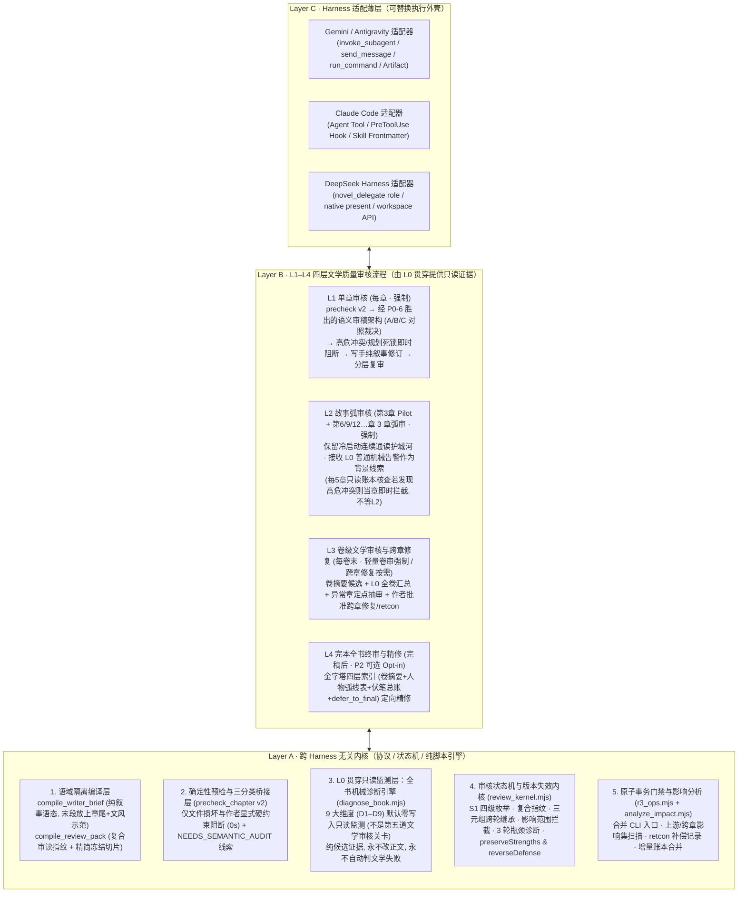

# 03 · R3 审核体系 v3 总体架构设计

> **文档版本**：`v1.1 (Freeze-Ready Candidate)`  
> **设计定位**：本方案严格保持**只设计、不实施**边界，不改动 R2 既有行为与旧项目兼容路径，作为 R3 升级为“**L0 只读监测层 + L1–L4 四层文学审核流程 · 语域隔离 · 可验证审稿架构 · 跨 Harness 可移植**”的总体技术蓝图。  
> **诚实约束**：本文所有尚未实跑验证的耗时节省与质量收益均明确标为 **`[理论估算]` / `[待离线/实跑验证]`**，绝不写成已实现事实。

---

## 一、设计总目标与五大架构硬原则

1. **以实证对照破解“发现 vs 克制”跷跷板（不预设单解）**：围绕 v2.2 触发停止条件的根因，设计 **A（单阶段完整审稿）vs B（Pass 1 发现 + Pass 2 定级）vs C（单阶段完整审稿 + 独立轻量定级）** 三方案离线对照实验，由升级版 G1–G6 硬门禁裁决主流程方案，未过线前严禁进入生产主干。
2. **创作层与治理层彻底语域隔离（硬约束）**：写手上下文只见故事、人物、上一章结尾、文风锚点与自然语言修订意图；**严禁 SHA-256、JSON Schema、门禁错误码、审稿内部状态机与 `reverseDefense` 进入写手写作上下文**，从源头根治首轮报告腔、防杠说明书补丁与对白解释过度。
3. **机械归脚本、语义归模型、裁决归作者（严防机械误伤文学）**：确立 **L0 全书机械诊断（9 大维度 `D1–D9`，贯穿全周期只读监测层，非第五道强制审核关卡）** 与 **`precheck v2`（`NEEDS_SEMANTIC_AUDIT` 语义待核锚点）**；完全重复段落、引号不配对、字数异常默认**绝不**作为文学硬伤或自动阻断，**仅文件损坏与作者显式设定的硬约束**才允许触发确定性阻断，严禁为了死磕字数牺牲内容完整性。
4. **规划冲突显式阻断，高危事实冲突即时处理**：将“合法创作桥段”与“大纲自身客观死锁”硬分层，后者触发显式 **`PLANNING_CONFLICT_BLOCK`** + 影响面分析；任何跨章高危事实冲突必须**发现当章立刻拦截处理**，绝不等到下一次故事弧审核。
5. **保留“5 分钟单章端到端”为生产系统北极星目标，但分阶段实事求是推进**：5 分钟是**系统架构与编排优化目标**（绝非写手限时指令，绝不以压榨文风或跳审换速度）；通过实际时间账本拆解与替代架构研究（调用合并、热复用、检查内聚、收尾异步化、审稿并行化、辅助分层模型）规划三阶段收敛路径，同时诚实披露当前架构下的实测下限与不可测项。

---

## 二、总体系统分层架构图

---

## 三、核心架构议题详解

### 议题 1：单章语义审稿架构——三方案对照验证设计（不预设双阶段必胜）

针对 v2.2 离线实证暴露的“单轮 Prompt Recall vs FPR 拉锯（FPR `15.15%` 未过线 + 跨题材 Holdout `V22-H3/H4` 漏检）”以及“**Pass 1 漏检后 Pass 2 无法找回**”的核心风险，v3 确立以下原则：**严禁未经实测就把双阶段写入生产主流程；P0-6 必须执行 A / B / C 三臂受控对照实验，以升级版 G1–G6 数据裁决主架构。**

#### 1.1 三种候选审稿架构对照定义（共享 `precheck v2` 与 `PLANNING_CONFLICT_BLOCK` 底座以防归因混杂）

| 方案代号 | 架构形态 | 执行链路 | 核心优势假设 | 核心风险与防线 |
|---|---|---|---|---|
| **方案 A（Control）** | **增强单阶段完整审稿** | 冻结紧凑包 + `precheck v2`（`NEEDS_SEMANTIC_AUDIT`）→ 单次全能红队（v2.2 平权融合协议 + 显式 `PLANNING_CONFLICT_BLOCK` 分层 + 6 维最小取证槽）→ 直接输出 S1 四级终审报告 | 1 次 LLM 调用、保持全局上下文一体性、无跨阶段信息损失；可直接分离 `precheck v2` 与 `PLANNING_CONFLICT_BLOCK` 的独立贡献 | 仍可能残留“发现与克制同上下文互搏”，需看在 `precheck v2` 补强后 FPR 与跨题材 Recall 是否已能双过线 |
| **方案 B（Two-Stage）** | **Pass 1 开放发现 + Pass 2 独立轻量定级** | ① **Pass 1（高召回发现器，无 `OR1–OR7` 抑制负担）**：读冻结审稿包 + `NEEDS_SEMANTIC_AUDIT`，强制逐条核销线索 + 对 `HL-1..HL-6` 填写 6 维最小取证槽，产出全部带原文 `quote` 候选缺陷（宁宽勿漏）+ `preserveStrengths`； ② **Pass 2（独立轻量定级器，不读全章）**：仅读候选清单 + 每条前后 300 字原文 + 核心规划条款，执行 S1 四级定级、`OR1–OR7` 过滤、`reverseDefense`、`impactScope` 与 `PLANNING_CONFLICT_BLOCK` 分流 | 彻底解耦“找问题”与“控尺度”；Pass 2 上下文极小（2–4 KB），定级稳定性与去过严潜力最高 | **最大风险：Pass 1 漏检后 Pass 2 永远无法找回**；且若 Pass 1 产出过多噪声候选会拖慢 Pass 2。**专项防线见 1.2** |
| **方案 C（Hybrid）** | **单阶段完整审稿 + 独立轻量定级复核** | ① **Stage 1**：运行完整单阶段审稿（保持完整红队发现与全章上下文初判）； ② **Stage 2（独立轻量定级复核器）**：只对 Stage 1 产出的 `BLOCKER/MAJOR` 与 `planningConflictAdvisories`（以及未完全闭合的 `NEEDS_SEMANTIC_AUDIT` 异常项）执行独立 `reverseDefense`、`OR1–OR7` 降噪与 `PLANNING_CONFLICT_BLOCK` 核裁（若 Stage 1 已判 `PASS` 且所有 `NEEDS_SEMANTIC_AUDIT` 均 `pass` 则**短路跳过 Stage 2**，实现零额外延迟！） | 保留方案 A 的完整上下文召回，同时借助独立 Stage 2 压低过度定级与修正 `OR6` 漂白；`PASS` 章零额外成本 | 若 Stage 1 因单轮克制已提前漏检（如 `V22-H3`），仅靠 Stage 2 仍无法补回——因此 Stage 1 必须采用高召回偏置（类似 v2.1 底座，把降噪交给 Stage 2） |

#### 1.2 专项解决“Pass 1 / Stage 1 漏检后 Pass 2 无法找回”的四重兜底机制
1. **`NEEDS_SEMANTIC_AUDIT` 强制核销锚点**：`precheck v2` 提前从正文和规划中抽出日期差、账目/数量变化、编号序列、硬约束三分类、信息差敏感词与高潮动作段标记；Pass 1 / Stage 1 必须逐条输出 `pass / issue_raised / insufficient_material` 及原文依据，缺一条即被脚本 Fail-Closed 拒收。
2. **6 维结构化最小取证槽（Per-Dimension Evidence Slot）**：即便某维度（`HL-1` 动作、`HL-2` 设定账目、`HL-3` 时间脚程、`HL-4` 动机反派、`HL-5` 限知 POV、`HL-6` 空间光学）判定 `0` 缺陷，Pass 1 也必须用 1 句话写出本维实际核查的关键场景/数字/几何锚点（防止模型草草跳过陌生题材的三维空间或会计推理）。
3. **Pass 1“宁报勿吞”宽口契约（方案 B 专属）**：明确禁止 Pass 1 自行以 `OR1–OR7` 理由隐藏可疑项；凡带原文 `quote` 的疑似客观矛盾一律入候选池交 Pass 2 仲裁（同时由脚本过滤伪造 `quote` 防止胡言乱语）。
4. **三方案硬裁决与消融**：P0-6 在同一批扩展校准集与大样本跨题材 Holdout（见 `08` 文档）上并行评测 A、B、C（并在胜出双阶段方案上做“同上下文二段式 vs 独立轻量 Pass 2”消融）：**若方案 B 的 Recall 低于方案 A 或 C 超过 `1.0 pp`、或出现任何 1 例 `BLOCKER` 漏检，直接淘汰方案 B**；仅由同时全过 G1–G6 且在 Recall / FPR / 延迟综合最优的方案晋级生产主流程。

---

### 议题 2：创作层与治理层彻底语域隔离（写手语域防火墙）

历史实测已证明：大量治理元数据（`[f.id | ch1 | established]`、SHA 哈希、门禁代码、`M1–M4` 协议编号、`02-写作计划.json` 原始字段）直接灌进写手上下文，叠加写手亲自执行 8–12 条 CLI 命令与手改 JSON，是诱发首轮报告腔、>40 字长句占比 `37%–52%`、正文括号参数与防杠说明书补丁的核心根因。

#### 2.1 写手语域防火墙规范

| 信息类型 | 写手上下文权限 | 呈现方式与语域要求 |
|---|---|---|
| 当前人物状态、处境、关系、知情边界 | ✅ **允许** | 翻译为自然中文叙述卡片，**剥离 `[F-012 \| ch2 \| established]` 等工程 ID 标签** |
| 上一章结尾原文（500–900 字） | ✅ **强制且置于最末位** | 吸收 `PenglongHuang/chapter-checklist.md` 最佳实践：**动笔前最后读到的必须是正文语态文字** |
| 本书文风锚点（`03-文风基准.md` 双 H3 示范 + 第 1 章校准段） | ✅ **强制且紧邻上章结尾** | 用原文段落锚定语感与句式呼吸，不用抽象规则清单替代 |
| 本章细纲、时间/物品锚点、未回收伏笔提醒 | ✅ **允许（去工程化）** | 自然语言故事要点 + 简洁数字底账 |
| 返工修订指令（收到 `revise` 时） | ✅ **仅投喂编译后的“纯叙事修订卡”** | 只含：① `preserveStrengths`（必须守住的 3 处亮点原句）；② 需修阻断项的自然语言剧情/逻辑说明与叙事化修改方向；**严禁原样粘贴原始审稿 JSON** |
| SHA-256、JSON Schema、门禁码、审读指纹、遥测、`reverseDefense`、历史 `reviewHistory` | ❌ **绝对禁止进入写手上下文** | 全部由主控/宿主编排层与脚本持有，写手只读写纯正文 Markdown（`reverseDefense` 仅在审稿定级内部执行，防止写手模仿写出防杠自证句） |

#### 2.2 CLI 合并与中间文件瘦身（写手侧 CLI 降至 0）
将原本分散的 8–12 条命令收敛为主控调用的 4 个统一原子原语：
1. `r3_ops.mjs start-chapter <proj> --chapter N`：门禁检查 + 规划缓存复用 + 编译纯叙事写手任务卡（`<0.3s`）。
2. `r3_ops.mjs submit-draft <proj> --chapter N --writer-id ...`：`precheck v2` → 字数参考（默认非阻断）→ R3 正文快照+Diff → 复合指纹冻结 → 编译审稿包（**修复空增 `revision` Bug**：`--dry-run` 预检或命中确定性硬错时不递增 `revision`）。
3. `r3_ops.mjs apply-review <proj> --chapter N --report <file>`：Schema/指纹/三元组校验 → 规范化落盘 → 若 `revise` 则自动编译纯叙事修订卡 + 熔断判断；若 `PLANNING_CONFLICT_BLOCK` 则自动调 `analyze_impact.mjs` 生成作者决策卡；若 `pass` 则推进完成态。
4. `r3_ops.mjs close-chapter <proj> --chapter N --delta <file>`：接收写手定稿附带的 ≤30 行结构化增量块（新事实/知情变化/伏笔变化/150 字摘要），由脚本原子合并进 `story-ledger.json` 与 `99-章节摘要.md` 并刷新可选诊断缓存。

---

### 议题 3：重新审视“5 分钟单章端到端”生产系统目标（实际时间账本与替代架构研究）

> **目标定位澄清**：**5 分钟单章端到端仍然是 R3 的生产系统架构优化目标（North Star）**，但它是**给编排系统、缓存、并行化与脚本化提出的性能要求**，**绝不是给写手设定的限时赶工指令**，也绝不以跳过审稿、放宽红线或压缩文学打磨为代价。

#### 3.1 实际时间账本拆解（严格区分四类数据来源）

下表将单章耗时按 **7 个细粒度构成项**拆解，并逐项标注证据等级：**`[真实运行日志]` / `[历史记录重建]` / `[理论估算]` / `[无法测量]`**。再次声明：**Step 3（`17.01–21.96m`）与 Phase 1 Arm 0–2（`24.27–31.43m`）因计时边界与遥测方式不同，无法直接横向比较，此处并列呈现各自真实口径。**

| 细粒度时间构成项 | Step 3 参照（`[历史记录重建]`，3 章） | 原 A/B 组 Ch 2–3（`[历史记录重建]`，热复用） | Phase 1 Arm 0 / Arm 1 / Arm 2（`[真实运行日志]`，9 章） | 可测性与瓶颈定位 |
|---|---|---|---|---|
| **① 模型推理与生成**（TTFT / 内部思考 / 流式生成） | 嵌入各阶段墙钟（初稿均 `4.53m`、冷首审均 `6.80m`、冷复审均 `6.45m`） | 嵌入各阶段墙钟（A 组写稿 `1.72–1.76m`、热首审 `3.40–3.67m`、热复审 `1.61m`） | 嵌入各阶段墙钟（Arm 1 初稿 `4.67m` / 冷首审 `7.35m`；Arm 2 初稿 `3.60m` / 热首审纯编辑 `3.20–3.68m` / 热复审纯编辑 `1.05–1.71m`） | 子项 `TTFT`、`modelInternalThinkingTime`、`tokenGenerationSpeed` 为 **`[无法测量]`**（宿主未落盘 Token/推理日志） |
| **② Agent 启动与调度排队** | 嵌入冷启动首审/复审（23 次全冷启动） | 热复用会话无重复启动 | 冷首审均值 `7.76m` vs 热首审均值 `4.50m`（差 `3.26m` 混含启动+重读+思考） | `hostSubagentQueueWait` 与纯进程启动开销为 **`[无法测量]`** |
| **③ 上下文读取**（多轮 `view_file` 与 76 KB 静态重读） | 单次冷审重读 `~76 KB`（75.9% 静态），需 4–7 次串行 `view_file` | 热会话缓存静态档案 | O1 紧凑包压至 `12–16 KB` 单次读取；但写手侧 Arm 0 读档仍使 `draft` 达 `8.21m`（Arm 1 +O3 降至 `4.67m`） | 工具级逐次耗时 **`[无法测量]`**，但 Arm 0→Arm 1 实测证实减少碎步读档与 Turn 切换可立省 **`3.54m`** |
| **④ 确定性工具执行**（脚本校验/哈希/预检） | 单测 5 脚本合计 `0.69s` + `submit` `0.65s`（`<1.5s/章`） | `<1.5s/章` | **`[真实运行日志]`**：Arm 1 `0.56s/章`、Arm 2 `0.96s/章`、Arm 3 `1.38s/章` | **确定非瓶颈**（占单章耗时 `< 0.1%`） |
| **⑤ 系统等待与交接停顿**（Turn 切换、宿主压缩） | 交接与收尾混入写作槽；仅 Ch 3 终验收 `1.21m` | 较紧凑 | **`[真实运行日志]`**：Arm 2 Ch 3 出现 `201s (3.35m)` 宿主自动压缩重传停顿；各组 `closeout` 实测 **`2.38–4.11 min/章`**（几乎全在 LLM 手改 370 行 JSON 与 Turn 往返） | 常规 Turn 间纯系统排队 **`[无法测量]`**；宿主压缩停顿与 `closeout` 墙钟 **`[真实运行日志]` 已证** |
| **⑥ 返工改稿**（`rework`） | 均值 `1.40m`（1.33 轮） | 较短 | **`[真实运行日志]`**：Arm 0 `5.21m` / Arm 1 `3.89m` / Arm 2 `5.32m`（受 `57.4%` 过度定级虚增必改项放大） | 高度受“初稿一次通过率 `0%`”与“过度定级虚增修改面”驱动 |
| **⑦ 复审与冷重置**（`reReview`） | 均值 `6.45m`（全冷复审） | 热复审 `1.61–1.67m/次` | **`[真实运行日志]`**：Arm 0 `7.04m` / Arm 1 `6.94m` / Arm 2 `6.11m`（热复审实测仅 `1.87m`，但 4/5 次因 `>30%` 改动触发冷重置回弹至 `4.9–11.2m`） | **头号时间乘数**：1 轮额外返工+冷重置直接增加 `+8 ~ +15 min` |
| **端到端总耗时汇总** | 常规 `17.01–21.96m`（均 `19.58m`，**口径缺完整独立收尾**） | Ch 2–3 均 `7.06–8.59m`（**旧环境重建，不可直比**） | Arm 0 `31.43m` / Arm 1 `25.85m` / Arm 2 `24.27m`（全热样板 Ch 2 `14.54m`，**严格全口径实时日志**） | 两类历史区间不可直接对比；当前串行实测全员未进 5 分钟 |

#### 3.2 替代架构深度研究：哪些机制能把耗时真正压向 5 分钟？

不能仅停留在“当前串行单章架构预测 8.5–12 分钟”就提前放弃 5 分钟目标。以下系统评估 **6 种架构级提速路径**，明确每种方式究竟省掉哪一段账本时间、理论节省量（均标 **`[理论估算]`**）以及质量边界约束：

| 替代架构机制 | 打击的时间账本项 | 机制说明 | 预计节省量（`[理论估算]`） | 质量/工程风险与落地阶段 |
|---|---|---|---|---|
| **M-A · 调用合并与全内联编译**（Call Coalescing） | ③ 上下文读取 + ⑤ 交接 Turn 切换 | 主控 `r3_ops.mjs` 一次性编译纯叙事写手卡与全内联紧凑审稿包（`12–16 KB`），消除写手侧 8–12 次 CLI 与编辑侧 4–7 次串行 `view_file` | `-1.5 ~ -3.0 min/章`（已有 Arm 1 `-3.54m` 实测佐证方向） | 零质量风险；**P0/P1 立即落地** |
| **M-B · 热上下文复用 + 尺度校准降熔断** | ② 启动 + ③ 静态重读 + ⑥/⑦ 返工复审 | 保留 O1 3 章热复用（已实测热首审 `-3.26m`、热复审 `-4.66m`）；通过 S1 四级与校准消除 `57.4%` 过度定级，使多数必要返工 diff 落在 `<= 30%` 内，减少无谓冷重置，并将一次通过率从 `0%` 推向 `>= 25%–50%` | `-5.0 ~ -10.0 min/章`（最大杠杆，取决于校准后真实返工轮次降幅） | 须严守 `DIFF_OVER_30PCT` 熔断护栏与 Blind A 零漏检恶化；**P0/P1 落地** |
| **M-C · 检查内聚与前置锚定**（Check Cohesion） | ⑥/⑦ 低级返工 + LLM 自由通读开销 | 将确定性校验、`NEEDS_SEMANTIC_AUDIT` 算术/日期/账目抽取、L0 诊断内聚进 `<0.5s` 脚本，省去 LLM 在长文中盲搜数字与编号的推理消耗 | 期望 `-1.0 ~ -2.5 min/章`（通过降低低级漏检与返工面间接兑现） | 严禁把软统计升级为硬阻断；**P0/P1 落地** |
| **M-D · 收尾异步化 / 关键路径剥离**（Async Off-Critical-Path Closeout） | ⑤ 收尾 `closeout`（当前实测 `2.4–4.1 min/章`！） | 写手定稿仅输出极简 ≤30 行结构化增量块，主控脚本 `r3_ops.mjs close-chapter` 合并落盘；进一步可在 **P2 架构探索**中把“非阻断型摘要润色/全书诊断/经验记录”移出单章关键路径，与下一章写前准备并行（仅保留账本硬字段同步提交） | 从 `3.0m` 压至 `0.8–1.2m`（P1 同步脚本合并），若叠加异步化可压至关键路径 **`0.2–0.5m`**（净省 `-2.5 ~ -3.5m`） | 须保证第 $N+1$ 章动笔前能读到第 $N$ 章核心事实与 `handoff`，防止并发脏读；**P1 做增量合并，P2 探索异步流水线** |
| **M-E · 审稿维度并行化**（Parallel Focused Sub-Auditors） | ① 首审长推理墙钟（当前冷首审 `7.76m` / 热首审 `4.50m`） | 将单章 6 维红队拆为 2 路并行窄焦只读子代理（如 **路 1：物理动作+空间几何+限知 POV** ∥ **路 2：设定账目+时间脚程+人物动机**），同读 12 KB 紧凑包并行审稿，再由轻量聚合定级器汇总。理想情况下首审墙钟由 `sum` 变为 `max(路1, 路2) + 聚合` | 首审有望再压 `-1.2 ~ -2.2 min/章`（`[理论估算]`，取决于宿主并发调度无排队抢占） | **中高风险**：总 Token 增约 `1.4×–1.7×`；跨维度复合问题（如时间+POV 联动）可能落入夹缝；需等 P0-6 先定 A/B/C 基准后在 **P2 做独立受控并发实验** |
| **M-F · 辅助工序轻量低延迟模型路由**（Tiered Model Routing） | ① 轻量非创作推理（Pass 2 定级、增量账本提取、热差分复核） | **主写手与核心红队发现严禁降级**；仅在离线证明 G1–G6 零退化的前提下，将短输入（2–4 KB）的定级仲裁、增量账本结构化提取路由至低延迟模型 | 每次轻量调用省 `-0.4 ~ -1.2 min`（累计 `-1.0 ~ -2.0 min/章`） | 须通过独立离线一致性（$\kappa >= 0.85$）与零漏检门禁；**P2 受控实验** |

#### 3.3 理论下限推导与“5 分钟目标”三阶段诚实结论

综合实测锚点与理论估算，不提前放弃 5 分钟目标，同时明确**理论物理下限**与**分阶段达成路线**：

1. **当前串行单主模型实测锚点与近期（P0+P1）可交付预测（`[理论估算，待实测]`）**：
   - 在不引入审稿并行化（M-E）和低延迟模型路由（M-F）的 P0+P1 阶段：
     - 写稿 `3.2–4.2m` + 机检 `0.01m` + 热首审（含轻量定级）`4.2–5.5m` + 期望返工与复审（0.5–0.8 轮）`1.5–3.5m` + 增量脚本收尾 `0.8–1.2m` → **P50 预测：`8.5–12.0 min`（热复用）/ `11.5–15.5 min`（全冷启动）**；对应 P0/P1 近期实测验收门槛设在 **`<= 13.0 min`（热）/ `<= 16.5 min`（冷）**。
2. **叠加替代架构（M-A ~ M-F）冲刺 5 分钟的理论下限推导（`[理论估算]`）**：
   - **一次通过章（0 轮返工）理论关键路径下限**：
     `写稿流式生成 (2.0–2.8m，参照原 A 组 1.72m / Arm 2 Ch 2 2.96m)` + `机检 (0.01m)` + `并行窄焦热首审 (1.5–2.2m)` + `异步/脚本化关键路径收尾 (0.2–0.4m)` = **`3.71 – 5.41 min`**（**中位约 `4.5 min`，理论上可触及并落入 5 分钟目标区间！**）。
   - **发生 1 轮必要语义返工章的理论关键路径下限**：
     在上述 `3.71–5.41m` 基础上叠加 `定向原子返工 (0.8–1.5m)` + `热差分复审 (1.0–1.8m，参照原 A/B 组 1.13–1.60m / Arm 2 1.42–2.24m)` = **`5.51 – 8.71 min`**（**中位约 `7.0 min`**）。
   - **全样本期望均值下限**：若通过语域净化 + 写前锚点 + 尺度校准将一次通过率提升至 `50%–65%`、其余章控制在 1 轮热差分复审，**全样本理论期望均值下限约为 `5.3 – 6.6 min`**；若底层主力模型生成速率提升 `1.3×–1.5×`（或通过 M-E/M-F 实测突破），则全样本均值具备逼近 **`<= 5.0 min`** 的理论空间。
3. **最终立场（冻结写入 PRD）**：
   - **保留 5 分钟为 R3 长期生产系统优化北极星目标**（不提前放弃），按 **S1 止血（P0/P1：`8.5–13.0m`）→ S2 架构并行与异步化实验（P2：`5.0–7.5m`）→ S3 协同模型底座延迟演进（`<= 5.0m`）** 三阶段推进；
   - **硬底线**：在任何阶段均**不得通过限时催促写手、砍字数或跳过独立复审来硬凑 5 分钟**，且上述 S2/S3 数值均明确标注为 **`[理论估算]`**，须待真实宿主日志验证。

---

## 四、跨 Agent Harness 兼容性架构

三个系统面向三种不同宿主：`webnovel-writer v6` → Claude Code；`webnovel-writer v8` → DeepSeek Harness；当前 R3 → Gemini / Antigravity。v3 严格拆分为 **Layer A（Harness 无关内核）** 与 **Layer C（Harness 适配薄层）**：

| 分层 | 具体组件 | 跨 Harness 迁移性 | 说明 |
|---|---|---|---|
| **Layer A · Harness 无关内核**（100% 通用，零宿主依赖） | 1. 书仓文件格式（`00/01/02/03` + `chapters/` + `story-ledger.json` + `reviews/r3/`） 2. Node ESM 确定性脚本（`r3_ops.mjs`、`precheck_chapter.mjs`、`diagnose_book.mjs`、`analyze_impact.mjs`、`v3_gate.mjs`） 3. JSON Schema 协议（S1 四级审稿、复合指纹、三元组继承、`PLANNING_CONFLICT_BLOCK`、全书 9 维诊断报告） 4. 审稿与写手纯文本角色章程 | ✅ **可直接原样迁移**至 Antigravity、Claude Code、Codex、Cursor、DeepSeek Harness | 唯一运行时依赖：Node.js（+ 可选 Python 3 标准库用于快照）。全部状态从磁盘与 SHA-256 推导，零专有会话数据库依赖。 |
| **Layer C · Harness 特定适配薄层**（按宿主替换） | 1. **子代理派发与上下文隔离**：Antigravity `invoke_subagent` / Claude Code `Agent` / DSH `novel_delegate`；无隔离宿主显式报 `ISOLATION_UNAVAILABLE` 并停审 2. **只读权限护栏**：Antigravity 只读子代理+全内联包 / Claude Code `PreToolUse` Hook / DSH 角色白名单 3. **作者批准交互**：对话原话落盘 `approval.json` 或宿主原生弹窗 4. **自然语言单一入口**：主控代调 `r3_ops.mjs`，写手侧 CLI 恒为 `0` | ⚠️ **隔离在薄适配文档中**（`references/v3/adapters/`） | 内核脚本零修改即可跨平台运行。 |

---

## 五、独立反对意见与反方压测（Devil's Advocate）

1. **反对意见 1：双阶段审稿（方案 B）并非天然必胜，可能因 Pass 1 漏检而输给方案 A 或方案 C**
   - **对策**：放弃“预设双阶段一定最优”的假设，强制在 P0-6 执行 **A vs B vs C** 三方案离线对照（大样本 G1–G6），并给 Pass 1/Stage 1 配备 `NEEDS_SEMANTIC_AUDIT` 强制核销与 6 维最小取证槽；哪个方案离线数据过线且综合最优，就用哪个。
2. **反对意见 2：四层文学审核（L1–L4）+ L0 机械诊断若边界不清，可能演变为臃肿的官僚机器**
   - **对策**：严格锁定 **L0 仅为只读监测层、永不阻断**；L2 取消重复的每 5 章独立编辑（仅高危冲突当章即时拦截，普通告警并入 3 章弧审）；L4 保持 P2 可选 Opt-in。
3. **反对意见 3：v8 三元组跨轮继承在半自动模式下可能变成误放行后门**
   - **对策**：仅允许继承**真实人类作者明确批注**（`author_kept` / `author_rejected` / `transferred_to_proposal`）且**锚点段落文本哈希未变**的条目；模型自判降级永不冒充作者保留。
4. **反对意见 4：切忌把 5 分钟北极星目标异化为写手限时指标或借口砍质量**
   - **对策**：写手任务卡中**严禁出现任何时间压迫提示**；5 分钟完全通过系统级调用合并、热复用、检查内聚、异步收尾与并行审稿去争取，且每一项提速改动都必须过 Track L 盲审与零漏检恶化门禁。
