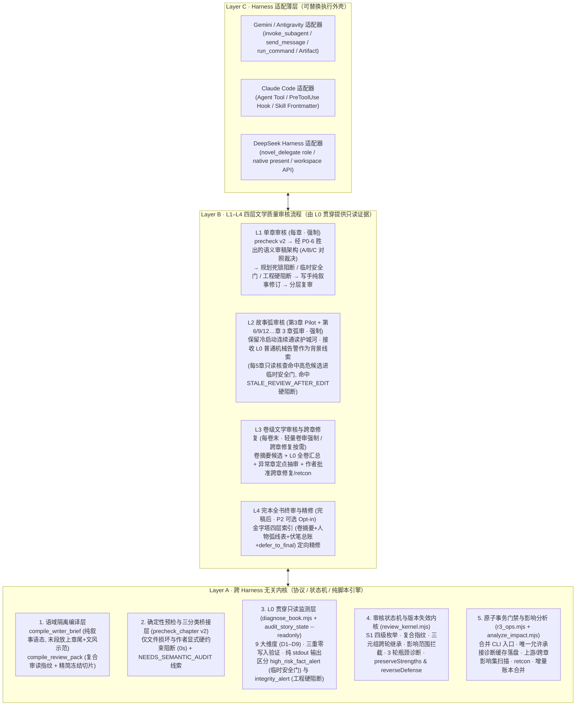

# 03 · R3 审核体系 v3 总体架构设计

> **文档版本**：`v1.2.1 (Freeze-Ready Candidate)`  
> **设计定位**：本方案严格保持**只设计、不实施**边界，不改动 R2 既有行为与旧项目兼容路径，作为 R3 升级为“**L0 纯只读监测层 + L1–L4 四层文学审核流程 · 语域隔离 · 可验证审稿架构 · 跨 Harness 可移植**”的总体技术蓝图。  
> **诚实约束**：本文所有尚未实跑验证的耗时节省与质量收益均明确标为 **`[理论估算]` / `[待离线/实跑验证]`**，绝不写成已实现事实。

---

## 一、设计总目标与五大架构硬原则

1. **以实证对照破解“发现 vs 克制”跷跷板（不预设单解）**：围绕 v2.2 触发停止条件的根因，设计 **A（单阶段完整审稿）vs B（Pass 1 发现 + Pass 2 定级）vs C（单阶段完整审稿 + 独立轻量定级）** 三方案离线对照实验，由升级版 G1–G6 准入规则（含聚类统计与独立来源章节约束）裁决主流程方案，未过线前严禁进入生产主干。
2. **创作层与治理层彻底语域隔离（硬约束）**：写手上下文只见故事、人物、上一章结尾、文风锚点与自然语言修订意图；**严禁 SHA-256、JSON Schema、门禁错误码、审稿内部状态机与 `reverseDefense` 进入写手写作上下文**，从源头根治首轮报告腔、防杠说明书补丁与对白解释过度。
3. **机械归脚本、语义归模型、裁决归作者（严防机械误伤文学）**：确立 **L0 全书机械诊断（`diagnose_book.mjs`，9 大维度 `D1–D9`）与 `audit_story_state.mjs --readonly`** 为贯穿全周期的纯只读监测层（只输出 stdout，须分别通过全量静态审计 + 只读文件系统/隔离沙箱实测 + 全目录 Manifest 哈希前后比对三重验证；`r3_ops.mjs` 是唯一允许承接诊断缓存落盘的编排层，绝不因此放宽 L0 只读要求；L0 不是第五道强制文学审核关卡）；完全重复段落、引号不配对、字数异常默认**绝不**作为文学硬伤或自动阻断，**仅文件损坏与作者显式设定的硬约束**才允许触发确定性阻断，严禁为了死磕字数牺牲内容完整性。
4. **规划冲突显式阻断，并严格区分“临时安全门”与“工程完整性硬阻断”**：将“合法创作桥段”与“大纲自身客观死锁”硬分层，后者触发 **`PLANNING_CONFLICT_BLOCK`**；跨章高危事实候选（`FACT_CONFLICT_CANDIDATE`）触发**等待核实的临时安全门**（可核实误报/合法叙事后解除）；已定稿正文未经显式 `retcon` 被外部修改（`STALE_REVIEW_AFTER_EDIT`）属于**工程完整性破损（`integrity_alert`）**，必须**立即阻断新章写入**，严禁标记误报解除，必须通过显式 `retcon`（或回滚快照）+ 重新审核 + 更新指纹恢复。
5. **保留“含必要返工与复审在内的 5 分钟单章端到端”为生产系统北极星目标，并严守统计诚实**：5 分钟是**涵盖正常必要返工与复审的完整生产系统架构优化目标**（绝不能仅以一次通过章宣称达标，也绝非写手限时指令）；混合情景的 **Mean** 与 **P50** 分开建模（无情景内部经验分布时，**不凭权重与区间插值编造理论 P50 估算值**）。

---

## 二、总体系统分层架构图

---

## 三、核心架构议题详解

### 议题 1：单章语义审稿架构——三方案对照验证设计（不预设双阶段必胜）

针对 v2.2 离线实证暴露的“单轮 Prompt Recall vs FPR 拉锯（FPR `15.15%` 未过线 + 跨题材 Holdout `V22-H3/H4` 漏检）”以及“**Pass 1 漏检后 Pass 2 无法找回**”的核心风险，v3 确立以下原则：**严禁未经实测就把双阶段写入生产主流程；P0-6 必须执行 A / B / C 三臂受控对照实验，以升级版 G1–G6 数据裁决主架构。**

#### 1.1 三种候选审稿架构对照定义（共享 `precheck v2` 与 `PLANNING_CONFLICT_BLOCK` 底座以防归因混杂）

| 方案代号 | 架构形态 | 执行链路 | 核心优势假设 | 核心风险与防线 |
|---|---|---|---|---|
| **方案 A（Control）** | **增强单阶段完整审稿** | 冻结紧凑包 + `precheck v2`（`NEEDS_SEMANTIC_AUDIT`）→ 单次全能红队（v2.2 平权融合协议 + 显式 `PLANNING_CONFLICT_BLOCK` 分层 + 6 维最小取证槽）→ 直接输出 S1 四级终审报告 | 1 次 LLM 调用、保持全局上下文一体性、无跨阶段信息损失；可直接分离 `precheck v2` 与 `PLANNING_CONFLICT_BLOCK` 的独立贡献 | 仍可能残留“发现与克制同上下文互搏”，需看在 `precheck v2` 补强后 FPR 与跨题材 Recall 是否已能双过线 |
| **方案 B（Two-Stage）** | **Pass 1 开放发现 + Pass 2 独立轻量定级** | ① **Pass 1（高召回发现器，无 `OR1–OR7` 抑制负担）**：读冻结审稿包 + `NEEDS_SEMANTIC_AUDIT`，强制逐条核销线索 + 对 `HL-1..HL-6` 填写 6 维最小取证槽，产出全部带原文 `quote` 候选缺陷（宁宽勿漏）+ `preserveStrengths`； ② **Pass 2（独立轻量定级器，不读全章）**：仅读候选清单 + 每条前后 300 字原文 + 核心规划条款，执行 S1 四级定级、`OR1–OR7` 过滤、`reverseDefense`、`impactScope` 与 `PLANNING_CONFLICT_BLOCK` 分流 | 彻底解耦“找问题”与“控尺度”；Pass 2 上下文极小（2–4 KB），定级稳定性与去过严潜力最高 | **最大风险：Pass 1 漏检后 Pass 2 永远无法找回**；且若 Pass 1 产出过多噪声候选会拖慢 Pass 2。**专项防线见 1.2** |
| **方案 C（Hybrid）** | **单阶段完整审稿 + 独立轻量定级复核** | ① **Stage 1**：运行完整单阶段审稿（保持完整红队发现与全章上下文初判）； ② **Stage 2（独立轻量定级复核器）**：只对 Stage 1 产出的 `BLOCKER/MAJOR` 与 `planningConflictAdvisories`（以及未完全闭合的 `NEEDS_SEMANTIC_AUDIT` 异常项）执行独立 `reverseDefense`、`OR1–OR7` 降噪与 `PLANNING_CONFLICT_BLOCK` 核裁（若 Stage 1 已判 `PASS` 且所有 `NEEDS_SEMANTIC_AUDIT` 均 `pass` 则**短路跳过 Stage 2**，实现零额外延迟！） | 保留方案 A 的完整上下文召回，同时借助独立 Stage 2 压低过度定级与修正 `OR6` 漂白；`PASS` 章零额外成本 | 若 Stage 1 因单轮克制已提前漏检（如 `V22-H3`），仅靠 Stage 2 仍无法补回——因此 Stage 1 必须采用高召回偏置（类似 v2.1 底座，把降噪交给 Stage 2） |

#### 1.2 专项解决“Pass 1 / Stage 1 漏检后 Pass 2 无法找回”的四重兜底机制
1. **`NEEDS_SEMANTIC_AUDIT` 强制核销锚点**：`precheck v2` 提前从正文和规划中抽出日期差、账目/数量变化、编号序列、硬约束三分类、信息差敏感词与高潮动作段标记；Pass 1 / Stage 1 必须逐条输出 `pass / issue_raised / insufficient_material` 及原文依据，缺一条即被脚本 Fail-Closed 拒收。
2. **6 维结构化最小取证槽（Per-Dimension Evidence Slot）**：即便某维度（`HL-1` 动作、`HL-2` 设定账目、`HL-3` 时间脚程、`HL-4` 动机反派、`HL-5` 限知 POV、`HL-6` 空间光学）判定 `0` 缺陷，Pass 1 也必须用 1 句话写出本维实际核查的关键场景/数字/几何锚点（防止模型草草跳过陌生题材的三维空间或会计推理）。
3. **Pass 1“宁报勿吞”宽口契约（方案 B 专属）**：明确禁止 Pass 1 自行以 `OR1–OR7` 理由隐藏可疑项；凡带原文 `quote` 的疑似客观矛盾一律入候选池交 Pass 2 仲裁（同时由脚本过滤伪造 `quote` 防止胡言乱语）。
4. **三方案硬裁决与消融**：P0-6 在同一批扩展校准集与大样本跨题材 Holdout（见 `08` 文档）上并行评测 A、B、C（并在胜出双阶段方案上做“同上下文二段式 vs 独立轻量 Pass 2”消融）：**若方案 B 的 Recall 低于方案 A 或 C 超过 `1.0 pp`、或出现任何 1 例 `BLOCKER` 漏检，直接淘汰方案 B**；仅由同时全过 G1–G6 且在 Recall / FPR / 延迟综合最优的方案晋级生产主流程。

---

### 议题 2：创作层与治理层彻底语域隔离（写手语域防火墙）

历史实测已证明：大量治理元数据（`[f.id | ch1 | established]`、SHA 哈希、门禁代码、`M1–M4` 协议编号、`02-写作计划.json` 原始字段）直接灌进写手上下文，叠加写手亲自执行 8–12 条 CLI 命令与手改 JSON，是诱发首轮报告腔、>40 字长句占比 `37%–52%`、正文括号参数与防杠说明书补丁的核心根因。

#### 2.1 写手语域防火墙规范

| 信息类型 | 写手上下文权限 | 呈现方式与语域要求 |
|---|---|---|
| 当前人物状态、处境、关系、知情边界 | ✅ **允许** | 翻译为自然中文叙述卡片，**剥离 `[F-012 \| ch2 \| established]` 等工程 ID 标签** |
| 上一章结尾原文（500–900 字） | ✅ **强制且置于最末位** | 吸收 `PenglongHuang/chapter-checklist.md` 最佳实践：**动笔前最后读到的必须是正文语态文字** |
| 本书文风锚点（`03-文风基准.md` 双 H3 示范 + 第 1 章校准段） | ✅ **强制且紧邻上章结尾** | 用原文段落锚定语感与句式呼吸，不用抽象规则清单替代 |
| 本章细纲、时间/物品锚点、未回收伏笔提醒 | ✅ **允许（去工程化）** | 自然语言故事要点 + 简洁数字底账 |
| 返工修订指令（收到 `revise` 时） | ✅ **仅投喂编译后的“纯叙事修订卡”** | 只含：① `preserveStrengths`（必须守住的 3 处亮点原句）；② 需修阻断项的自然语言剧情/逻辑说明与叙事化修改方向；**严禁原样粘贴原始审稿 JSON** |
| SHA-256、JSON Schema、门禁码、审读指纹、遥测、`reverseDefense`、历史 `reviewHistory` | ❌ **绝对禁止进入写手上下文** | 全部由主控/宿主编排层与脚本持有，写手只读写纯正文 Markdown（`reverseDefense` 仅在审稿定级内部执行，防止写手模仿写出防杠自证句） |

#### 2.2 CLI 合并与中间文件瘦身（写手侧 CLI 降至 0）
将原本分散的 8–12 条命令收敛为主控调用的 4 个统一原子原语：
1. `r3_ops.mjs start-chapter <proj> --chapter N`：门禁检查 + 规划缓存复用 + 编译纯叙事写手任务卡（`<0.3s`）。
2. `r3_ops.mjs submit-draft <proj> --chapter N --writer-id ...`：`precheck v2` → 字数参考（默认非阻断）→ R3 正文快照+Diff → 复合指纹冻结 → 编译审稿包（**修复空增 `revision` Bug**：`--dry-run` 预检或命中确定性硬错时不递增 `revision`）。
3. `r3_ops.mjs apply-review <proj> --chapter N --report <file>`：Schema/指纹/三元组校验 → 规范化落盘 → 若 `revise` 则自动编译纯叙事修订卡 + 熔断判断；若 `PLANNING_CONFLICT_BLOCK` 则自动调 `analyze_impact.mjs` 生成作者决策卡；若 `pass` 则推进完成态。
4. `r3_ops.mjs close-chapter <proj> --chapter N --delta <file>`：接收写手定稿附带的 ≤30 行结构化增量块（新事实/知情变化/伏笔变化/150 字摘要），由脚本原子合并进 `story-ledger.json` 与 `99-章节摘要.md`；若需加速缓存，由 **`r3_ops.mjs` 自身**调用只读 `diagnose_book.mjs` 并捕获其 stdout 写入隔离派生缓存目录（`diagnose_book.mjs` 本身不含任何写盘能力）。

---

### 议题 3：重新审视“5 分钟单章端到端”生产系统目标（精确时间账本与替代架构研究）

> **目标定位澄清（硬定义）**：
> 1. **5 分钟单章端到端仍然是 R3 的长期生产系统架构优化北极星目标（North Star）**，但它是**给编排系统、缓存、并行化与脚本化提出的性能要求**，**绝不是给写手设定的限时赶工指令**。
> 2. **全口径含返工定义**：生产级 5 分钟目标**必须包含正常比例的必要返工与复审（全样本端到端 Mean / P50 `<= 5.0 min`）**，**绝不能只拿“一次通过章”宣称已达成 5 分钟目标**。

#### 3.1 统计指标、互斥阶段边界与历史基线统一口径

1. **核心统计指标统一定义（严禁把 Mean 与 P50 交叉对比）**：
   - **Mean（算术均值）**：$\frac{1}{N}\sum_{i=1}^N T_i$，反映真实总产能与算力成本，对冷重置和 2 轮返工的长尾高度敏感；
   - **P50（中位数）**：排序后第 50 百分位耗时，反映“典型一章”的体感速度；
   - **P90（第 90 百分位）**：反映尾部最慢 10% 章节（通常对应触发 `DIFF_OVER_30PCT` 冷重置或 2 轮返工）的波动上界（注：在 $N=3$ 小样本历史基线中 P90 仅作描述性参考）。
2. **五阶段严格互斥边界核对（排查重复计算与时间重叠）**：
   - **Step 3 历史重建数据的已知重叠**：Step 3（`17.01–21.96m`）中 Ch 1、Ch 2 的收尾耗时未单列，**实际重叠并入了下一章的 `draft` 槽位**（仅 Ch 3 独立测得 `1.21m`），故其分阶段耗时与 Phase 1 不可直比。
   - **Phase 1 实时遥测与 v3 模型的严格互斥切分（零重叠、零重复计算）**：
     1. `T_draft`（`chapter_start` → `draft_ready`）：写前简报注入 + 初稿生成（**不含**上一章收尾与本章复审）；
     2. `T_precheck`（`draft_ready` → `review_v1_start`）：确定性预检 + 复合指纹冻结 + 审稿包编译（`<1.5s ≈ 0.02m`）；
     3. `T_review1`（`review_v1_start` → `review_v1_end`）：首轮独立语义审稿（含胜出方案可能的轻量定级）；
     4. `T_rework_cycle`（仅 `revise` 时累加，`rework_start` → `review_vK_end`）：写手定向返工改稿（`rework`）+ 分层复审（`reReview`）；
     5. `T_closeout`（`final_pass_received` → `chapter_closed`）：增量块输出 + 账本/摘要/交接原子合并。
   - *异步口径补充*：未来探索 M-D 收尾异步化时，必须分别报告**关键路径墙钟（阻塞下一章启动的耗时）**与**后台总计算时长**，绝不把后台任务伪装为零成本。

#### 3.2 实际时间账本拆解（7 维构成 + 四类证据来源 + 历史基线统一表）

| 细粒度时间构成项 | Step 3 参照（`[历史记录重建]`，3 章，*与 Arm 0–2 不可直比*） | 原 A/B 组 Ch 2–3（`[历史记录重建]`，热复用，*不可直比*） | Phase 1 Arm 0 / Arm 1 / Arm 2（`[真实运行日志]`，严格互斥 5 阶段，9 章） | 可测性与瓶颈定位 |
|---|---|---|---|---|
| **① 模型推理与生成**（TTFT / 思考 / 流式生成） | 嵌入各阶段（初稿均 `4.53m` [含前章收尾]、冷首审均 `6.80m`、冷复审均 `6.45m`） | 嵌入各阶段（A 写稿 `1.72–1.76m`、热首审 `3.40–3.67m`、热复审 `1.61m`） | 嵌入各阶段（Arm 1 `draft` `4.67m` / 冷首审 `7.35m`；Arm 2 `draft` `3.60m` / 热首审纯编辑 `3.20–3.68m` / 热复审纯编辑 `1.05–1.71m`） | `TTFT`、`modelInternalThinkingTime`、`tokenGenerationSpeed` 均为 **`[无法测量]`** |
| **② Agent 启动与调度排队** | 嵌入 23 次全冷启动 | 热会话无重复启动 | 冷首审均值 `7.76m` vs 热首审均值 `4.50m`（差 `3.26m` 混含启动+重读+思考） | `hostSubagentQueueWait` 与进程启动纯开销 **`[无法测量]`** |
| **③ 上下文读取**（`view_file` 与 76 KB 重读） | 单次冷审重读 `~76 KB`（75.9% 静态），4–7 次 `view_file` | 热会话缓存静态档案 | O1 紧凑包压至 `12–16 KB`；Arm 0→Arm 1 减少碎步读档使 `draft` 降 **`3.54m`**（`8.21→4.67m`） | 工具级逐次耗时 **`[无法测量]`**，但 Arm 0→1 差值 **`[真实运行日志]` 已证** |
| **④ 确定性工具执行**（脚本） | `<1.5s/章` | `<1.5s/章` | **`[真实运行日志]`**：Arm 1 `0.56s/章`、Arm 2 `0.96s/章`、Arm 3 `1.38s/章` | **确定非瓶颈**（`<0.1%`） |
| **⑤ 系统等待与交接停顿** | Ch 1/2 收尾混入 `draft`；Ch 3 显性 `1.21m` | 较紧凑 | **`[真实运行日志]`**：Arm 2 Ch 3 宿主压缩停顿 `201s (3.35m)`；各组 `closeout` **`2.38–4.11 min/章`** | 常规队列排队 **`[无法测量]`**；宿主压缩与 `closeout` **`[真实运行日志]` 已证** |
| **⑥ 返工改稿**（`rework`） | 均 `1.40m`（1.33 轮） | 较短 | **`[真实运行日志]`**：Arm 0 `5.21m` / Arm 1 `3.89m` / Arm 2 `5.32m` | 受 `57.4%` 过度定级虚增修改面驱动 |
| **⑦ 复审与冷重置**（`reReview`） | 均 `6.45m`（全冷） | 热复审 `1.61–1.67m/次` | **`[真实运行日志]`**：Arm 0 `7.04m` / Arm 1 `6.94m` / Arm 2 `6.11m`（热复审实测 `1.87m`，但 4/5 次 `>30%` 改动触发冷重置回弹至 `4.9–11.2m`） | **头号时间乘数** |
| **端到端基线汇总（Mean / P50 / P90）** | Mean `19.58m` / P50 `20.12m`（区间 `17.01–21.96m`，缺独立收尾） | Ch 2–3 Mean `7.06m`(A) / `8.59m`(B) | Arm 0: Mean **`31.43m`** / P50 **`32.03m`** / P90 `33.10m` Arm 1: Mean **`25.85m`** / P50 **`26.97m`** / P90 `27.75m` Arm 2(原始): Mean **`24.27m`** / P50 **`29.09m`** / P90 `29.16m`（扣压缩 Mean `23.15m` / P50 `25.83m`；全热 Ch 2 `14.54m`） | 跨批口径不同不可直比；当前串行实测全员未进 5 分钟 |

#### 3.3 实际初稿 `3.60–4.67 min` 与理论下限 `2.0–2.8 min` 之间的差距归因
Phase 1 实时日志中写手 `draft` 均值录得 `Arm 2: 3.60m`（最快 Ch 2 为 `2.96m`）、`Arm 1: 4.67m`，高于理论生成下限估算 `2.0–2.8m`（参考早期原 A 组 `1.72–1.76m`、原 B 组 `2.75–3.06m`），主要差距由四项因素构成：
1. **实写篇幅显著膨胀**：Phase 1 Arm 1/2 终稿字数普遍达 **`4,419–6,319` 字**（Arm 3 Ch 1 初稿甚至达 7,592 字后再自精简），而理论 `2.0–2.8m` 锚定 `3,500–4,000` 字紧凑正文，多出的 `1,000–2,000` 字直接拉长流式生成与内部思考时间（估占差距的 ~35%–50%）；
2. **写前读档与工具 Turn 往返计入 `draft`**：Phase 1 的 `draft` 槽仍含写手读档、写正文、测字数/预检及交接 Turn 开销（Arm 0 `8.21m` → Arm 1 `4.67m` → Arm 2 `3.60m` 已印证压缩工具往返可立省数分钟）；
3. **治理语域污染导致的隐性思考消耗**：写手简报混入治理标签与防红队心理负担，增加了起草期的冗余校验思考与防杠铺垫；
4. **宿主与模型负载波动（`[无法测量]`）**：2026-11-24（原 A 组 `1.72–1.76m`）与 2026-11-25（Phase 1 `2.96–4.67m`）间的底层模型推理速率与排队波动无法直接测量。因此，**`2.0–2.8m` 仍属基于篇幅收敛与零工具碎步假设的 `[理论估算]`，尚未在严格全口径实时遥测下实证复现**。

#### 3.4 替代架构深度研究（注明重叠归属，严禁简单相加！）

> **禁加声明（Non-Additivity Rule）**：以下 6 种优化机制在时间账本上存在明显**作用区间重叠**（如 M-A ∩ M-B 均打击读档/交接，M-B ∩ M-C 均打击返工轮次，M-B ∩ M-E ∩ M-F 均打击首审/定级推理墙钟且 M-E 会部分稀释 M-B 的单会话热复用收益）。**表中单列节省量为各自独立边际 `[理论估算]`，严禁将 6 行数字直接相加！** 端到端总耗时必须按 3.5 节的互斥情景模型综合核算。

| 替代架构机制 | 打击的时间账本项 | 重叠关系标注 | 机制说明 | 单项边际预计节省（`[理论估算]`，*不可直接相加*） | 质量/工程风险评估与落地阶段 |
|---|---|---|---|---|---|
| **M-A · 调用合并与全内联编译**（Call Coalescing） | ③ 上下文读取 + ⑤ 交接 Turn 切换 | 与 **M-B** 重叠（均缩减静态读档开销） | 主控 `r3_ops.mjs` 一次性编译纯叙事写手卡与全内联紧凑审稿包（`12–16 KB`），消除写手侧 8–12 次 CLI 与编辑侧 4–7 次串行 `view_file` | `-1.5 ~ -3.0 min/章`（Arm 1 `-3.54m` 实测佐证方向） | **`[待验证风险评估]`**：将 68 KB 全书档案裁剪为 12–16 KB 静态切片存在**遗漏长程隐性伏笔/关键上下文**以及**单次合并提示词过长引发注意力稀释**的潜在风险，必须通过 P0-6 离线对照与 Track L Blind A/B 实测验证零漏检恶化；**P0/P1 落地** |
| **M-B · 热上下文复用 + 尺度校准降熔断** | ② 启动 + ③ 静态重读 + ⑥/⑦ 返工复审 | 与 **M-A** 重叠读档，与 **M-C** 重叠降返工，与 **M-E** 存在热缓存稀释权衡 | 保留 O1 3 章热复用（热首审 `-3.26m`、热复审 `-4.66m`）；通过 S1 四级与校准消除 `57.4%` 过度定级，压缩返工 diff 至 `<= 30%` 减少冷重置 | `-5.0 ~ -10.0 min/章`（取决于校准后真实返工降幅） | 须严守 `DIFF_OVER_30PCT` 熔断护栏与 Blind A 零漏检恶化；**P0/P1 落地** |
| **M-C · 检查内聚与前置锚定**（Check Cohesion） | ⑥/⑦ 低级返工 + LLM 自由通读 | 与 **M-B** 重叠返工轮次压缩 | 将确定性校验、`NEEDS_SEMANTIC_AUDIT` 算术/日期/账目抽取、L0 诊断内聚进 `<0.5s` 脚本，降低低级硬伤返工概率 | 期望 `-1.0 ~ -2.5 min/章` | 严禁将软统计升格为硬阻断；**P0/P1 落地** |
| **M-D · 收尾异步化 / 关键路径剥离** | ⑤ 收尾 `closeout`（实测 `2.38–4.11m`） | 独立作用于收尾阶段（与 M-A 在 P1 的脚本化合并存在衔接） | P1 改为写手输出 ≤30 行增量块 + 脚本原子合并（压至 `0.8–1.2m`）；P2 进一步将非阻断型摘要润色/诊断移出关键路径，与下章准备并行（*后台计算时长另行记录*） | P1 同步合并省 `-1.8 ~ -2.5m`；P2 异步化关键路径再省 `-0.4 ~ -0.8m`（关键路径压至 `0.2–0.4m`） | 须保证第 $N+1$ 章动笔前强一致读取第 $N$ 章核心事实与 `handoff`，防并发脏读；**P1 同步合并 / P2 异步实验** |
| **M-E · 审稿维度并行化**（Parallel Focused Auditors） | ① 首审长推理墙钟 | 与 **M-B / M-F** 重叠作用于首审墙钟，且**部分削弱单会话热缓存命中** | 将 6 维红队拆为 2 路并行窄焦只读子代理（物理/空间/POV ∥ 设定/账目/时间/动机）同读紧凑包，由轻量聚合器汇总 | 相对串行热首审净再省 `-1.0 ~ -2.0 min/章`（取决于宿主无并发排队） | **中高风险**：总 Token 增约 `1.4×–1.7×`；跨维度复合硬伤易落夹缝；**P2 受控并发实验** |
| **M-F · 辅助工序轻量低延迟模型路由** | ① 轻量非创作推理（Pass 2 定级、增量账本提取、热差分复核） | 与 **M-B / M-E** 重叠作用于定级与复审耗时 | **主写手与核心红队发现严禁降级**；仅在离线证明 G1–G6 零退化后，将短输入（2–4 KB）定级/提取路由至低延迟模型 | 相对同主模型轻量调用再省 `-0.4 ~ -1.2 min/章` | 须过独立加权 Kappa（$\kappa_w >= 0.85$）与零漏检门禁；**P2 受控实验** |

#### 3.5 P0+P1 精确时间账本：Mean 与 P50 混合情景模型严格分离（及 5 分钟理论下限）

> **对前版（v1.1 / v1.2）估算模型的透明修正说明**：
> - v1.1 曾将区间端点直接相加得到 `9.71–14.41 min` 却误标为 `P50 8.5–12.0 min`；
> - v1.2 虽按互斥情景修正了 Mean 算术，但仍凭情景权重与区间端点给出了 `热复用 P50 约 11.2–13.5 min`、`一次通过率 50% 时 P50 下探至 ~10.9–11.5 min`、`全冷 P50 约 13.5–16.5 min` 的插值估算。
> - **本版（v1.2.1）正式修正**：情景权重与情景区间端点**只足以推导混合 Mean（条件期望）的敏感度边界，绝对不足以确定混合分布的 P50（中位数）**！以下严格分开建立 Mean 与 P50 的数学计算方法，**删除全部缺乏情景内分布依据的理论 P50 数值**。

1. **互斥情景分量与逐情景区间（当前串行主模型基线，`[理论估算，待实测]`）**：
   - **互斥分量**：`T_draft = 3.2–4.2m`、`T_precheck = 0.02m`、`T_review1 = 4.2–5.5m`（热）/ `6.5–8.0m`（冷）、`T_closeout = 0.8–1.2m`；单轮返工+复审 `T_rework_cycle` = Track A 热差分 `3.0–4.8m`（改稿 `1.5–2.5m` + 热复审 `1.5–2.3m`）或 Track B 冷重置 `7.5–11.0m`（改稿 `2.5–4.0m` + 冷复审 `5.0–7.0m`）。
   - **情景 ① · 一次通过章（0 轮返工，假设权重 $w_1 = 35\%$）**：
     - 热复用：`3.2–4.2 + 0.02 + 4.2–5.5 + 0 + 0.8–1.2` = **`8.22 – 10.92 min`**（区间中点 `9.6m`）
     - 全冷启动：`3.2–4.2 + 0.02 + 6.5–8.0 + 0 + 0.8–1.2` = **`10.52 – 13.42 min`**（区间中点 `12.0m`）
   - **情景 ② · 1 轮必要返工 + Track A 热差分复审（假设权重 $w_2 = 50\%$）**：
     - 热复用：`8.22–10.92 + 3.0–4.8` = **`11.22 – 15.72 min`**（区间中点 `13.5m`）
   - **情景 ③ · 1 轮大改返工 + Track B 冷重置复审（假设权重 $w_3 = 15\%$）**：
     - 热复用体系触发熔断：`8.22–10.92 + 7.5–11.0` = **`15.72 – 21.92 min`**（区间中点 `18.8m`）

2. **方法 A · 混合期望均值（Mean）的精确计算方法（仅依赖权重与各情景条件均值）**：
   - 由全期望公式，混合分布的数学期望与各情景内部具体分布形态（偏态/方差）无关，严格满足：
     $$E[T] = \sum_{i=1}^{3} w_i\,\mu_i = 0.35\,\mu_1 + 0.50\,\mu_2 + 0.15\,\mu_3$$
   - 若各情景条件均值 $\mu_i$ 取对应区间中点（`[理论估算]`：$\mu_1 = 9.6\text{m}, \mu_2 = 13.5\text{m}, \mu_3 = 18.8\text{m}$），可得热复用理论混合 **Mean 约为 `12.9 min`**（按三情景极端下界/上界测算的敏感度包络为 **`10.9 – 15.0 min`**）；全冷启动体系在对应条件均值假设下，理论混合 **Mean 敏感度包络约为 `15.0 – 18.0 min`**。上述数值均严格标注为 **`[理论估算]`**，绝不包装为实测结果。

3. **方法 B · 混合分布中位数（P50）的正确计算方法与“无法精确估算”声明**：
   - 设三个情景各自的累计分布函数（CDF）为 $F_1(t), F_2(t), F_3(t)$，则混合分布的 CDF 为：
     $$F_{\text{mix}}(t) = \sum_{i=1}^{3} w_i\,F_i(t)$$
     混合中位数 $t_{0.5}$（P50）必须通过求解方程 $F_{\text{mix}}(t_{0.5}) = 0.5$ 确定，**高度依赖于各情景内部真实概率分布的形状（偏态、峰度、方差与区间重叠程度）**，**绝不能仅凭情景权重 $(w_1, w_2, w_3)$ 与区间端点线性插值计算！**
   - **为什么“一次通过率达到 50%”也不等于可以直接推导 P50 的具体数值？**
     - 当 $w_1 = 0.50$ 时，求解 $0.50\,F_1(t) + (1-0.50)\,F_{\text{rev}}(t) = 0.50$ 仍取决于 $F_1(t)$ 在其支撑区间内的分布位置及与 $F_{\text{rev}}(t)$ 的重叠程度：若两情景存在重叠或情景 ① 右尾稀疏、左偏集中，P50 会随真实分布形状在宽范围内移动；仅凭 $w_1 = 0.50$ 永远无法推导出 P50 的唯一点值或窄区间。
   - **本版硬裁决（删除无依据估算）**：在获得 P0+P1 真实受控运行日志以构建经验分布 $\hat{F}_1, \hat{F}_2, \hat{F}_3$ 之前，**混合情景的理论 P50 明确标注为“无法由权重与区间精确估算（待实跑经验分布确定）”**。
   - **区分“理论估算”与“实跑工程验收红线”**：`08` 文档中设定的热复用经验 P50 `<= 13.5m` / Mean `<= 14.5m`（全冷经验 P50 `<= 16.5m` / Mean `<= 18.0m`）是面向**未来真实运行样本经验分布**设定的**工程验收上限（Engineering Acceptance Threshold）**，而非从混合区间与权重插值算出的理论预测值。

4. **面向“含必要返工与复审在内的 5 分钟全口径目标”的 Mean 理论下限推导（`[理论估算]`）**：
   - 设一次通过率为 $p$，一次通过章关键路径条件均值耗时为 $\mu_0$，单轮必要返工+复审条件均值增量为 $\Delta\mu_{\text{rev}}$（假定 2 轮返工占比趋近 0），由全期望公式得全样本期望均值：
     $$E[T] = \mu_0 + (1 - p)\,\Delta\mu_{\text{rev}}$$
   - **在叠加替代架构（M-A ~ M-F）但保持现行主力模型生成速率前提下**：
     - $\mu_0$ 理论关键路径下限区间 = `写稿 (2.0–2.8m)` + `机检 (0.02m)` + `并行窄焦热首审 (1.5–2.2m)` + `异步关键路径收尾 (0.2–0.4m)` = **`3.72 – 5.42 min`**（中点 `~4.6m`）；
     - $\Delta\mu_{\text{rev}}$ 理论下限区间 = `原子定向返工 (0.8–1.5m)` + `热差分/低延迟复审 (1.0–1.8m)` = **`1.80 – 3.30 min`**（中点 `~2.5m`）；
     - 含 1 轮必要返工单章均值 $\mu_0 + \Delta\mu_{\text{rev}}$ 理论下限 = **`5.52 – 8.72 min`**（中点 `~7.1m`）；
     - 若一次通过率 $p = 50\%$，全样本理论期望均值 $E[T]$ 敏感度下限为 **`4.62 – 7.07 min`**（中点 **`~5.8 min`**；相应混合 **P50 在缺乏实测分布前同样无法精确估算**）——要使含必要返工的全样本稳态均值稳定进入 `<= 5.0 min`，仍要求：① 一次通过率提升至 $p \ge 65\%$ 且 $\mu_0 \le 4.0\text{m}, \Delta\mu_{\text{rev}} \le 2.2\text{m}$；或 ② 底层主力模型推理/生成速率提升 `1.3×–1.5×`。
5. **冻结写入 PRD 的三阶段工程路线**：
   - **S1（P0+P1 止血）**：实跑验收门槛设于热复用经验 Mean `<= 14.5m` / 经验 P50 `<= 13.5m`（全冷经验 Mean `<= 18.0m` / 经验 P50 `<= 16.5m`）；
   - **S2（P2 架构并行与异步化实验）**：验证 M-D/M-E/M-F，目标将含必要返工的全样本实测 Mean 压向 **`5.5 – 7.5 min`**（经验 P50 同步实测报告）；
   - **S3（协同低延迟模型演进）**：在 Track L 盲评与零漏检约束下，向**含必要返工与复审在内的全样本实测 Mean 与经验 P50 均 `<= 5.0 min`** 收敛。
   - **硬底线**：绝不拿“仅一次通过章”冒充达成 5 分钟目标，绝不给写手施加限时压迫，绝不以跳过复审或砍字数换时间。

---

## 四、跨 Agent Harness 兼容性架构

三个系统面向三种不同宿主：`webnovel-writer v6` → Claude Code；`webnovel-writer v8` → DeepSeek Harness；当前 R3 → Gemini / Antigravity。v3 严格拆分为 **Layer A（Harness 无关内核）** 与 **Layer C（Harness 适配薄层）**：

| 分层 | 具体组件 | 跨 Harness 迁移性 | 说明 |
|---|---|---|---|
| **Layer A · Harness 无关内核**（100% 通用，零宿主依赖） | 1. 书仓文件格式（`00/01/02/03` + `chapters/` + `story-ledger.json` + `reviews/r3/`） 2. Node ESM 确定性脚本（`r3_ops.mjs`、`precheck_chapter.mjs`、`diagnose_book.mjs`、`analyze_impact.mjs`、`v3_gate.mjs`） 3. JSON Schema 协议（S1 四级审稿、复合指纹、三元组继承、`PLANNING_CONFLICT_BLOCK`、全书 9 维诊断报告） 4. 审稿与写手纯文本角色章程 | ✅ **可直接原样迁移**至 Antigravity、Claude Code、Codex、Cursor、DeepSeek Harness | 唯一运行时依赖：Node.js（+ 可选 Python 3 标准库用于快照）。全部状态从磁盘与 SHA-256 推导，零专有会话数据库依赖。 |
| **Layer C · Harness 特定适配薄层**（按宿主替换） | 1. **子代理派发与上下文隔离**：Antigravity `invoke_subagent` / Claude Code `Agent` / DSH `novel_delegate`；无隔离宿主显式报 `ISOLATION_UNAVAILABLE` 并停审 2. **只读权限护栏**：Antigravity 只读子代理+全内联包 / Claude Code `PreToolUse` Hook / DSH 角色白名单 3. **作者批准交互**：对话原话落盘 `approval.json` 或宿主原生弹窗 4. **自然语言单一入口**：主控代调 `r3_ops.mjs`，写手侧 CLI 恒为 `0` | ⚠️ **隔离在薄适配文档中**（`references/v3/adapters/`） | 内核脚本零修改即可跨平台运行。 |

---

## 五、独立反对意见与反方压测（Devil's Advocate）

1. **反对意见 1：双阶段审稿（方案 B）并非天然必胜，可能因 Pass 1 漏检而输给方案 A 或方案 C**
   - **对策**：放弃“预设双阶段一定最优”的假设，强制在 P0-6 执行 **A vs B vs C** 三方案离线对照（严格区分独立章节数与案例数并采用聚类 Bootstrap 95% CI），并给 Pass 1/Stage 1 配备 `NEEDS_SEMANTIC_AUDIT` 强制核销与 6 维最小取证槽；哪个方案离线数据过线且综合最优，就用哪个。
2. **反对意见 2：四层文学审核（L1–L4）+ L0 机械诊断若边界不清，可能演变为臃肿的官僚机器**
   - **对策**：严格锁定 **L0 仅为三重验证零写入的只读监测层、永不自动判文学失败**；明确分轨 `FACT_CONFLICT_CANDIDATE`（可核实误报解除的临时安全门）与 `STALE_REVIEW_AFTER_EDIT`（不可标误报解除的工程完整性硬阻断）；L2 取消重复的每 5 章独立编辑；L4 保持 P2 可选 Opt-in。
3. **反对意见 3：v8 三元组跨轮继承在半自动模式下可能变成误放行后门**
   - **对策**：仅允许继承**真实人类作者明确批注**（`author_kept` / `author_rejected` / `transferred_to_proposal`）且**锚点段落文本哈希未变**的条目；模型自判降级永不冒充作者保留。
4. **反对意见 4：切忌把 5 分钟北极星目标异化为写手限时指标或借口砍质量**
   - **对策**：写手任务卡中**严禁出现任何时间压迫提示**；5 分钟完全通过系统级调用合并、热复用、检查内聚、异步收尾与并行审稿去争取，且每一项提速改动都必须过 Track L 盲审三带裁决与零漏检恶化门禁。
