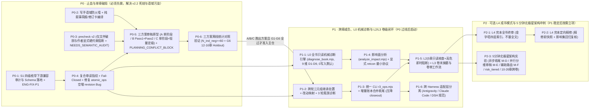

# 07 · P0 / P1 / P2 开发任务与依赖关系

> **文档版本**：`v1.1 (Freeze-Ready Candidate)`  
> **执行纪律声明**：本文件仅为**只读架构排期与任务依赖设计**。未经作者明确审阅批准，**不启动任何代码修改、不修改 R2、不合并分支、不启动新的小说创作实验**。  
> **门槛一致性声明**：本文全部 G1–G6、效率与只读门槛均与 `03`、`04`、`05`、`06`、`08` 保持逐项统一；所有未实跑的耗时收益均标为 **`[理论估算]`**。

---

## 一、依赖拓扑图（DAG）

---

## 二、P0 任务详表（立即止血，直接解决当前三大最高优先级痛点）

| 任务 ID | 任务名称 | 解决什么问题 | 依赖现有能力 | 新增 Agent 调用？ | 运行成本变化 | 预期收益 | 失败风险与缓释 | 验收方法（与 `08` 逐项一致） |
|---|---|---|---|---|---|---|---|---|
| **P0-1** | **S1 四级枚举下游兼容审计 + `ENG-FIX-P1`** | 正式仓库尚无 `SUGGESTION` 枚举，局部修饰易混入 `MINOR/MAJOR`；补清 P1 已知字段校验遗留问题 | `r2_review_common.mjs`、`r3_p1_common.mjs`、`v3_gate.mjs`、`submit_pilot_review.mjs` | **否** | `0ms` / 0 Token | 建立“永不阻断、0% 进必改闭环”的正式 `SUGGESTION` 通道；保证 R2 旧三级报告 100% 向后兼容 | 下游消费者未识别新枚举导致误拒；**缓释**：先出全仓消费者清单 + 新读旧/旧读新双向兼容单测 | 见 `08` E1 & G5：原有 Node `89/89` + Python `12/12` 回归全绿；`SUGGESTION` 0% 阻断 |
| **P0-2** | **写手语域防火墙与纯叙事任务卡/修订卡** | 解决首轮报告腔、防杠说明书补丁、>40 字长句占比 37–52%、对白解释过多及治理信息污染写手上下文 | `build_chapter_brief.mjs`、`r3_p1_common.mjs`（`preserveStrengths`） | **否** | 写手输入略减（去治理噪音），`<0.2s` | 写手上下文 0 出现 SHA/JSON/门禁码/`reverseDefense`/限时压迫词；动笔前最后读段强制为“上章结尾 + 文风示范” | 写手漏看硬约束；**缓释**：硬约束翻译为简洁自然语言底账，而非删除事实 | 见 `08` E5 & Track L 阶段二：自动化断言写手简报/修订卡 0 命中治理与限时词；盲评验证语域净化 |
| **P0-3** | **`precheck_chapter.mjs` v2（作者显式硬约束 + `NEEDS_SEMANTIC_AUDIT`）** | 解决 `V22-H4`（`26-23=2` 与 3000 引守恒）、`OLD-HOLD-1`（16 灵碎）漏检；同时防机械规则误杀重复段/跨段引语/字数 | `precheck_chapter.mjs`、`r3_structured_checks.mjs`、`build_chapter_brief.mjs` | **否** | `<0.25s/章`，零 Token | **仅文件破损与作者显式硬约束阻断**；字数偏离、重复段、引号异常默认 `softWarnings`（严禁为字数牺牲内容完整性）；抽出算术/日期/账目/信息差线索进 `NEEDS_SEMANTIC_AUDIT` | 正则误抽产生噪音线索；**缓释**：`NEEDS_SEMANTIC_AUDIT` 永不阻断写手，仅作审稿必核锚点 | 单测覆盖文件破损、作者显式硬约束、重复段/跨段引语/字数零误杀及 `V22-H3/H4`/`OLD-HOLD-1` 线索 100% 提取 |
| **P0-4** | **复合审读指纹 + Fail-Closed + 修 `atomic_ops` 空增版本 Bug** | 解决正文未变但规划/账本已变导致审读失配、子代理漏审维度及预检自修空增 `v1` 污染遥测 Bug | `r2_review.mjs`、`r3_atomic_ops.mjs`、`r3_telemetry.mjs`、`build_review_pack.mjs` | **否** | `<30ms/章` | 五元组复合指纹 + 6 维最小取证槽 + `NEEDS_SEMANTIC_AUDIT` 强制核销；修复预检自修空增 `revision` | 破坏既有 R2 哈希验证；**缓释**：复合指纹仅写入 `v3.r3` 扩展字段，原 `manuscriptHashes` 语义 100% 不变 | 见 `08` E2：故障注入（改细纲/改账本/漏维度/漏核销/假引文/预检自修）100% fail-closed |
| **P0-5** | **三方案审稿架构原型（A / B / C）+ `PLANNING_CONFLICT_BLOCK`** | 为 P0-6 提供公平对照原型，解决 Recall vs FPR 拉锯、Pass 1 漏检隐患与 `OR6` 漂白大纲硬伤（**不预设方案 B 必胜**） | `build_review_pack.mjs`、v2.2 四级规则、`r3_p1_common.mjs`（`reverseDefense`） | 方案 A 不增；方案 B/C 增 1 次轻量短上下文定级 | 方案 B/C 单次定级 `[理论估算]` `+0.4–0.8m`（方案 C `PASS` 章短路 `+0m`） | 共享 `precheck v2`、`dimensionAuditSlots` 与 `PLANNING_CONFLICT_BLOCK` 底座，隔离测试单阶段 vs Pass1+Pass2 vs 单阶段+轻量定级 | 方案 B 因 Pass 1 漏检被 Pass 2 无法补救；**缓释**：6 维取证槽 + `NEEDS_SEMANTIC_AUDIT` + 宽口候选 + 与 A/C 同场比拼 | 仅在隔离沙箱完成三方案协议原型，不提前替换生产主模板 |
| **P0-6** | **三方案（A vs B vs C）离线统计对照验证（准入主仓硬闸门）** | 用充分统计样本裁决胜出架构，严防小样本过拟合与“拍脑袋换架构” | 73 项定案校准集 + **独立扩充非阻断样本 `N_ind_neg >= 60`** + **4–6 题材 × ≥12–16 章独立 Holdout（`N_pos >= 30`, `N_neg >= 40`）** | 离线评测一次性调用 | 一次性离线验证成本 | 客观裁决 A / B / C 胜出者，决定能否准入生产主仓（Go / No-Go 硬门禁） | 样本不足或混淆“重复次数”与“独立样本量”；**缓释**：严格分列 `$N_{\text{ind}}$` 与 `$K_{\text{rep}}$`，全部报原始 `TP/FP/FN/TN` + 95% Wilson CI | **与 `08` 严格统一**： • G1：Recall `>= 95.0%`、已知回归 100%、BLOCKER 漏检 `= 0` • G2：`N_ind_neg >= 60` + `K=3` 轮，Clear-tier FP `= 0`、**3 轮均值 FPR `<= 13.0%` 且单轮均 `<= 15.0%`**、Precision `>= 88.0%` • G3/G4/G5 全过 • G6：BLOCKER 漏检 `= 0`、综合 Recall `>= 90.0%`（95% Wilson CI 下界 `>= 75.0%`）、非阻断误阻断 `<= 13.0%`（明确档 `= 0`） |

---

## 三、P1 任务详表（全周期工程减负、L0 机械诊断与 L2/L3 卷级闭环）

| 任务 ID | 任务名称 | 解决什么问题 | 依赖现有能力 | 新增 Agent 调用？ | 运行成本变化 | 预期收益 | 失败风险与缓释 | 验收方法 |
|---|---|---|---|---|---|---|---|---|
| **P1-1** | **L0 全书只读机械诊断引擎（`diagnose_book.mjs`，9 大维度 `D1–D9`）** | 补齐跨章人物断档、口头禅、节奏/对话占比、重复短语/段落候选、摘要覆盖、伏笔/事实联动、文风漂移与审稿过期监测 | `v3_common.mjs`、`chapter_wordcount_common.mjs`、`check_repetition.mjs`、`r3_feedback_view.mjs` | **否（0 Agent）** | 全书 50 章 `<0.5s`，零 Token，默认 **0 字节磁盘写入** | 低成本持续监测层（非第五道审核关卡），为即时分流闸与 L2/L3/L4 提供客观证据 | 误将重复段/跨段引语/字数波动判成硬伤；**缓释**：默认全部 `advise` 零阻断 + 中文跨段引语白名单 + 严禁为字数牺牲内容完整性 | 见 `08` E4：零写入断言、50 章 `<500ms`、防误判三专项用例 0 误阻断、高危冲突与审后改文 100% 检出 |
| **P1-2** | **跨轮三元组继承 + 改动映射 + 3 轮瓶颈诊断** | 消除返工复审反复翻旧账、漏修/超范围乱改及无限返工死循环 | P0-4、P0-6 胜出架构、`r3_p1_common.mjs` | **否** | `[理论估算]` 压低无效返工轮次 | 保护真实作者已拍板的保留/驳回项；3 轮不收敛主动停下归因 | 模型误把自判放行当作者保留；**缓释**：仅真实作者批注且锚点段落哈希未变时继承 | 见 `08` E3：序号平移认亲、改段豁免失效、第 3 轮触发瓶颈诊断单测 100% 通过 |
| **P1-3** | **统一 CLI `r3_ops.mjs` + 增量账本合并收尾** | 解决单章 8–12 次碎步 CLI 与 `closeout` 实测耗 `2.38–4.11 min` 痛点 | `r3_atomic_ops.mjs`、`audit_story_state.mjs`、`r3_p1.mjs` | **否** | `[理论估算]` `closeout` 压至 `<= 1.20m`；CLI 降至 `<= 4` 次，写手侧 `= 0` | 释放非创作耗时，消除目录碎片化 | 增量合并破坏既有 `story-ledger.json`；**缓释**：原子写入 + 写前校验 + 失败回滚 | 端到端单章脚本回归 + 与旧 `audit_story_state --handoff` 逐字段等价校验 |
| **P1-4** | **影响面分析（`analyze_impact.mjs`）+ 显式 `retcon` 协议** | 解决修改上游大纲或已定稿章后“不知要重审哪些下游章”及静默篡改风险 | `story-ledger.json`、P1-1、`r3_snapshots.mjs` | **否** | `<0.3s`，零 Token | 精确区分 L0 零级联微修、直接依赖集与实体共现候选集；`retcon` 全程快照留痕 | 启发式扫描漏掉隐式语义依赖；**缓释**：同时输出直接集+候选集，最终由编辑/作者核验 | 构造跨章事实变更与 `retcon` 夹具，验证直接集 100% 命中且原稿快照不可篡改 |
| **P1-5** | **L2（5 章只读核查+高危即时阻断）+ L3 卷末摘要与卷审工作流** | 解决高危事实冲突不能拖到弧审、消除 5 章脚本写入与 L0 只读冲突、补齐卷末审核与两笔账成本核算 | `r3_p1.mjs volume`、P1-1、P1-4 | 正常卷审每卷末 **1 次**聚焦卷审（同时省去多余每 5 章常驻编辑） | `[理论估算]` 正常卷审 `4–7m/卷`（摊销 `0.20–0.35m/章`）；发现跨章问题修复成本按轻/中/重度单列 | 高危冲突当章即时阻断；卷末宏观闭环与权威卷摘要落盘 | 卷审塞全文导致退化；**缓释**：强制三步漏斗（脚本→摘要→定点抽读 2–3 章） | 模拟 15–20 章单卷夹具验证：5 章 `--readonly` 零写入、高危事实当章阻断、卷摘要落盘与下卷首章衔接 |
| **P1-6** | **跨 Harness 适配层分离文档化** | 保障内核协议向 Claude Code / DeepSeek Harness / Codex 零修改迁移 | `SKILL.md`、`references/v3/workflow.md` | **否** | 0 运行成本 | 内核脚本与宿主胶水清晰解耦 | 文档与代码脱节；**缓释**：路由单测加入核心脚本零宿主依赖断言 | 协议走查 + 无宿主环境下纯 CLI 全链路冒烟测试通过 |

---

## 四、P2 任务详表（暂缓——待 P0/P1 真实连载验证稳定后再评估立项）

| 任务 ID | 任务名称 | 定位与前置条件 | 新增 Agent 调用？ | 核心验收标准 |
|---|---|---|---|---|
| **P2-1** | **L4 完本全书终审引擎** | 仅当 P1 跑通真实跨卷连载且存在完本成书需求时启动；严禁塞全文，走金字塔四层索引 | 完本后按需 2–4 次聚焦调用 | 准确汇总未收伏笔、烂尾角色与首尾设定冲突 |
| **P2-2** | **L4 完本定向精修与回归核查** | 依赖 P2-1 + P1-4 + `create_snapshot.py` | 按精修章数按需调用 | 精修前必留完整快照、逐章 Diff、仅重审改动章及直接影响集 |
| **P2-3** | **5 分钟北极星架构冲刺与长程受控实验** | 探索收尾异步化（M-D）、审稿维度并行化（M-E）、辅助低延迟模型路由（M-F）、`risk_tiered` 分级抽审及 10–26 章跨卷验证 | 视实验组设定 | 对比 P1 稳态基线的端到端墙钟、Token、Blind A 漏检率与多评委 Blind B 文学评分（绝不以牺牲质量换速度） |

---

## 五、明确“不值得做（Do-Not-Build）”列表

1. **不做**“每章固定独立润色子代理”与“每章固定独立沉淀对账子代理”。
2. **不做**“自建本地 Web 书房可视化服务器”（当前纯 JSON + Markdown 报告零常驻进程且跨 Harness 通用）。
3. **不做**“持久向量数据库作为事实召回主路径”。
4. **不做**“对 `MINOR`/`SUGGESTION` 或 L0 软统计强制逐条人工处置才能继续写下一章”。
5. **不做**“把 5 分钟系统目标变成写手限时指令，或为了死磕字数牺牲内容完整性”。
6. **不做**“脱离三方案对照的盲目单轮 Prompt v2.3/v2.4 文字调参”。
